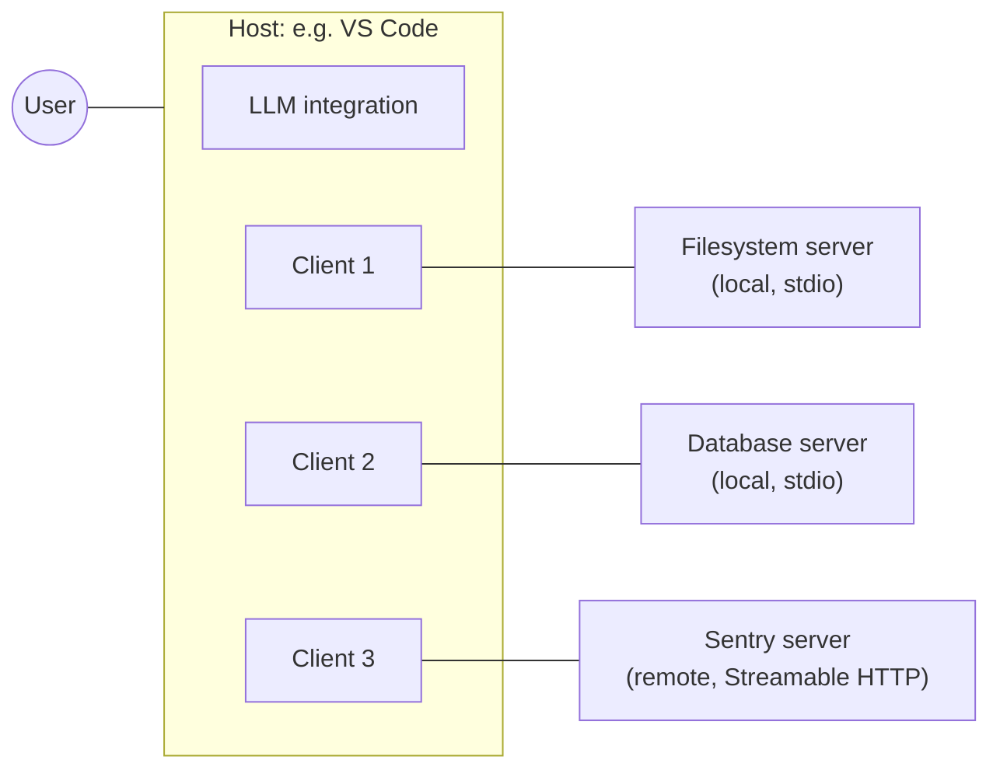
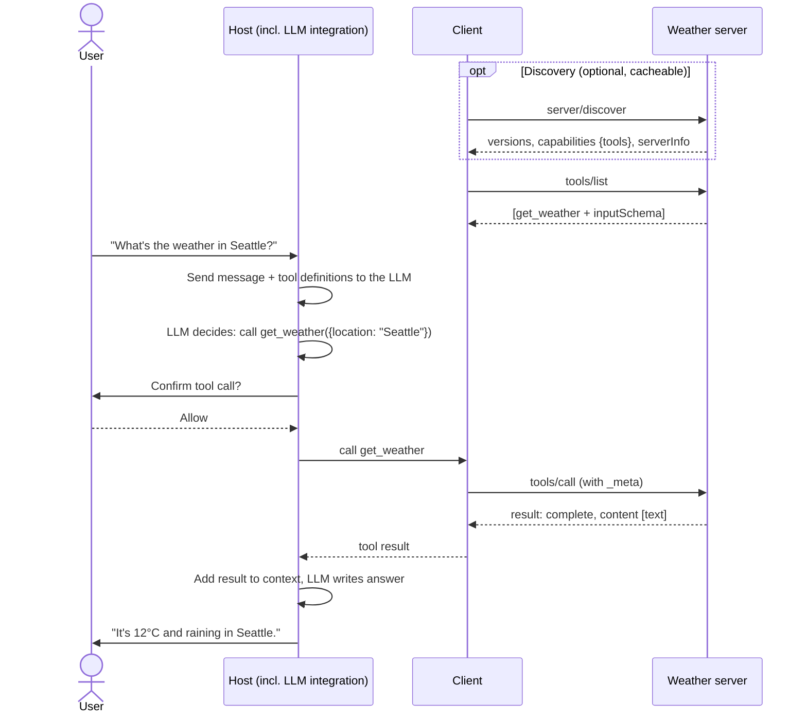

# Core Concepts

*Competency: **Core MCP Concepts**.*

This chapter introduces MCP's whole vocabulary in one pass. Domain 2 goes deeper into
architecture and messages, and Domain 3 into each primitive. The goal here is a correct mental
model you can hang every later detail on.

---

## 1. Three participants

MCP has three participants. The distinction between the first two confuses nearly everyone at
first, so take it slowly.

### Host

The **host** is the AI application the user actually interacts with: Claude Desktop, Claude
Code, VS Code with Copilot, Cursor, ChatGPT, or a custom agent you wrote.

The host is the **coordinator**. The specification lists its responsibilities:

- Creates and manages multiple client instances
- Controls client connection permissions and lifecycle
- **Enforces security policies and consent requirements**
- **Handles user authorization decisions**
- Coordinates AI/LLM integration
- Manages context aggregation across clients

Notice that the host is where **the user**, **the model** and **policy** all live. It talks to the
LLM, shows the UI, asks the user for permission, and decides what goes into the model's context.

### Client

A **client** is a **protocol component inside the host** that maintains the connection to **one**
server. It is not an application the user sees. It is a connector object.

- Communicates with **exactly one** server
- Attaches protocol version and capabilities to every request
- Routes protocol messages
- Manages subscriptions and notifications
- Maintains security boundaries between servers

### Server

A **server** is a program that exposes capabilities through MCP: a GitHub server, a filesystem
server, a Postgres server, a Sentry server.

- Exposes **resources, tools and prompts**
- Operates independently with focused responsibilities
- Can request client input (elicitation) by returning an `InputRequiredResult`
- Must respect security constraints
- Can be a **local process** or a **remote service**

### Putting them together



The rule to memorize: **a host creates one client per server connection; each client talks to
exactly one server.** VS Code connecting to three servers means three client objects inside VS
Code.

!!! tip "Why one client per server?"
    Isolation. If one client served several servers, a message from one server could leak into
    another's context. One client per server gives the host a clean boundary to enforce: server A
    never sees server B's traffic. It is the mechanism behind the design principle that servers
    *"should not be able to read the whole conversation, nor 'see into' other servers."*

!!! note "\"Server\" means the program, not the machine"
    An MCP server is a program that serves context, wherever it runs. The filesystem server
    launched by Claude Desktop on your laptop is a **local** server. The Sentry MCP server running
    on Sentry's infrastructure is a **remote** server. Both are MCP servers.

---

## 2. Three server primitives

**Primitives** are the most important concept in MCP. They define what a server can offer.

| Primitive | What it is | Example |
| --- | --- | --- |
| **Tools** | Executable functions the AI can invoke to **perform actions** | `create_issue`, `run_query`, `send_email` |
| **Resources** | **Data** identified by a URI, provided as context | A file, a database schema, a calendar |
| **Prompts** | Reusable **templates** that structure interactions with the model | "Review this code", "Plan a vacation" |

Each primitive has **discovery** (`*/list`), **retrieval** (`*/get` or `resources/read`) and, for
tools, **execution** (`tools/call`).

A single server usually offers more than one. A database server might expose:

- **Tools** to run queries
- A **resource** containing the schema
- A **prompt** with few-shot examples of good queries

### The control model: who decides when each is used

This is the most examinable idea in Domain 1. Each primitive has a different **controller**:

| Primitive | Controlled by | Meaning | Typical UI |
| --- | --- | --- | --- |
| **Prompts** | **User** | The user explicitly chooses to invoke it | Slash commands, menu items |
| **Resources** | **Application** | The host decides what context to attach | File picker, automatic inclusion |
| **Tools** | **Model** | The LLM decides when to call it | The model's tool calls, with confirmation |

Why does this distinction exist? Because the three primitives carry different **risks** and fit
different **interactions**.

**Tools are model-controlled** because the whole point is agency: the model notices it needs
the weather and calls `get_weather` without the user naming the tool. That is powerful and
risky. A tool can write to databases or send emails, so the spec says there **SHOULD** always be
a human in the loop able to deny tool invocations.

**Resources are application-controlled** because they are context, and context is the host's
decision. The host might let the user pick files, include them automatically, or search them with
embeddings. The model does not "call" a resource.

**Prompts are user-controlled** because they are workflows a person chooses to start. Note the
subtlety the spec calls out: *user-controlled refers to who decides **when** the prompt is used,
not who authors its content. Prompt content is defined by the server.*

!!! tip "The mapping, as an exam reflex"
    - "The user types `/review`" → **prompt**
    - "The app attaches the open file as context" → **resource**
    - "The model decides to look something up / take an action" → **tool**

!!! warning "Control model is guidance, not enforcement"
    The protocol does not force any UI. The spec repeats that implementations are *"free to expose
    [primitives] through any interface pattern that suits their needs."* The control model
    describes **intent**, and exam questions test the intent.

---

## 3. Client features

Clients can also offer features **to** servers, so servers can build richer interactions.

| Feature | What it lets a server do | Status in `2026-07-28` |
| --- | --- | --- |
| **Elicitation** | Ask the **user** for information or confirmation during a request | **Active** |
| **Sampling** | Ask the client's **LLM** for a completion | **Deprecated** |
| **Roots** | Learn which **filesystem directories** the client considers relevant | **Deprecated** |

Elicitation is the one to know in depth. A booking server might need the user to confirm a
$3,000 purchase before completing a tool call. Rather than failing, it elicits confirmation.

How it works has changed. In `2026-07-28`, a server **does not send a request** to the client.
It **returns** an `InputRequiredResult` saying what it needs, and the client **retries** the
original request with the answers. This is **Multi Round-Trip Requests**, covered in
[MRTR & Elicitation](../domain-3/mrtr-elicitation.md).

---

## 4. The message format: JSON-RPC 2.0

MCP messages are **JSON-RPC 2.0**. JSON-RPC is a tiny, well-established standard for remote
procedure calls encoded as JSON. It has three message shapes:

**Request**: "please do this", with an `id` so the answer can be matched:

```json
{ "jsonrpc": "2.0", "id": 1, "method": "tools/list", "params": { } }
```

**Response**: carries the same `id` and either a `result` or an `error`:

```json
{ "jsonrpc": "2.0", "id": 1, "result": { "resultType": "complete", "tools": [ ] } }
```

**Notification**: "FYI", with **no `id`**, and no response allowed:

```json
{ "jsonrpc": "2.0", "method": "notifications/tools/list_changed" }
```

Why JSON-RPC? It is simple, language-neutral, human-readable, transport-independent and already
understood by a huge amount of tooling. LSP uses it too.

MCP adds its own rules on top. Two matter immediately:

- Request `id`s **MUST NOT be `null`** (base JSON-RPC allows null).
- **Only clients send requests.** Servers send responses and notifications, never requests.

Full detail: [JSON-RPC Messages & `_meta`](../domain-2/messages.md).

---

## 5. Capabilities

Not every client and server supports every feature. **Capabilities** are how each side declares
what it supports, so neither attempts something the other can't handle.

- **Server capabilities** are returned by **`server/discover`**:

```json
"capabilities": {
  "tools": { "listChanged": true },
  "resources": { "subscribe": true },
  "prompts": {}
}
```

- **Client capabilities** travel in **every request's `_meta`**:

```json
"_meta": {
  "io.modelcontextprotocol/clientCapabilities": { "elicitation": { "form": {}, "url": {} } }
}
```

The rules follow directly:

- A server that implements a feature **must advertise** it.
- A server **MUST NOT rely on** a client capability the client did not declare. If it needs one,
  it returns `MissingRequiredClientCapabilityError` (`-32021`).
- A server **MUST NOT** send an elicitation request to a client that did not declare
  `elicitation`.

This design lets features be added **progressively**. A minimal server can implement only tools.
A minimal client can declare no capabilities at all.

---

## 6. Statelessness

In `2026-07-28` MCP is a **stateless protocol**:

> All the information needed to process a request is contained in the request itself. A server
> processes each request independently; no state should be inferred from previous requests, even
> those on the same connection or stream.

Concretely:

- There is **no `initialize` handshake** and **no session**.
- Every request carries its **protocol version** and **client capabilities** in `_meta`.
- An open connection, even a stdio process, **is not a conversation**.
- State that must span requests uses an **explicit identifier** passed on each request, such as a
  handle returned by a tool.

Why? So that any server instance can handle any request. Remote MCP servers can then scale
horizontally behind an ordinary load balancer with no sticky sessions or shared session store.

!!! warning "If you learned MCP before July 2026"
    The `initialize` / `notifications/initialized` handshake no longer exists in the current
    protocol. See [What Changed](../exam/whats-new.md).

---

## 7. Two layers

MCP is described as two layers.

**Data layer (inner).** The JSON-RPC protocol itself: discovery (`server/discover`), the
primitives, client features, notifications and utilities. This is *what* is said.

**Transport layer (outer).** How messages travel: connection setup, framing, authorization. This
is *how* it is carried. Two standard transports exist:

| Transport | Where | How |
| --- | --- | --- |
| **stdio** | Local | Client launches server as a subprocess; newline-delimited JSON over stdin/stdout |
| **Streamable HTTP** | Remote | Each client message is an HTTP POST; replies are JSON or an SSE stream |

The layers are independent. The **same JSON-RPC messages** work over either transport, and custom
transports are allowed if they preserve the message format and patterns.

---

## 8. A complete interaction, end to end

Everything above, in one flow. A user asks a host, *"What's the weather in Seattle?"*



Note what each participant did:

- The **server** never talked to the model or the user. It answered two requests.
- The **client** only moved protocol messages.
- The **host** did everything involving the user, the model and the decision to allow the call.

That division of labor is MCP's architecture in miniature. Domain 2 examines it in detail.

---

## 9. Recap

- **Host** = the AI application (coordinates, enforces consent, talks to the LLM). **Client** = one
  connector per server inside the host. **Server** = program exposing capabilities, local or remote.
- **One client per server**, for isolation.
- Server primitives: **tools** (actions, **model**-controlled), **resources** (data by URI,
  **application**-controlled), **prompts** (templates, **user**-controlled).
- Client features: **elicitation** (active); **sampling** and **roots** (deprecated).
- Messages are **JSON-RPC 2.0**: requests (with non-null id), responses, notifications (no id).
  **Only clients send requests.**
- **Capabilities** declare support: server's via `server/discover`, client's in every request's
  `_meta`.
- MCP is **stateless**: no handshake, no session; version and capabilities ride on each request.
- Two layers: **data** (JSON-RPC messages) and **transport** (stdio or Streamable HTTP).
