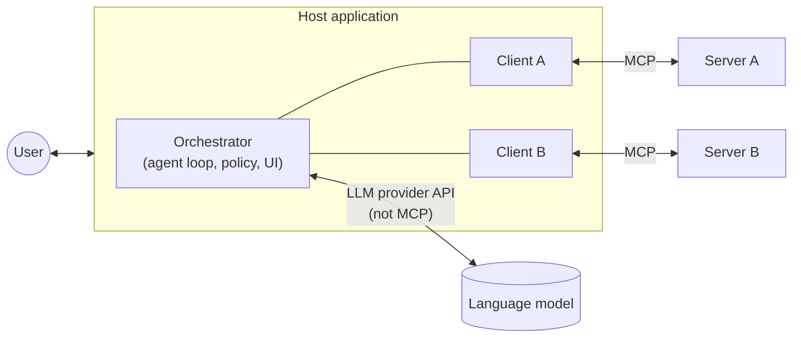
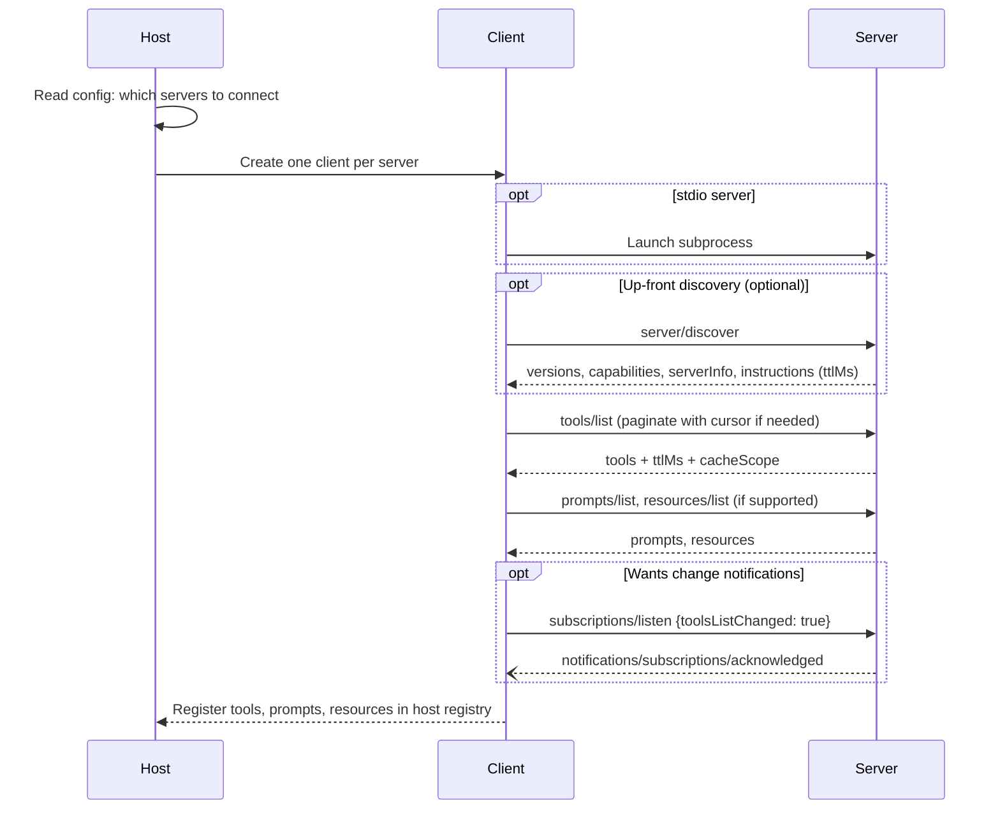
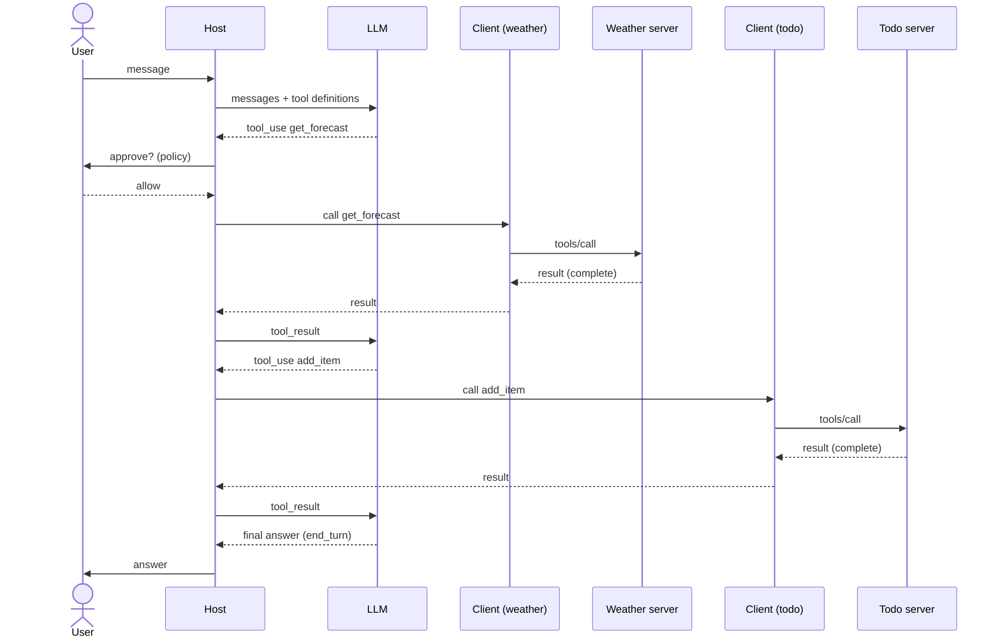
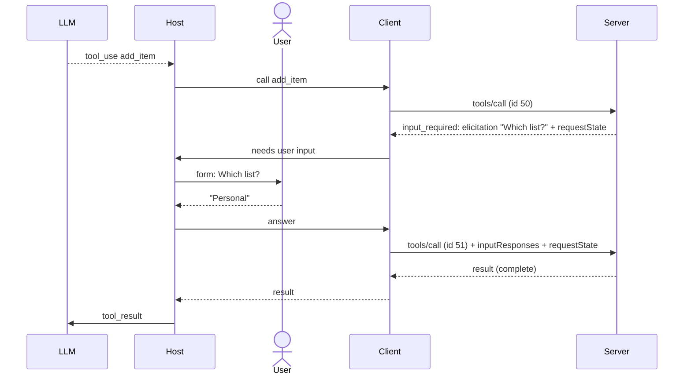

# Model Interaction Flow

*Competency: **Model Interaction Flow**.*

MCP connects an AI application to servers, but the component that actually **decides** to use a tool
is a language model. The model is not an MCP participant: it never sends or receives an MCP message.
This chapter traces exactly how a user's message becomes model reasoning, then MCP traffic, then an
answer, and where each responsibility sits.

The recommended experience for the exam includes *"LLM API interaction experience"* and *"agentic AI
concepts (ReAct patterns, tool-use, chain-of-thought)"*. This is where MCP meets both.

---

## 1. Where the model sits



Two different protocols meet inside the host:

- **Host ↔ model:** the model provider's API (Anthropic Messages, OpenAI Chat Completions or Responses,
  a local model server). **Not MCP.**
- **Host ↔ servers:** **MCP**, through one client per server.

The host **translates between them**. The model only ever sees tool definitions and tool results in its
provider's format; servers only ever see MCP requests. **The model never talks to a server, and a server
never talks to the model.**

!!! important "The consequence exam questions probe"
    Because the host is the only bridge, the host is the only place that can:

    - decide **which** tool definitions the model sees,
    - **inspect and approve** a tool call before it reaches a server,
    - **inspect and filter** a tool result before it reaches the model,
    - keep one server's data away from another server.

---

## 2. Phase 1: startup and discovery

Before any conversation, the host prepares.



What the host now holds:

- A **registry of tools** from every server, disambiguated if names collide.
- **Prompts** to offer the user (for example, as slash commands).
- **Resources** to offer as attachable context.
- Cached results, fresh until their `ttlMs` expires or a `list_changed` notification invalidates them.

---

## 3. Phase 2: a conversation turn

The user types: **"Is it going to rain in Seattle tomorrow? If so, add 'bring umbrella' to my todo list."**

### Step 1: The host builds the model request

The host sends the conversation plus the available tools to the model, in the **provider's format**. MCP
tool definitions map almost one-to-one onto provider tool definitions:

```text
MCP tool definition                      Anthropic Messages API tool      OpenAI tool (function)
─────────────────────                    ───────────────────────────      ──────────────────────
name          ────────────────────────►  name                          ►  function.name
description   ────────────────────────►  description                   ►  function.description
inputSchema   ────────────────────────►  input_schema                  ►  function.parameters
```

```json
{
  "model": "…",
  "max_tokens": 1024,
  "tools": [
    { "name": "weather__get_forecast", "description": "Get the forecast for a city and date",
      "input_schema": { "type": "object", "properties": { "city": {"type":"string"}, "date": {"type":"string","format":"date"} }, "required": ["city","date"] } },
    { "name": "todo__add_item", "description": "Add an item to the user's todo list",
      "input_schema": { "type": "object", "properties": { "text": {"type":"string"} }, "required": ["text"] } }
  ],
  "messages": [
    { "role": "user", "content": "Is it going to rain in Seattle tomorrow? If so, add 'bring umbrella' to my todo list." }
  ]
}
```

Notice the `weather__` and `todo__` prefixes. The host added them to **disambiguate** tools from different
servers and to know where to route each call. MCP doesn't mandate a scheme; it only says hosts **SHOULD**
disambiguate.

Also notice what is **not** here: nothing about stdio, JSON-RPC, `_meta`, capabilities or which server
hosts the tool. The model sees a flat list of functions.

### Step 2: The model decides to call a tool

This is the **model-controlled** part. The model reasons (the "Reason" step of a **ReAct** loop) and emits
a tool call instead of a final answer:

```json
{
  "role": "assistant",
  "stop_reason": "tool_use",
  "content": [
    { "type": "text", "text": "Let me check tomorrow's forecast." },
    { "type": "tool_use", "id": "toolu_01", "name": "weather__get_forecast",
      "input": { "city": "Seattle", "date": "2026-09-16" } }
  ]
}
```

### Step 3: The host applies policy

**Before** anything reaches a server, the host decides whether the call may proceed. The specification says
there **SHOULD** always be a human in the loop able to deny invocations, and that clients **SHOULD** show tool
inputs to the user before calling the server, to avoid accidental or malicious data exfiltration.

In practice hosts combine:

- **Per-call confirmation** ("Allow `get_forecast` with city=Seattle?")
- **Pre-approval** for tools the user has marked safe, possibly informed by `readOnlyHint` from a **trusted** server
- **Policy** (organization-blocked tools, blocked servers)
- **Validation** of arguments against `inputSchema`

### Step 4: The client sends `tools/call`

The host strips its routing prefix, finds the client for the weather server, and the client sends MCP:

```json
{
  "jsonrpc": "2.0",
  "id": 41,
  "method": "tools/call",
  "params": {
    "name": "get_forecast",
    "arguments": { "city": "Seattle", "date": "2026-09-16" },
    "_meta": {
      "io.modelcontextprotocol/protocolVersion": "2026-07-28",
      "io.modelcontextprotocol/clientCapabilities": { "elicitation": { "form": {} } },
      "io.modelcontextprotocol/clientInfo": { "name": "MyHost", "version": "2.3.0" },
      "traceparent": "00-4bf92f3577b34da6a3ce929d0e0e4736-00f067aa0ba902b7-01"
    }
  }
}
```

The server receives **only** the tool name and arguments, never the user's message, the conversation, or the
fact that a todo server exists.

### Step 5: The server executes and returns

```json
{
  "jsonrpc": "2.0",
  "id": 41,
  "result": {
    "resultType": "complete",
    "content": [ { "type": "text", "text": "Seattle, 2026-09-16: 90% chance of rain, high 16°C." } ],
    "structuredContent": { "precipitationChance": 0.9, "highC": 16 },
    "isError": false
  }
}
```

### Step 6: The host feeds the result back to the model

The host translates the MCP result into the provider's tool-result format and calls the model again with the
whole conversation so far:

```json
{
  "role": "user",
  "content": [
    { "type": "tool_result", "tool_use_id": "toolu_01",
      "content": "Seattle, 2026-09-16: 90% chance of rain, high 16°C." }
  ]
}
```

Before doing so, the spec says clients **SHOULD validate tool results** before passing them to the LLM. The host
may also use **annotations** here, for example keeping `audience: ["user"]` content out of the model's context.

### Step 7: The loop continues

The model observes the result (the "Observe" step) and decides it needs a second tool:

```json
{ "type": "tool_use", "id": "toolu_02", "name": "todo__add_item", "input": { "text": "bring umbrella" } }
```

The host routes this to the **todo** server's client (steps 3–6 again). After that result, the model returns a
final text answer with `stop_reason: "end_turn"`:

> "Yes, there's a 90% chance of rain in Seattle tomorrow. I've added 'bring umbrella' to your todo list."

### The whole turn



Two MCP servers, one model, zero direct contact between any of them. **The host is the agent loop.**

---

## 4. Variations on the flow

### When a tool needs user input: MRTR inside the loop

Suppose `todo__add_item` on a shared list needs the user to pick which list. The server returns
`resultType: "input_required"` with an `elicitation/create` request:



Note what the **model** saw: one tool call and one result. The elicitation happened entirely between host, user,
client and server. The server asked the **user**, not the model.

### When a tool fails

**Tool execution error** (bad input the model can fix, API failure, business rule): the server returns a **result**
with `isError: true`, and the host **SHOULD** give it to the model so it can **self-correct**:

```json
{ "resultType": "complete", "isError": true,
  "content": [ { "type": "text", "text": "Invalid date: must be in the future. Today is 2026-09-15." } ] }
```

The model reads this, fixes the date, and retries.

**Protocol error** (unknown tool, malformed request): a JSON-RPC **error**. Hosts **MAY** pass these to the model, but
recovery is less likely. See [Error Handling](../domain-3/error-handling.md).

### Parallel tool calls

Models can request several tools in one turn (for example forecasts for Paris and London). The host can issue the
`tools/call` requests **concurrently**, each with its own JSON-RPC `id`, and return all results together. Since MCP is
stateless and each request is independent, nothing in the protocol requires ordering.

### Resources: application-driven context

Resources enter the flow **before** the model call, chosen by the application:

```text
User attaches "Q3-report.pdf" from the resource picker
      → Host: resources/read { uri: "file:///reports/Q3-report.pdf" }
      → Server returns contents
      → Host places contents in the model's messages as context
      → Model answers using it
```

The model did not "call" anything. That is what **application-controlled** means.

### Prompts: user-driven templates

```text
User types /code_review and pastes code
      → Host: prompts/get { name: "code_review", arguments: { code: "…" } }
      → Server returns messages [{role: "user", content: …}]
      → Host inserts those messages into the conversation
      → Model responds
```

The **user** triggered it, the **server** authored the message content, the **host** placed it in context.

### Long-running operations

For operations that take minutes, the host may:

- request **progress** by putting a `progressToken` in `_meta` and showing `notifications/progress` to the user;
- **cancel** if the user gives up (close the HTTP stream, or send `notifications/cancelled` on stdio);
- use the **Tasks extension**, if both sides support it, to get a durable handle and poll with `tasks/get` instead of
  holding a connection open.

---

## 5. Scaling the flow: context economy

Every tool definition the host puts in the model request **costs tokens**, on every turn. With a handful of tools
this is irrelevant. With dozens of servers exposing hundreds of tools, definitions alone can consume most of the
context window before the model reads the user's message, and too many options also degrade tool selection.

The official [Client Best Practices](https://modelcontextprotocol.io/docs/develop/clients/client-best-practices)
describe two host-side patterns. Neither changes the MCP protocol; both change **what the host shows the model**:

- **Progressive tool discovery.** Fetch everything with `tools/list`, but give the model only a lightweight
  `search_tools` meta-tool, and load full definitions when needed. Suggested trigger: when definitions exceed
  roughly **1–5% of the context window**.
- **Programmatic tool calling ("code mode").** Generate a typed API from tool schemas (including `outputSchema`),
  let the model write a script that calls several tools in a **sandbox**, and return only the final output to the
  model, so intermediate data never passes through its context.

Both are covered in [Operational Use Cases](../domain-5/operational-use-cases.md).

!!! note "Deterministic ordering helps prompt caching"
    Servers **SHOULD** return `tools/list` in a **deterministic order**. Model providers cache the prompt prefix,
    which includes the tools array. A server that shuffles its tools on every call silently defeats that cache.

---

## 6. Recap

- The model is **not an MCP participant**. Host ↔ model uses the **provider API**; host ↔ servers uses **MCP**. The
  **host translates** and runs the agent loop.
- Startup: create a client per server → optional `server/discover` → `tools/list` / `prompts/list` / `resources/list`
  → register → optionally `subscriptions/listen`.
- A turn: host sends messages + tool definitions → model returns **tool_use** → **host applies policy/consent** →
  client sends **`tools/call`** → server returns result → host **validates** and returns a **tool_result** → loop until
  the model gives a final answer.
- MCP `name` / `description` / `inputSchema` map directly to provider tool definitions. Hosts **disambiguate** names
  across servers.
- Servers see **only the call arguments**: never the conversation, other servers, or the model.
- **MRTR elicitation** happens between host, user, client and server; the model sees one call and one result.
- **`isError: true`** results go back to the model for **self-correction**; protocol errors rarely help it.
- Resources enter context by **application** choice; prompts by **user** choice.
- At scale, use **progressive discovery** and **code mode**; servers should return tools in **deterministic order**.
