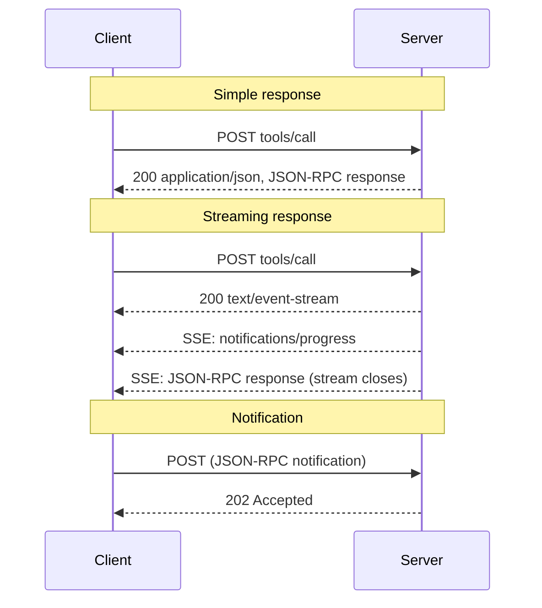

# Transports

*Part of the exam focus on **transports**.*

The data layer defines **what** is said. A transport defines **how it travels**: framing, delivery,
where metadata lives, how cancellation is signaled. The specification is explicit that this separation
is strict:

> Protocol semantics are identical on every transport. A transport is a **binding**: it defines how
> messages are framed and delivered, how request metadata is carried, and how cancellation and
> termination are signaled. It does not define what the messages mean.

MCP defines two standard transports, **stdio** and **Streamable HTTP**, and allows custom ones.

---

## 1. What every transport must do

A transport binding **MUST** deliver:

- client-sent **requests** and **notifications** to the server, and
- server-sent **responses** and **notifications** to the client.

**No other message direction exists.** Because servers never send requests and clients never send
responses, a transport only needs to carry traffic in this one shape. That is a large simplification
compared with earlier revisions.

Messages are JSON-RPC, **UTF-8** encoded. All protocol metadata lives in the **message body**
(`_meta`). A transport **MAY** mirror some body fields into envelope metadata (HTTP does, as headers), but
**the body remains the source of truth**.

---

## 2. stdio

### How it works

In the **stdio** transport, the **client launches the server as a subprocess** and they talk over the
subprocess's standard streams.

```text
┌──────────── Host process ─────────────┐        ┌────── Server subprocess ──────┐
│                                       │ stdin  │                               │
│   Client ─────── requests, ──────────────────► │  reads one JSON message/line  │
│           notifications/cancelled     │        │                               │
│                                       │ stdout │                               │
│   Client ◄────── responses, ─────────────────── │  writes one JSON message/line │
│                  notifications        │        │                               │
│                                       │ stderr │                               │
│   (capture / forward / ignore) ◄──────────────── │  logs, anything else          │
└───────────────────────────────────────┘        └───────────────────────────────┘
```

### The framing rules

- The server reads JSON-RPC messages from **stdin** and writes them to **stdout**.
- Each message is a **single** JSON-RPC request, notification or response.
- Messages are **delimited by newlines** and **MUST NOT contain embedded newlines**.
- The server **MUST NOT** write anything to **stdout** that is not a valid MCP message.
- The client **MUST NOT** write anything to the server's **stdin** that is not a valid MCP message.
- The server **MAY** write UTF-8 to **stderr** for any logging: informational, debug or error.
- The client **MAY** capture, forward or ignore stderr, and **SHOULD NOT** assume stderr output means an error.

!!! danger "The classic stdio bug"
    A server that calls `print("Starting up...")` writes a non-JSON line to **stdout**. The client tries to
    parse it as a JSON-RPC message and fails, often with a confusing error far from the cause. **All logging
    in a stdio server goes to stderr.** This is also the recommended replacement for the deprecated MCP
    Logging feature.

    Pretty-printed JSON breaks it too: embedded newlines split one message across several lines.

### Direction on stdio

- The client writes **requests** and **notifications** to stdin, and **MUST NOT** write responses.
- The server writes three kinds of message to stdout:
  1. **Responses**, correlated by `id`
  2. **Request-scoped notifications** such as `notifications/progress`
  3. **Subscription notifications** for an active `subscriptions/listen`, which the client **MUST** correlate
     using `io.modelcontextprotocol/subscriptionId` in `_meta`, because everything shares one channel
- The server **MUST NOT** write JSON-RPC **requests** to stdout.

### Metadata

stdio has no header layer. Everything, including version and capabilities, is **inline** in each message's
`_meta`.

### Cancellation

There are no per-request streams to close, so to cancel an in-flight request the client **MUST** send
`notifications/cancelled` with the request's id. The server **SHOULD** stop work as soon as practical and
**MUST NOT** send further messages for that request.

### Shutdown

The client **SHOULD** shut down by:

1. **Closing** the server's **stdin**.
2. **Waiting** for the server to exit.
3. If it doesn't exit in reasonable time, **forcibly terminating** it: on POSIX, escalating from `SIGTERM` to
   `SIGKILL`; on Windows, `TerminateProcess` or Job Objects.

Servers **SHOULD** exit promptly when stdin closes or reads return end-of-file. This is the primary, and only
portable, graceful-shutdown signal. A server **MAY** initiate shutdown by closing its stdout and exiting.

### Unexpected termination

If the server process dies, the client **SHOULD restart it**. Because the protocol is stateless, in-flight
requests are simply lost and can be retried against the new process. Active `subscriptions/listen` streams
must be re-established; the server holds no subscription state across restarts.

!!! note "A stdio process is not a session"
    Clients **SHOULD NOT** use an individual task, thread or conversation as the lifetime of the stdio process.
    One process can serve interleaved requests from many conversations, and the server must not treat process
    identity as conversation identity.

### Authorization on stdio

The authorization framework is for HTTP. Implementations using stdio **SHOULD NOT** follow it, and instead
**retrieve credentials from the environment**: environment variables or configuration passed at launch.

```json
{
  "mcpServers": {
    "github": {
      "command": "npx",
      "args": ["-y", "@modelcontextprotocol/server-github"],
      "env": { "GITHUB_TOKEN": "..." }
    }
  }
}
```

That configuration shape (used by Claude Desktop's `claude_desktop_config.json`) is **host-specific**, not part
of the specification.

### When to use stdio

- **Local** integrations: filesystem, local git, local databases, developer tools.
- **Single user**, one client per process.
- **Lowest overhead**: no network, no HTTP stack.
- **Natural access control**: only the launching client can talk to the process. The security best practices
  recommend stdio for local servers precisely to *"limit access to just the MCP client"*.

---

## 3. Streamable HTTP

### How it works

In **Streamable HTTP**, the server is an **independent process** that can handle **many clients**.

- The server exposes **one HTTP endpoint**, the **MCP endpoint**, that accepts **POST**
  (for example `https://example.com/mcp`).
- **Every** JSON-RPC message from the client is its **own HTTP POST**.
- For each request the server replies with either **a single JSON object** or an **SSE stream scoped to that
  request**.
- Server-to-client interactions (elicitation and friends) are embedded in results as **MRTR** input requests.
- Long-lived change notifications arrive on the response stream of a **`subscriptions/listen`** request.

Streamable HTTP was introduced in `2025-03-26` to replace the two-endpoint **HTTP+SSE** transport, and was
significantly reshaped in `2026-07-28`: the **GET stream endpoint** and **protocol-level sessions** were removed.

### Sending messages

1. The client **MUST** use **POST**.
2. The client **MUST** send an `Accept` header listing **both** `application/json` and `text/event-stream`.
3. The client **MUST** include the **request metadata headers** (section 3.3).
4. The body **MUST** be a **single** JSON-RPC request or notification. The client **MUST NOT** send responses.
5. If the body is a **notification**:
    - accepted → **`202 Accepted`**, **no body**;
    - not accepted → an HTTP error such as `400`, optionally with a JSON-RPC error body that has no `id`.
6. If the body is a **request**, the server **MUST** return either `Content-Type: application/json` or
   `Content-Type: text/event-stream`, and the client **MUST** support both.

!!! note "No client notifications over HTTP in the core protocol"
    The only client-sent notification in the core, `notifications/cancelled`, is used only on **stdio**. On
    Streamable HTTP, **closing the response stream is the cancellation**.

### Receiving messages

When the server chooses an **SSE** response:

- It **MAY** send **notifications** before the final response (for example `notifications/progress`). These
  **MUST relate to the originating request**.
- It **MUST NOT** send independent JSON-RPC **requests** on the stream. That was allowed in `2025-03-26` through
  `2025-11-25` and is **no longer part of the protocol**.
- The final JSON-RPC **response SHOULD terminate** the stream.

**Streams are not resumable.** `Last-Event-ID` is not supported. If a response stream breaks, the in-flight
request is lost and the client **MUST** re-issue it as a **new request with a new id**.

Operational details worth knowing:

- Servers **SHOULD** send `X-Accel-Buffering: no` on SSE responses, so reverse proxies such as nginx don't buffer
  events and delay them.
- For long-lived streams (especially `subscriptions/listen`), servers are encouraged to send periodic **SSE comment
  lines** (a line starting with `:`) as **keep-alives**, so idle connections aren't closed by intermediaries.
  Clients must ignore them.



### 3.3 Request metadata headers <span class="new-2026">2026</span>

Streamable HTTP **mirrors selected body fields into HTTP headers**, so load balancers, gateways, WAFs and
observability tools can route and inspect traffic **without parsing the JSON body**.

| Header | Source field | Required on |
| --- | --- | --- |
| `MCP-Protocol-Version` | `_meta["io.modelcontextprotocol/protocolVersion"]` | **Every POST** |
| `Mcp-Method` | `method` | **All requests** |
| `Mcp-Name` | `params.name` or `params.uri` | **`tools/call`, `resources/read`, `prompts/get`** |

```http
POST /mcp HTTP/1.1
Content-Type: application/json
Accept: application/json, text/event-stream
MCP-Protocol-Version: 2026-07-28
Mcp-Method: tools/call
Mcp-Name: get_weather

{"jsonrpc":"2.0","id":1,"method":"tools/call","params":{"name":"get_weather", ...}}
```

**Version handling:**

- `MCP-Protocol-Version` **MUST match** the body's protocol version; otherwise **`400`** + `HeaderMismatch`
  (**`-32020`**).
- Unsupported version → **`400`** + `UnsupportedProtocolVersionError` (**`-32022`**) listing supported versions.
- Unknown **method** → **`404 Not Found`** + JSON-RPC **`-32601`** (Method not found). The JSON-RPC body is what
  distinguishes this from a `404` from a legacy server that doesn't host the endpoint at all.
- A server supporting clients older than `2025-06-18` (before the header existed) **MAY** treat a missing header as
  `2025-03-26`; otherwise it **MUST** reject requests without it.

### Custom headers from tool parameters

A server **MAY** mark a tool parameter with **`x-mcp-header`** in its `inputSchema`. Clients **MUST support this**:
when calling that tool over Streamable HTTP, they add a **`Mcp-Param-{Name}`** header carrying the argument value.

```json
"region": { "type": "string", "x-mcp-header": "Region" }
```

```http
Mcp-Param-Region: us-west1
```

This lets infrastructure route by region or tenant without reading the body.

**Constraints on the annotation** (a violating tool definition is **invalid**, and a client **MUST exclude that tool**
from its `tools/list` result, **SHOULD log a warning**, and keep using the valid ones):

- non-empty, valid HTTP token characters, no CR/LF
- case-insensitively **unique** within the schema
- only on **primitive** types: `string`, `integer`, `boolean`. **Not `number`.** Integers must be within the JavaScript
  safe range (±2⁵³−1)
- only on properties **statically reachable** through a chain of `properties` keys: not through `items`, `oneOf` /
  `anyOf` / `allOf` / `not`, `if`/`then`/`else`, or `$ref`

**Value encoding:** strings as-is, integers as decimal, booleans as lowercase `true`/`false`. A value that isn't safe
plain ASCII (non-ASCII, control characters, leading/trailing whitespace) **MUST** be Base64-encoded with a sentinel:

```http
Mcp-Param-Greeting: =?base64?SGVsbG8sIOS4lueVjA==?=
```

The same sentinel encoding applies to `Mcp-Name` for names or URIs outside the safe character set. A plain value that
happens to look like the sentinel must itself be encoded, to avoid ambiguity.

A `null` or absent argument → the client **omits** the header. A present argument with the header missing → the server
**MUST reject** the request.

!!! warning "Headers are visible to intermediaries"
    Server developers **SHOULD NOT** mark **sensitive** parameters (passwords, API keys, tokens, PII) with
    `x-mcp-header`. Proxies, load balancers and logs see headers.

### Server validation: why mismatches are rejected

Servers that process the body **MUST reject** any request where a mirrored header disagrees with the body, with
**`400 Bad Request`** and **`-32020` HeaderMismatch**. Failure conditions include a missing required header, a value
mismatch (after decoding Base64 values), and invalid characters.

The reason is a classic security bug: **two components trusting two different sources of truth**. Imagine a gateway
that authorizes by `Mcp-Name: read_report` while the server executes `params.name: "delete_all_reports"` from the
body. Forcing headers and body to match makes the check and the action refer to the same thing.

Intermediaries that enforce policy on mirrored headers **SHOULD** verify the protocol version requires header–body
validation, and reject requests with older or missing versions rather than trusting unvalidated headers.

### Security and the endpoint

1. Servers **MUST validate the `Origin` header** on all incoming connections to prevent **DNS rebinding**. If
   `Origin` is present and invalid → **`403 Forbidden`**.
2. When running **locally**, servers **SHOULD bind to `127.0.0.1`**, not `0.0.0.0`.
3. Servers **SHOULD** implement proper **authentication** for all connections.

**DNS rebinding**, explained: you visit `evil.example` in a browser. Its DNS record first points to the attacker's
server (which serves JavaScript), then is quickly changed to `127.0.0.1`. The browser's same-origin policy considers
it the same origin (`evil.example`), so that JavaScript can now send requests to a service on **your localhost**, such
as an unauthenticated local MCP server bound to a port. Checking `Origin` (which will say `evil.example`) and binding
only to loopback defeat it.

### Cancellation on HTTP

**Closing the SSE response stream is cancellation.** The server **MUST** treat a client disconnect as cancellation of
that request, **SHOULD** stop work, and **MUST NOT** send further messages for it. No `notifications/cancelled` is needed
or expected. Because every request has its own stream, the disconnect is unambiguous.

### Authorization on HTTP

Implementations using HTTP **SHOULD** conform to the MCP **OAuth 2.1** authorization framework. Access tokens go in
`Authorization: Bearer <token>` on **every** request, and **never in the query string**. See
[Authorization with OAuth 2.1](../domain-4/authorization.md).

### Legacy HTTP traffic

A server that supports only `2026-07-28` and receives old-style traffic **SHOULD**:

| Legacy traffic | Response |
| --- | --- |
| `GET` or `DELETE` to the MCP endpoint | **`405 Method Not Allowed`** |
| `Mcp-Session-Id` header | **Ignore it**; do not mint or echo session IDs |
| `Last-Event-ID` header | **Ignore it**; streams are not resumable |

---

## 4. Choosing a transport

| Consideration | **stdio** | **Streamable HTTP** |
| --- | --- | --- |
| Location | Same machine | Anywhere on the network |
| Process model | Client launches server | Server runs independently |
| Clients per server | Typically one | Many |
| Framing | Newline-delimited JSON | One POST per message; JSON or SSE reply |
| Metadata | Inline `_meta` only | `_meta` **plus** mirrored headers |
| Cancellation | `notifications/cancelled` | Close the response stream |
| Subscription correlation | **MUST** use `subscriptionId` (shared channel) | One stream per listen request (id still carried) |
| Credentials | Environment | OAuth 2.1 bearer tokens |
| Logging | stderr | Server's own logging / OpenTelemetry |
| Key security measures | Sandboxing, consent before launch | Origin validation, loopback bind locally, auth, token audience |
| Scaling | N/A (per user) | Stateless: any instance serves any request |

!!! tip "Exam reflex"
    **Local, single-user, same machine → stdio.** **Remote, multi-user, networked → Streamable HTTP.**

---

## 5. Custom transports

Clients and servers **MAY** implement custom transports. They **MUST** preserve:

- the **JSON-RPC message format**,
- the **message patterns** (request/response, MRTR, subscribe/notify), and
- the **per-request metadata model**.

They **SHOULD** document connection establishment, framing and cancellation.

Custom transports over a **reliable bidirectional byte stream** (Unix domain sockets, TCP) **SHOULD reuse the stdio
framing**, meaning newline-delimited JSON-RPC. Only the subprocess-specific parts (launch, stderr, shutdown by closing
stdin, restart) need equivalents.

---

## 6. The deprecated HTTP+SSE transport

For recognition only. The `2024-11-05` **HTTP+SSE** transport used **two endpoints**: a GET endpoint that opened an SSE
stream whose first event (`endpoint`) told the client where to POST, and a separate POST endpoint. It has been deprecated
since `2025-03-26` and is formally **Deprecated** under the lifecycle policy, eligible for removal three months after
SEP-2596 reaches Final. **Migrate to Streamable HTTP.**

!!! note "Why only three months? Doesn't the policy require twelve?"
    The twelve-month minimum deprecation window is measured **from the revision that first marks the
    feature Deprecated** — for HTTP+SSE that was `2025-03-26`, so the floor elapsed long before the
    lifecycle policy existed. SEP-2596's transition provisions reclassify such already-deprecated
    features and give them a grace period of three months after the SEP reaches Final. No conflict
    with the twelve-month rule in [Domain 1](../domain-1/interoperability.md).

A client supporting it falls back like this: POST to the URL; on `400`/`404`/`405` **without** a recognized modern
JSON-RPC error body, issue a `GET` and wait for an `endpoint` event.

---

## 7. Recap

- A transport is a **binding**: framing, delivery, metadata placement, cancellation. **Semantics are identical** on every transport.
- **stdio:** client launches server; **newline-delimited** JSON on stdin/stdout, no embedded newlines; **nothing but MCP on
  stdout**; logs to **stderr**; cancel with **`notifications/cancelled`**; shut down by **closing stdin**, then SIGTERM →
  SIGKILL; restart on crash; credentials from the **environment**.
- **Streamable HTTP:** one MCP endpoint; **every message is a POST**; `Accept` lists JSON and SSE; reply is **JSON or a
  request-scoped SSE stream**; notifications get **202**; **no server requests** on streams; **not resumable**; **closing
  the stream cancels**.
- Required headers: **`MCP-Protocol-Version`** (all), **`Mcp-Method`** (all requests), **`Mcp-Name`** (`tools/call`,
  `resources/read`, `prompts/get`). Mismatch → **400 + `-32020`**. Unknown method → **404 + `-32601`**.
- `x-mcp-header` → `Mcp-Param-{Name}`; primitives only (no `number`); Base64 sentinel `=?base64?…?=`; never for secrets.
- **Validate `Origin`** (invalid → 403), **bind to 127.0.0.1** locally, authenticate.
- Legacy `GET`/`DELETE` → **405**; ignore `Mcp-Session-Id` and `Last-Event-ID`.
- HTTP+SSE is **deprecated**.
