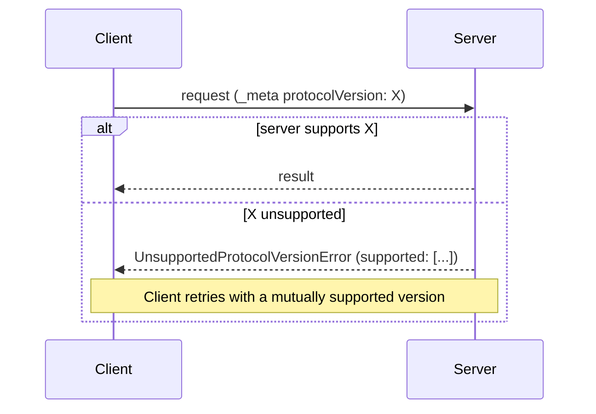

# Versioning & Discovery

*Part of the exam focus on **capabilities**; supports the competency **MCP Hosts, Clients and Servers**.*

Two programs written by strangers need to agree on **which version of the protocol** they speak and
**which features** each supports. This chapter covers how that agreement works in `2026-07-28`, and how
modern implementations interoperate with the older, handshake-based protocol.

---

## 1. Version identifiers

MCP versions are strings in **`YYYY-MM-DD`** format, indicating **the last date backward-incompatible
changes were made**.

The protocol version is **not** incremented for backward-compatible updates. The spec can gain
clarifications, new optional fields and similar improvements while keeping the same version string, so
interoperability is preserved.

### Revision states

| State | Meaning |
| --- | --- |
| **Draft** | In progress, not ready for consumption |
| **Current** | The current version, ready for use; may still receive backward-compatible changes |
| **Final** | Past, complete, frozen |

At the time the exam was published, the **current** revision is **`2026-07-28`**.

### Feature states

Individual features have their own lifecycle, under the
[feature lifecycle and deprecation policy](https://modelcontextprotocol.io/community/feature-lifecycle):

| State | Meaning |
| --- | --- |
| **Active** | Normal |
| **Deprecated** | Still in the spec and working; **new implementations SHOULD NOT adopt it**; existing ones **SHOULD migrate**; stays at least **12 months** (or **90 days** under the expedited-removal exception) before becoming eligible for removal |
| **Removed** | Taken out in a later revision |

"Eligible for removal" is a floor, not a schedule. The actual removal is a Core Maintainer decision taken
during release preparation, and may happen later.

---

## 2. Terminology: protocol eras

`2026-07-28` introduces three terms you should know precisely:

| Term | Meaning |
| --- | --- |
| **Modern** | Versions that convey version, identity and capabilities as **per-request metadata** (`2026-07-28` and later) |
| **Legacy** | Versions that establish a session with an **`initialize` handshake** (`2025-11-25` and earlier) |
| **Dual-era** | An implementation supporting **both** modern and legacy versions |

---

## 3. Per-request version negotiation

There is **no negotiation handshake**. Every request declares its version, and the server accepts or
rejects **each request independently**:



Where the version lives:

- In the body: `_meta["io.modelcontextprotocol/protocolVersion"]` (always).
- On Streamable HTTP, **also** in the `MCP-Protocol-Version` header, which must match.

If the server doesn't implement the requested version, whether it is unknown or known but deliberately
unsupported, it **MUST** return `UnsupportedProtocolVersionError`:

```json
{
  "jsonrpc": "2.0",
  "id": 1,
  "error": {
    "code": -32022,
    "message": "Unsupported protocol version",
    "data": { "supported": ["2026-07-28", "2025-11-25"], "requested": "1900-01-01" }
  }
}
```

On HTTP the status is **`400 Bad Request`**. The client **SHOULD** pick a mutually supported version from
`supported` and **retry**, or surface an error to the user if none exists.

Clients and servers **MAY** support **multiple versions** at once.

---

## 4. `server/discover`

### What it is

A request that returns the server's **supported protocol versions**, **capabilities** and **identity** in
one call. **Servers MUST implement it.** It carries no parameters beyond the standard `_meta`.

**Request:**

```json
{
  "jsonrpc": "2.0",
  "id": "discover-1",
  "method": "server/discover",
  "params": {
    "_meta": {
      "io.modelcontextprotocol/protocolVersion": "2026-07-28",
      "io.modelcontextprotocol/clientInfo": { "name": "ExampleClient", "version": "1.0.0" },
      "io.modelcontextprotocol/clientCapabilities": {}
    }
  }
}
```

**Response:**

```json
{
  "jsonrpc": "2.0",
  "id": "discover-1",
  "result": {
    "resultType": "complete",
    "supportedVersions": ["2026-07-28"],
    "capabilities": { "tools": {}, "resources": {} },
    "_meta": {
      "io.modelcontextprotocol/serverInfo": { "name": "ExampleServer", "version": "1.0.0" }
    },
    "instructions": "This server provides weather and resource utilities.",
    "ttlMs": 3600000,
    "cacheScope": "public"
  }
}
```

### `DiscoverResult` fields

| Field | Meaning |
| --- | --- |
| `supportedVersions` | Versions the server supports; the client should choose one of these |
| `capabilities` | Server capabilities: tools, resources, prompts, completions, logging, extensions |
| `_meta["io.modelcontextprotocol/serverInfo"]` | Name and version of the server software (**SHOULD** be included; **unverified**) |
| `instructions` | Optional natural-language guidance **for LLMs** on how to use this server well |
| `ttlMs`, `cacheScope` | Caching hints (**required** on this result) |

The `instructions` field deserves a moment. It is text **the server** writes **for the model**, for example
"Always call `search_tickets` before `create_ticket` to avoid duplicates." A host may add it to the model's
context. Like tool descriptions, it is **server-authored text entering the model's context**, and should be
treated with the same trust as the server itself.

### When to call it

**Calling `server/discover` is optional for clients.** A client may send any RPC directly and handle
`UnsupportedProtocolVersionError`. The spec gives two situations where calling it is useful:

1. **Presenting server information.** One request returns identity, capabilities and versions, instead of
   probing with `tools/list`, `prompts/list` and `resources/list` separately.
2. **stdio backward-compatibility probe.** On stdio there are no HTTP status codes to drive fallback, so a
   dual-era client **SHOULD** send `server/discover` first (section 6).

Because the result carries caching hints, a client normally does **not** repeat discovery on every request.
It caches the result for `ttlMs`.

!!! important "`server/discover` vs. `initialize`, precisely"
    | | `initialize` (legacy) | `server/discover` (modern) |
    | --- | --- | --- |
    | Server must implement? | Yes | **Yes** |
    | Client must call? | **Yes, first** | **No, optional** |
    | Establishes a session? | Yes | **No** |
    | Client capabilities sent | Once, here | On **every** request |
    | Result cacheable? | No | **Yes** (`ttlMs`, `cacheScope`) |

---

## 5. Capabilities

### Server capabilities (from `server/discover`)

| Capability | Sub-options | Enables |
| --- | --- | --- |
| `tools` | `listChanged` | `tools/list`, `tools/call`; `listChanged` → tool list-change notifications |
| `resources` | `subscribe`, `listChanged` | `resources/list`, `resources/read`, templates; `subscribe` → per-URI update notifications |
| `prompts` | `listChanged` | `prompts/list`, `prompts/get` |
| `completions` | — | `completion/complete` |
| `logging` | — | Log notifications (*deprecated*) |
| `extensions` | per-extension settings | Optional extensions, e.g. `io.modelcontextprotocol/tasks` |

**Implemented features MUST be advertised.** Invoking tools requires the server to declare `tools`; receiving
resource-update notifications requires the server to support `subscribe` and the client to open a
`subscriptions/listen` stream naming those URIs.

### Client capabilities (in every request's `_meta`)

| Capability | Sub-options | Lets the server… |
| --- | --- | --- |
| `elicitation` | `form`, `url` | Include `elicitation/create` in `inputRequests` (only the declared modes) |
| `sampling` | `tools`, `context` (*deprecated*) | Include `sampling/createMessage` |
| `roots` | — | Include `roots/list` (*deprecated*) |
| `extensions` | per-extension settings | Use negotiated extensions |

Two detailed rules:

- **An empty `elicitation: {}` object means form mode only**, for backward compatibility. A client supporting
  URL mode must declare `url` explicitly.
- A server **MUST NOT** include in `inputRequests` any request type the client hasn't declared, and **MUST NOT**
  rely on undeclared capabilities at all. If it needs one, it returns **`MissingRequiredClientCapabilityError`**
  (`-32021`) with `data.requiredCapabilities`.

### Capabilities are per request

Because client capabilities travel on each request, they can **legitimately differ** from one request to the
next. A host might declare `elicitation` for requests made during an interactive chat, and omit it for a
background job where no user is present to answer. The server must evaluate **each** request against **that
request's** declared capabilities.

---

## 6. Extension negotiation

Extensions are advertised in the **`extensions`** field of capabilities: a map from **extension identifier** to a
**settings object**.

```json
"capabilities": {
  "tools": {},
  "extensions": {
    "io.modelcontextprotocol/ui": { "mimeTypes": ["text/html;profile=mcp-app"] },
    "io.modelcontextprotocol/tasks": {}
  }
}
```

- Identifiers follow the **`_meta` key naming rules**, with a **mandatory prefix** (`{vendor-prefix}/{name}`).
  Official extensions use `io.modelcontextprotocol/`.
- Each extension defines its settings schema. **An empty object means "supported, no settings".**
- Extensions are **always opt-in**, and **disabled by default**.

**If only one side supports an extension**, the supporting side **MUST** either **fall back to core protocol
behavior** or **reject the request with an appropriate error** (if the extension is mandatory for it).
Extensions **SHOULD** document their fallback. For example, a server offering MCP Apps UI should still return
meaningful **text** to clients without the UI extension.

Full coverage: [Extensions](../domain-5/extensions.md).

---

## 7. Backward compatibility across eras

### The compatibility matrix

| Client | Server | Outcome |
| --- | --- | --- |
| Modern | Modern | **Works.** Discovery optional; version mismatches → retry |
| Modern | Legacy | **Fails.** The server may reject, stay silent, or even process an ambiguous method under legacy rules. On stdio the client SHOULD probe first so it fails deterministically with an actionable error |
| Dual-era | Modern | **Works.** Probe succeeds or returns a modern error; client stays modern |
| Dual-era | Legacy | **Works.** Probe fails in a non-modern way; client falls back to `initialize` (and possibly to HTTP+SSE) |
| Legacy | Modern | **Fails.** stdio: `initialize` is unknown and lacks `_meta`, so it is rejected. HTTP: missing headers → `400` |
| Legacy | Dual-era | **Works.** Server answers `initialize` and serves legacy semantics |
| Legacy | Legacy | Works per the legacy revision |

The asymmetry to remember: **dual-era clients can reach everyone; legacy clients can't reach modern-only servers**,
because legacy clients have **no fall-forward mechanism**.

For that reason a modern-only server **SHOULD name its supported versions in whatever error it returns to an
`initialize` request**, on any transport. It may be the only diagnostic a legacy user ever sees.

### Detecting the era on stdio

A dual-era client **SHOULD** send **`server/discover`** first, with its preferred modern version:

| Probe outcome | Conclusion | Action |
| --- | --- | --- |
| `DiscoverResult` | Modern server | Choose a version from `supportedVersions`; continue |
| Recognized modern error (e.g. `UnsupportedProtocolVersionError`) | Modern server, different version | Use a version from `supported`; **do not** fall back to `initialize` |
| Any other error, or **timeout** | Legacy server | Fall back to the `initialize` handshake |

The fallback **MUST NOT be keyed to one specific error code**. Legacy servers answer unknown pre-`initialize`
requests with implementation-defined errors (commonly `-32601` or `-32602`), or not at all.

Probing is **RECOMMENDED even for modern-only clients**. Some legacy servers don't check that `initialize` came
first, and would process an era-ambiguous method like `tools/call` under **legacy semantics**, producing confusing
partial success. A probe gives a clean, deterministic failure.

### Detecting the era on Streamable HTTP

A dual-era client **MAY** send a **modern request first**. On `400 Bad Request` it **SHOULD inspect the body** before
falling back, because modern servers also use `400` for version, capability and header errors:

| `400` body | Conclusion | Action |
| --- | --- | --- |
| Recognized modern JSON-RPC error | Modern server | Retry with a supported version, or fix the request |
| Empty, or not a recognized modern error | Legacy server | Fall back to `initialize`, and possibly to HTTP+SSE |

### Caching the result

**The era is a property of the server, not of a request.** Clients **SHOULD cache** the determination for the
lifetime of the **server process** (stdio) or **origin** (HTTP), and **MAY** persist it across restarts of the same
configuration, re-probing if the cached assumption later fails.

### Dual-era servers

A dual-era server picks its behavior from **how the client opens**:

- A request with modern per-request `_meta` → served **statelessly** under `2026-07-28`.
- An `initialize` request → **legacy** semantics, scoped to the stdio process or the HTTP session.

It **MAY** serve both eras **concurrently** on the same endpoint or process.

---

## 8. Recap

- Versions are `YYYY-MM-DD` = last backward-incompatible change. Revisions: **Draft, Current, Final**. Features:
  **Active, Deprecated** (≥12 months, or 90 days expedited), **Removed**.
- **Modern** = per-request metadata (`2026-07-28`+); **legacy** = `initialize` handshake; **dual-era** = both.
- **No handshake**: every request declares its version; unsupported → **`-32022`** with `supported`, and the client
  retries.
- **`server/discover`**: servers **MUST implement**, clients **MAY call**. Returns `supportedVersions`,
  `capabilities`, `serverInfo`, optional `instructions`, and **cache hints**.
- Server capabilities come from discovery; **client capabilities ride on every request** and may differ per request.
  Empty `elicitation` = **form only**.
- Needing an undeclared client capability → **`-32021`**.
- Extensions: `extensions` map, prefixed identifiers, **opt-in**; if unsupported by the peer, **fall back or reject**.
- stdio era detection: **probe with `server/discover`**; non-modern error or timeout → legacy. Never key fallback on
  one code.
- HTTP era detection: modern request first; on `400`, **inspect the body**.
- **Legacy clients can't reach modern-only servers**; such servers should name their versions in the `initialize`
  error. Cache era per process or origin.
