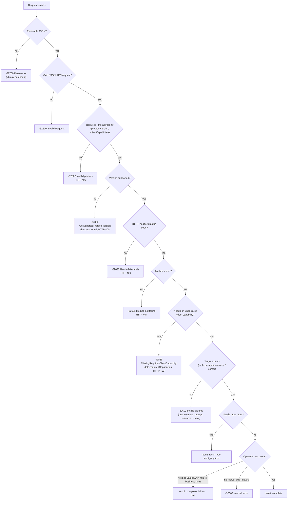

# Error Handling

*Competency: **Error Handling**.*

Things go wrong in several distinct ways in MCP, and each has a specific, required reporting
mechanism. Getting the mechanism right matters for more than tidiness: it decides whether a
language model can recover. This chapter builds the full decision tree and every code you need.

---

## 1. Two families of failure

The tools specification defines the split that the rest of MCP follows:

> Tools use two error reporting mechanisms:
>
> 1. **Protocol Errors** indicate issues with the request structure itself that models are less likely
>    to be able to fix.
> 2. **Tool Execution Errors** contain actionable feedback that language models can use to self-correct
>    and retry with adjusted parameters.

| | **Protocol error** | **Tool execution error** |
| --- | --- | --- |
| Meaning | The **request** couldn't be processed as a request | The request was valid; **the operation** failed |
| Wire form | JSON-RPC **error response** (`error: {code, message, data?}`) | A normal **result** with **`isError: true`** |
| `resultType` | None (it's not a result) | `"complete"` |
| Examples | Unknown tool; malformed request; missing required `_meta`; unsupported version; internal server failure | Upstream API failure; invalid date; value out of range; business rule violated; expired handle |
| Who it's for | The **client/host** | The **model** |
| Client **SHOULD** give it to the model? | **MAY** (unlikely to help) | **SHOULD** (so it can self-correct) |

### Why the distinction exists

Picture a model calling a flight booking tool with `departure: "2025-08-01"` when today is 2026-09-15.

**As a protocol error:**

```json
{ "jsonrpc": "2.0", "id": 4, "error": { "code": -32602, "message": "Invalid params" } }
```

Many hosts surface JSON-RPC errors as generic failures, and even if the model sees this, "Invalid params" tells it
nothing actionable. The conversation stalls.

**As a tool execution error:**

```json
{
  "jsonrpc": "2.0",
  "id": 4,
  "result": {
    "resultType": "complete",
    "content": [ { "type": "text", "text": "Invalid departure date: must be in the future. Current date is 2026-09-15." } ],
    "isError": true
  }
}
```

The model reads that, understands exactly what went wrong, and retries with a valid date. **The error message is part
of the tool's interface to the model.**

!!! important "Input validation errors are tool execution errors"
    Since `2025-11-25` the spec has made this explicit: **input validation errors** (date in the wrong format, value out of
    range) should be returned as **tool execution errors**, not protocol errors, **to enable model self-correction**.

    A **schema-level** failure of the request envelope, where the request doesn't satisfy `CallToolRequest` at all, is a
    protocol error. A **semantic** problem with argument values the model chose is a tool execution error.

---

## 2. The decision tree



The order in real implementations varies slightly, but the **mapping** of condition to mechanism is what the spec defines.

---

## 3. Every code

### Standard JSON-RPC codes

| Code | Name | MCP use |
| --- | --- | --- |
| `-32700` | Parse error | Invalid JSON |
| `-32600` | Invalid Request | Not a valid JSON-RPC request object |
| `-32601` | Method not found | Unknown method (HTTP **404**); also "capability not supported" for completions |
| `-32602` | Invalid params | **Missing required `_meta`**; **unknown tool**; **invalid prompt name**; **missing required prompt arguments**; **resource not found**; **invalid cursor**; **invalid log level**; unknown skill (Skills extension) |
| `-32603` | Internal error | Server-side failures |

`-32602` is overloaded, so learn its list. When in doubt about a "doesn't exist / wrong parameter" condition in MCP, the
answer is usually `-32602`.

### MCP-defined codes <span class="new-2026">2026</span>

| Code | Name | When | HTTP |
| --- | --- | --- | --- |
| **`-32020`** | **HeaderMismatch** | Required Streamable HTTP header missing, malformed, or doesn't match the body | **400** |
| **`-32021`** | **MissingRequiredClientCapability** | Processing needs a capability the client didn't declare; `data.requiredCapabilities` lists them | **400** |
| **`-32022`** | **UnsupportedProtocolVersion** | Requested version not supported; `data.supported` (and `data.requested`) | **400** |

```json
{ "jsonrpc": "2.0", "id": 1, "error": { "code": -32022, "message": "Unsupported protocol version",
  "data": { "supported": ["2026-07-28", "2025-11-25"], "requested": "1900-01-01" } } }
```

```json
{ "jsonrpc": "2.0", "id": 1, "error": { "code": -32020,
  "message": "Header mismatch: Mcp-Name header value 'foo' does not match body value 'bar'" } }
```

### Retired codes

| Code | Was | Status |
| --- | --- | --- |
| `-32002` | Resource not found (`2025-11-25` and earlier) | **Replaced by `-32602`.** Implementations of this version **MUST NOT emit** it; clients **SHOULD still accept** it from older servers |
| `-32042` | URL elicitation required (`2025-11-25` only) | **MUST NOT emit.** Replaced by MRTR |

Codes from earlier versions **remain reserved** and will not be reused for something else.

### The range policy <span class="new-2026">2026</span>

JSON-RPC reserves **`-32000` to `-32099`** for implementation-defined server errors. MCP partitions it:

```text
 -32099 ┐
        │  -32020 … -32099   RESERVED FOR THE MCP SPECIFICATION
 -32020 ┘                    Only spec-defined codes, only with their defined meanings.
 -32019 ┐
        │  -32000 … -32019   LEGACY, implementation-defined
 -32000 ┘                    No new allocations. Receivers assume no meaning (except -32002).

 -32768 … -32000             Whole JSON-RPC reserved range: don't invent new codes here.
 everything else             Available for application-defined errors.
```

Rules:

- **New codes MUST NOT** be allocated in `-32000`…`-32019`, and new implementations **SHOULD NOT** use them.
- Implementations **MUST NOT emit** any code in `-32020`…`-32099` that the spec doesn't define, and **MUST** use defined
  codes only with their specified meanings.
- New error codes for other purposes **SHOULD** be allocated **outside** `-32768`…`-32000` entirely.
- Errors purely **local** to an implementation (an SDK-side timeout, for example) have no assigned codes, and implementations
  should make sure they can't be mistaken for errors **received from the peer**.

---

## 4. Errors by feature

| Feature | Condition | Mechanism |
| --- | --- | --- |
| **Tools** | Unknown tool | `-32602` |
| | Request fails `CallToolRequest` schema | Protocol error |
| | API failure, invalid values, business logic, expired handle | **`isError: true`** |
| **Resources** | Not found | **`-32602`** (accept legacy `-32002`); **never** empty `contents` |
| | Internal | `-32603` |
| **Prompts** | Invalid name / missing required arguments | `-32602` |
| | Internal | `-32603` |
| **Completion** | Capability not supported | `-32601` |
| | Invalid prompt name / missing arguments | `-32602` |
| **Pagination** | Invalid cursor | `-32602` |
| **Logging** *(deprecated)* | Unrecognized `logLevel` in `_meta` | `-32602` |
| **Base protocol** | Missing required `_meta` | `-32602` + HTTP 400 |
| | Undeclared capability needed | `-32021` + HTTP 400 |
| | Unsupported version | `-32022` + HTTP 400 |
| **Streamable HTTP** | Header/body mismatch | `-32020` + HTTP 400 |
| | Unknown method | `-32601` + HTTP 404 |
| | Invalid `Origin` | HTTP **403** (body may be an id-less JSON-RPC error) |
| | Notification not accepted | HTTP 4xx (e.g. 400) |
| | Legacy `GET` / `DELETE` | HTTP **405** |
| **MRTR** | Malformed `inputResponses` | JSON-RPC error |
| | Missing needed input on retry | **New `InputRequiredResult`**, not an error |
| | `requestState` fails verification | **Reject** |
| **Elicitation** | User declines or cancels | Not an error: `action: decline` / `cancel`; server must handle |
| **Cancellation** | Unknown / completed / malformed | **Ignore** |

---

## 5. HTTP status codes

On Streamable HTTP, errors have an HTTP status **and** usually a JSON-RPC body. Both matter: the **body** is how a
dual-era client tells a modern server's `400` from a legacy server's.

| Status | Used for |
| --- | --- |
| **200** | Request answered (JSON or SSE), including results with `isError: true` and `input_required` |
| **202** | Notification accepted (no body) |
| **400** | Malformed request, missing `_meta`, header mismatch (`-32020`), missing capability (`-32021`), unsupported version (`-32022`) |
| **401** | Authorization required, or token invalid or expired, with `WWW-Authenticate` |
| **403** | Invalid `Origin`; **insufficient scope** (`error="insufficient_scope"`); insufficient permissions |
| **404** | Unknown method (with `-32601` body) |
| **405** | `GET` or `DELETE` on a modern-only endpoint |

!!! tip "A tool execution error is HTTP 200"
    `isError: true` lives inside a successful JSON-RPC **result**, so over HTTP it is a **200**. An option claiming a failed
    tool returns a 4xx or 5xx status is describing a protocol error, not a tool execution error.

---

## 6. Handling errors on the client side

**Protocol errors**

- `-32022` → pick a version from `data.supported` and **retry**.
- `-32021` → the server needs a capability you didn't declare. If you can support it (for instance, a user is present to
  answer elicitations), declare it and retry; otherwise surface the error.
- `-32020` → for `Mcp-Param-*` problems, the client **SHOULD call `tools/list`** to check for an updated `inputSchema`, then
  retry with the right headers.
- `-32601` on a supported-looking method → the server may be legacy, or lacks the capability.
- `-32602` "unknown tool" after a cached `tools/list` → the list may be stale. Clients **MAY re-fetch before the TTL
  expires** when they have reason to believe data changed, such as this.

**Tool execution errors**

- Pass the content to the model (**SHOULD**) so it can adjust and retry.
- In code-mode sandboxes, wrappers **should convert `isError: true` into a thrown exception** so model-written code can use
  `try`/`catch`.

**Local errors**

- An SDK timeout or connection failure is **local**. Don't present it as if the server returned it.

### Writing good tool error messages (server side)

The error text is instructions for a model. It should say:

1. **What** was wrong ("departure date is in the past"),
2. **What valid looks like** ("must be after 2026-09-15", "one of: staging, production"),
3. **What to do next** ("create a new basket with `create_basket`").

And it must not leak secrets or internals: stack traces, connection strings, internal hostnames.

---

## Recap

- **Protocol errors** = JSON-RPC error responses about the **request**. **Tool execution errors** = results with
  **`isError: true`** about the **operation**, meant for the **model** to self-correct.
- **Input validation errors are tool execution errors.**
- Standard: `-32700` parse, `-32600` invalid request, **`-32601` method not found (HTTP 404)**, **`-32602` invalid params**,
  `-32603` internal.
- `-32602` covers: **missing `_meta`**, **unknown tool**, **invalid prompt / missing arguments**, **resource not found**,
  **invalid cursor**, invalid log level.
- MCP codes: **`-32020` HeaderMismatch**, **`-32021` MissingRequiredClientCapability**, **`-32022` UnsupportedProtocolVersion**,
  all **HTTP 400**.
- **`-32002` retired** (accept, don't emit); `-32042` retired. `-32000`…`-32019` legacy; `-32020`…`-32099` reserved for the spec.
- Resource not found must never be an **empty `contents`** array.
- Missing input on MRTR retry → **new `InputRequiredResult`**. Elicitation decline/cancel are **not errors**. Bad
  cancellations are **ignored**.
- HTTP: **202** notifications, **401** auth, **403** Origin or scope, **404** unknown method, **405** legacy GET/DELETE;
  `isError: true` is still **200**.
