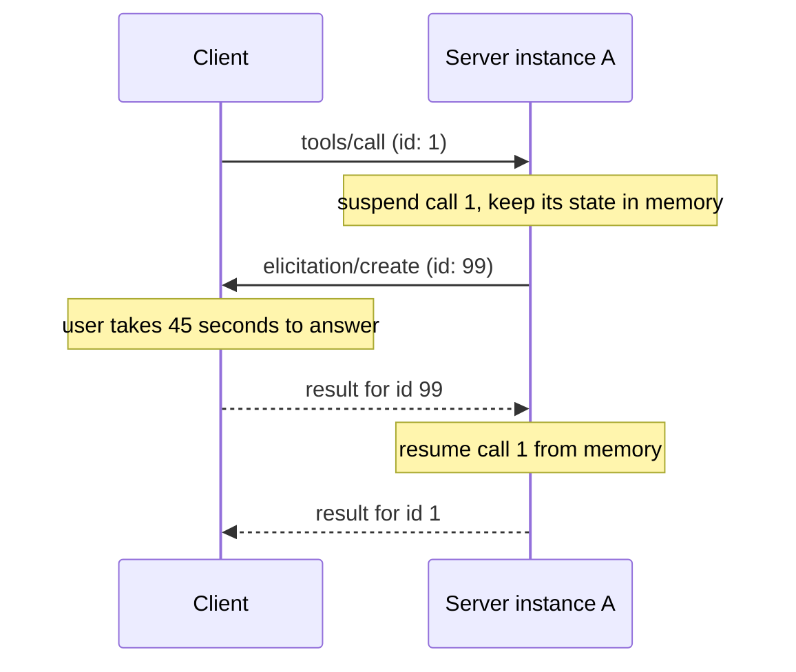
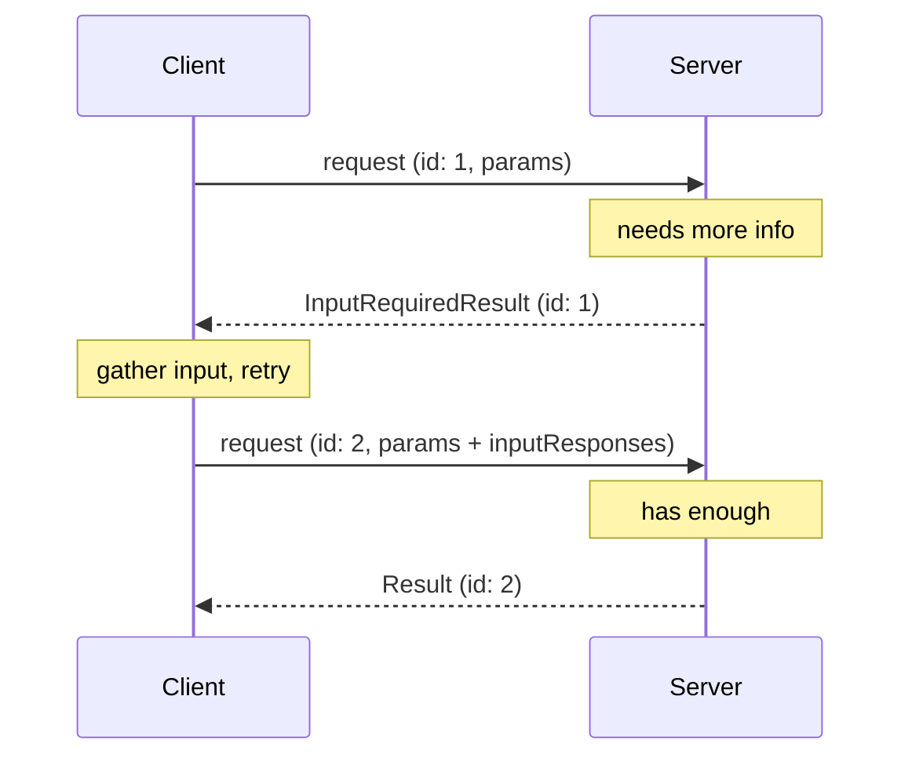
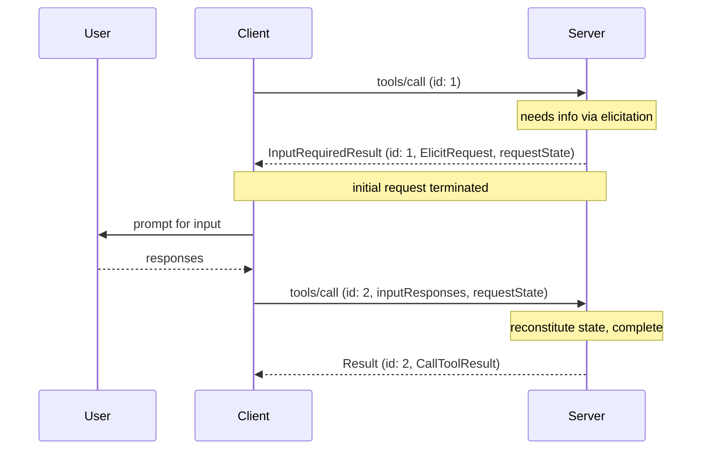
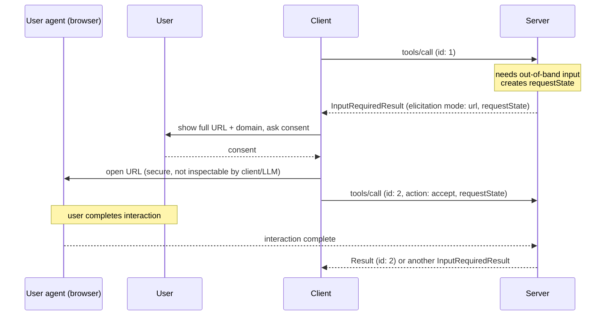

# Multi Round-Trip Requests & Elicitation

*Competencies: **Interaction Patterns & Response Handling**, **Protocol Primitives**.*

This is the most important chapter in the course for `2026-07-28`. Multi Round-Trip Requests (MRTR)
replaced the way servers used to ask clients for things, and elicitation is the main thing they ask
for. The two are covered together because in the current protocol you cannot understand one without the other.

---

## Part 1: The problem MRTR solves

### Servers sometimes need something mid-request

A server is processing a request and discovers it can't finish without more information:

- A **booking** tool needs the user to confirm a $3,000 charge.
- A **GitHub** tool needs the user's username before it can look anything up.
- A **deploy** tool wants explicit approval before touching production.
- A server wants **the user to connect a third-party account** first.

Failing the request would be a poor experience. The server wants to **pause, ask, and continue**.

### How it used to work, and why that broke

Through `2025-11-25`, the server **sent its own JSON-RPC request** to the client in the middle of
handling the client's request:



Look at what that requires:

1. **Suspended state in memory** on **instance A** for as long as the user takes: seconds, or hours.
2. The answer must come back to **the same instance A**, or the state is lost: **sticky routing**, or a
   **shared store** that every instance can consult.
3. A **channel for server-initiated requests** to reach the client, which on HTTP meant long-lived SSE
   streams or a separate GET endpoint.

For a local stdio server, fine. For a remote server running twenty instances behind a load balancer,
autoscaling up and down, this is exactly the kind of state that makes horizontal scaling painful.

SEP-2322, which introduced MRTR, is blunt about the consequence: adoption of server-initiated request features like
elicitation, sampling and roots was *"very low or blocked for many Remote MCP servers"* because of the operational complexity
of SSE streams and server-side state. It also observes that most tools are **ephemeral** (they accumulate no server-side
state and can simply start over once they have the missing information), so the protocol should be optimized for that case.

### The MRTR idea

Invert it. Instead of the server **asking** and **waiting**, the server **answers** ("I can't finish yet;
here is what I need") and **forgets**. The **client** gathers the information and **asks again**, attaching
the answers.

The MRTR page's own description:

> The multi round-trip requests pattern provides a standardized way to handle these server-requests without
> requiring a shared storage layer across server instances or requiring stateful load balancing.

The four steps:

1. The client sends the initial request with its parameters.
2. The server determines it needs more information and **responds requesting it**.
3. The client gathers it (from the user or elsewhere) and **retries the original request** including that information.
4. The server has enough and **responds with the final result**.



!!! important "The sentence that defines MRTR"
    *"The requests in each step are completely independent: the server processing the retry does not need any
    information beyond what is directly present in the retry request."*

    Request 1 **ends** when the server returns `InputRequiredResult`. Request 2 is a brand-new request that could
    land on a different server instance. That is the whole point.

---

## Part 2: The core types

### `InputRequests`

A **map** of server-to-client requests. **Keys** are identifiers the server chooses; **values** are request
objects of exactly three kinds:

| Request | Asks for | Status |
| --- | --- | --- |
| `elicitation/create` (`ElicitRequest`) | Information or confirmation **from the user** | Active |
| `sampling/createMessage` (`CreateMessageRequest`) | An LLM completion **from the client's model** | Deprecated |
| `roots/list` (`ListRootsRequest`) | The client's filesystem **roots** | Deprecated |

```json
{
  "github_login": {
    "method": "elicitation/create",
    "params": {
      "mode": "form",
      "message": "Please provide your GitHub username",
      "requestedSchema": {
        "type": "object",
        "properties": { "name": { "type": "string" } },
        "required": ["name"]
      }
    }
  },
  "capital_of_france": {
    "method": "sampling/createMessage",
    "params": {
      "messages": [ { "role": "user", "content": { "type": "text", "text": "What is the capital of France?" } } ],
      "systemPrompt": "You are a helpful assistant.",
      "maxTokens": 100
    }
  }
}
```

A map rather than a single request means the server can ask for **several things at once**, and the client can
fulfil them all before one retry.

### `InputResponses`

A map with **the same keys**, holding the client's **result** for each request:

```json
{
  "github_login": { "action": "accept", "content": { "name": "octocat" } },
  "capital_of_france": {
    "role": "assistant",
    "content": { "type": "text", "text": "The capital of France is Paris." },
    "model": "claude-3-sonnet-20240307",
    "stopReason": "endTurn"
  }
}
```

### `InputRequiredResult`

A **result** (not an error, and not a request) with **`resultType: "input_required"`** and:

| Field | Meaning |
| --- | --- |
| `inputRequests` *(optional)* | The `InputRequests` map the client must fulfil |
| `requestState` *(optional)* | An **opaque string meaningful only to the server**, which the client must echo back |

**At least one** of the two **MUST** be present.

```json
{
  "jsonrpc": "2.0",
  "id": 1,
  "result": {
    "resultType": "input_required",
    "inputRequests": {
      "github_login": {
        "method": "elicitation/create",
        "params": {
          "mode": "form",
          "message": "Please provide your GitHub username",
          "requestedSchema": { "type": "object", "properties": { "name": { "type": "string" } }, "required": ["name"] }
        }
      }
    },
    "requestState": "AEAD-protected blob"
  }
}
```

### Which requests can return it

| Client request | May return `InputRequiredResult` |
| --- | --- |
| `tools/call` | **Yes** |
| `resources/read` | **Yes** |
| `prompts/get` | **Yes** |
| **Anything else** | **MUST NOT** |

So `tools/list`, `server/discover`, `completion/complete` and `subscriptions/listen` can never be interrupted
for input.

---

## Part 3: The workflow in detail

### A complete tool call with elicitation



On the wire:

```jsonc
// 1. C→S
{"jsonrpc":"2.0","id":1,"method":"tools/call",
 "params":{"name":"get_weather","arguments":{"location":"New York"},
           "_meta":{"io.modelcontextprotocol/protocolVersion":"2026-07-28",
                    "io.modelcontextprotocol/clientCapabilities":{"elicitation":{"form":{}}}}}}

// 2. S→C  request 1 is now over
{"jsonrpc":"2.0","id":1,"result":{"resultType":"input_required",
  "inputRequests":{"github_login":{"method":"elicitation/create","params":{"mode":"form",
     "message":"Please provide your GitHub username",
     "requestedSchema":{"type":"object","properties":{"name":{"type":"string"}},"required":["name"]}}}},
  "requestState":"v1.Rk9PQkFSX1NUQVRF.hmac-8f3a1c"}}

// 3. C→S  NEW id, SAME name/arguments, + inputResponses, + EXACT requestState
{"jsonrpc":"2.0","id":2,"method":"tools/call",
 "params":{"name":"get_weather","arguments":{"location":"New York"},
           "inputResponses":{"github_login":{"action":"accept","content":{"name":"octocat"}}},
           "requestState":"v1.Rk9PQkFSX1NUQVRF.hmac-8f3a1c",
           "_meta":{"io.modelcontextprotocol/protocolVersion":"2026-07-28",
                    "io.modelcontextprotocol/clientCapabilities":{"elicitation":{"form":{}}}}}}

// 4. S→C
{"jsonrpc":"2.0","id":2,"result":{"resultType":"complete",
  "content":[{"type":"text","text":"Weather for octocat's saved location, New York: 72°F"}]}}
```

### Server requirements

| # | Requirement |
| --- | --- |
| 1 | **MAY** respond to a supported request with `InputRequiredResult` |
| 2 | **MAY** include `inputRequests`. Keys **MUST** be unique within the request. Values **MUST** be `ElicitRequest`, `CreateMessageRequest` or `ListRootsRequest` |
| 3 | **MAY** include `requestState`, in any encoding (base64 JSON, encrypted JWT, binary…) |
| 4 | **MUST** treat incoming `requestState` as **attacker-controlled**. If it influences **authorization, resource access or business logic**, **MUST protect its integrity** (HMAC or AEAD) and **MUST reject** state that fails verification. Integrity protection may be omitted **only** when tampering can cause nothing worse than request failure |
| 5 | To prevent **replay**, **SHOULD** include inside the protected payload and verify: the **authenticated principal**; a **short expiry (TTL)**; an **identifier for the originating request** (method name plus a digest of salient parameters) |
| 6 | **MUST** include **at least one** of `inputRequests` or `requestState` |
| 7 | **MUST NOT** send `inputRequests` the client hasn't declared capability for (no `elicitation/create` without `elicitation`) |
| 8 | **MUST NOT assume** the client will fulfil the requests or retry. **MAY** return `InputRequiredResult` again on the retry, to keep prompting until it has what it needs |

### Client requirements

| # | Requirement |
| --- | --- |
| 1 | If `inputRequests` is present, **MUST construct the requested inputs** before retrying. If absent, **MAY retry immediately** |
| 2 | If `requestState` is present, **MUST echo back its exact value**; **MUST NOT inspect, parse, modify or assume anything** about it. If absent, **MUST NOT include one** in the retry |
| 3 | The retry's JSON-RPC **`id` MUST differ** from the original's |
| 4 | `inputRequests` and `requestState` affect **only the retry of that request**; **MUST NOT** be used for any other request the client is sending in parallel |

### Why `requestState` exists

Statelessness means the retry must carry everything. But the **server** may have done work before it hit the need
for input: validated arguments, fetched a quote, chosen a price, allocated a reservation. `requestState` lets the
server **hand that context to the client to carry**, instead of storing it.

An **`InputRequiredResult` with only `requestState` and no `inputRequests`** is legal and useful: it means
*"I need you to come back; here's my progress."* The client retries immediately, and the server continues from the
state. Servers can use this to break long work into steps without holding anything between them.

### Why `requestState` must be protected

`requestState` **travels through the client**. A malicious or compromised client can **modify** it. Consider a naive
server that puts plain JSON in it:

```json
{"step": "confirm_purchase", "userId": "u_123", "amount": 3000, "approved": false}
```

An attacker base64-decodes it, sets `"amount": 1` and `"approved": true`, re-encodes it and retries. If the server
trusts `requestState`, the attacker just bought a $3,000 item for $1.

Hence the MUSTs: **integrity protection** (HMAC or AEAD, so tampering is detected), and **rejection** on failure.

Then **replay**. Even untampered, a valid state blob could be **reused**:

| Replay | Mitigation inside the protected payload |
| --- | --- |
| Another user presents Alice's captured state | **Authenticated principal**; reject a different principal |
| Alice presents an old state days later | **Short TTL**; reject after expiry |
| State from `buy_ticket(concert)` presented on `refund_ticket(other)` | **Request identifier**: method + digest of salient params; reject on mismatch |

!!! warning "These bound replay; they don't guarantee single use"
    Principal, TTL and request binding stop cross-user, stale and cross-request reuse. They do **not** stop the same
    user replaying the same state twice within its TTL. For operations that must happen **at most once** (a one-time
    redemption, a payment), the server **MUST enforce single use server-side**, for example by recording a nonce as
    consumed.

### Error handling

- Servers **SHOULD validate** that the retry carries a valid `InputResponses` object that parses correctly.
- Malformed JSON, invalid schema or internal errors → a normal JSON-RPC **error**.
- **Extra, unexpected** entries in `inputResponses` → the server **SHOULD ignore** what it doesn't recognize.
- **Missing required** information → the server **SHOULD return a new `InputRequiredResult`** asking again, **rather
  than an error**.
- If the user declines or the client can't fulfil the requests, the client **does not need to send anything**. The
  server isn't waiting, because request 1 already ended. (Compare the legacy pattern, where the server was blocked on a
  reply.)

### MRTR and caching

Results from a retry carrying `inputResponses` or `requestState` **MUST NOT be cached**, since they depend on inputs
outside the cache key. `InputRequiredResult`s themselves are **not cacheable** and carry no cache hints.

---

## Part 4: Elicitation

### 1. What elicitation is

> The Model Context Protocol provides a standardized way for servers to request additional information from users
> through the client during interactions. This flow allows clients to maintain control over user interactions and data
> sharing while enabling servers to gather necessary information dynamically.

Two modes:

| Mode | What happens | Data exposed to the client? | For |
| --- | --- | --- | --- |
| **Form** | The client renders a form from a schema and returns the user's answers | **Yes** | Structured, **non-sensitive** input: preferences, confirmations, names |
| **URL** | The client sends the user to a URL; the interaction happens **out of band** | **No** (only the URL itself) | **Sensitive** interactions: credentials, payments, third-party OAuth |

### 2. The non-negotiable safety rules

!!! danger "Sensitive data must use URL mode"
    - Servers **MUST NOT** use **form mode** to request sensitive information such as **passwords, API keys, access
      tokens or payment credentials**.
    - Servers **MUST** use **URL mode** for interactions involving such information.

    "Sensitive" here means **secrets and credentials that grant access or authorize transactions**. General contact or
    profile information (name, email, username) is not categorically prohibited in form mode; whether to ask for it is
    at the server's discretion, subject to the user's ability to review and decline.

Why? Form data passes **through the MCP client**: its memory, its logs, possibly its LLM context, possibly intermediate
proxies. A password typed into a form-mode elicitation is exposed to all of them. URL mode keeps the secret between the
**user's browser** and a **page the server controls**.

And clients **MUST**:

- make it clear **which server** is requesting information,
- respect privacy and provide clear **decline and cancel** options,
- in **form mode**, let users **review and modify** responses before sending,
- in **URL mode**, clearly display the **target domain/host** and **gather consent** before navigating.

### 3. Capability

```json
{
  "_meta": {
    "io.modelcontextprotocol/clientCapabilities": {
      "elicitation": { "form": {}, "url": {} }
    }
  }
}
```

- A client declaring `elicitation` **MUST support at least one mode**.
- **An empty `elicitation: {}` equals `{ "form": {} }`**, form only, for backward compatibility.
- Servers **MUST NOT** send an elicitation with a mode the client didn't declare.

### 4. Common parameters

Every elicitation request **MUST** include:

| Parameter | Notes |
| --- | --- |
| `mode` | `"form"` or `"url"`. **May be omitted for form mode**; clients **MUST** treat a missing `mode` as form |
| `message` | Human-readable explanation of **why** the interaction is needed |

### 5. Form mode

Adds **`requestedSchema`**: a restricted JSON Schema, a **flat object with primitive properties only**.

| Type | Supported keywords |
| --- | --- |
| string | `title`, `description`, `minLength`, `maxLength`, `format` (`email`, `uri`, `date`, `date-time`), `default` |
| number / integer | `title`, `description`, `minimum`, `maximum`, `default` |
| boolean | `title`, `description`, `default` |
| single-select enum | `enum`, or `oneOf` of `{const, title}` for labelled options; `default` |
| multi-select enum | `type: "array"`, `items.enum` or `items.anyOf` of `{const, title}`, `minItems`, `maxItems`, `default` |

**Not supported:** nested objects, arrays of objects beyond enums, other advanced JSON Schema. Clients that support
defaults **SHOULD** pre-fill fields with them.

A realistic booking confirmation:

```json
{
  "method": "elicitation/create",
  "params": {
    "mode": "form",
    "message": "Please confirm your Barcelona vacation booking details:",
    "requestedSchema": {
      "type": "object",
      "properties": {
        "confirmBooking": { "type": "boolean", "description": "Confirm the booking (Flights + Hotel = $3,000)" },
        "seatPreference": { "type": "string", "enum": ["window", "aisle", "no preference"] },
        "roomType": { "type": "string", "enum": ["sea view", "city view", "garden view"] },
        "travelInsurance": { "type": "boolean", "default": false, "description": "Add travel insurance ($150)" }
      },
      "required": ["confirmBooking"]
    }
  }
}
```

Clients **SHOULD** validate responses against the schema; servers **SHOULD** validate what they receive.

### 6. URL mode

Adds **`url`**, which **MUST** be a valid URL:

```json
{
  "method": "elicitation/create",
  "params": {
    "mode": "url",
    "url": "https://mcp.example.com/ui/set_api_key",
    "message": "Please provide your API key to continue."
  }
}
```

The client's response is just:

```json
{ "action": "accept" }
```

Read that carefully. **`accept` means the user consented to open the URL. It does not mean the interaction is
complete.** The interaction happens out of band, and the client is **not told** its outcome. When the client retries
the original request, the **server** works out (from `requestState` or its own stored state) whether the out-of-band
step finished, and either returns the final result or another `InputRequiredResult`. Clients **SHOULD** give users
manual controls to **retry or cancel** the original request.



!!! note "URL mode is not MCP authorization"
    URL mode is **not** for authorizing the MCP client's access to the MCP server. That is
    [MCP authorization](../domain-4/authorization.md). URL mode is for when the **server** needs sensitive information
    or **third-party authorization** on the user's behalf. The client's bearer token is unchanged.

### 7. The three response actions

Both modes use the same three actions:

| Action | Meaning | `content` | Server should |
| --- | --- | --- | --- |
| **`accept`** | User explicitly approved and submitted | Form: the data. URL: omitted | Process the data |
| **`decline`** | User **explicitly** refused ("No", "Reject") | Typically omitted | Handle the refusal, e.g. offer alternatives |
| **`cancel`** | User **dismissed without choosing** (closed dialog, Escape, clicked outside, browser failed to load) | Typically omitted | Handle dismissal, e.g. ask again later |

The decline/cancel distinction is examinable. **Decline** is a decision. **Cancel** is the absence of one.

Servers **SHOULD NOT assume** elicitations succeed, and **MUST handle** decline, cancel and client failure.

### 8. Safe URL handling

URL mode sends users to server-chosen URLs, a classic phishing surface. The rules on both sides:

**Servers requesting URL elicitation:**

1. **MUST NOT** put sensitive end-user information (credentials, PII) **in the URL**.
2. **MUST NOT** provide a **pre-authenticated URL** to a protected resource, since a malicious client could use it to
   impersonate the user.
3. **SHOULD NOT** put clickable URLs in any field of a **form-mode** elicitation.
4. **SHOULD** use **HTTPS** outside development.

**Clients handling URL elicitation:**

1. **MUST NOT pre-fetch** the URL or any of its metadata.
2. **MUST NOT open** it **without explicit user consent**.
3. **MUST show the full URL** for examination before consent.
4. **MUST open it securely**, in a way that does **not let the client or the LLM inspect** the page or the user's
   input. On iOS, `SFSafariViewController` is acceptable; `WKWebView` is not.
5. **SHOULD highlight the domain**, to counter subdomain spoofing.
6. **SHOULD warn** about ambiguous or suspicious URIs, such as those containing **Punycode**.
7. **SHOULD NOT render URLs as clickable** anywhere except the `url` field of a URL elicitation.

### 9. URL mode for third-party OAuth

A key pattern: an MCP server integrates with third-party APIs (say, a Google Drive or Salesforce account) and needs
the **user's authorization for those APIs**.

| | MCP authorization | Third-party authorization |
| --- | --- | --- |
| Between | MCP **client** ↔ MCP **server** | MCP **server** ↔ **third-party** API |
| Mechanism | Core [authorization spec](../domain-4/authorization.md) | **URL-mode elicitation** |
| MCP server's role | OAuth **resource server** | OAuth **client** (and resource server to the MCP client) |

The critical requirements:

1. **Third-party credentials MUST NOT transit through the MCP client.**
2. **The MCP server MUST NOT use the client's credentials** for the third-party service. That would be **token
   passthrough**, which is forbidden.
3. **The user MUST authorize the MCP server directly**, outside the MCP protocol.
4. **The MCP server is responsible for the tokens**: it stores and manages them, bound to the user's identity. The
   server **must be stateful** for this.
5. The server **MUST NOT transmit** credentials obtained via URL elicitation **to the MCP client**.
6. MCP servers **MUST NOT rely on URL elicitation to authorize users for themselves**.

### 10. The phishing attack, and the fix

The spec describes a concrete account-takeover attack against a naive implementation:

1. **Alice** (malicious), connected to a benign server, triggers an elicitation.
2. The server generates a third-party **authorization URL** and returns it to Alice's client.
3. Instead of clicking it, Alice **sends the link to Bob**, another user of the same server.
4. **Bob** clicks it and completes authorization, believing he's connecting his own account.
5. The third-party service redirects back to the server, which **binds the tokens to Alice's request**.
6. **Alice** now has access to **Bob's** third-party account.

The fix is a MUST: **the server must verify that the user who completes the flow is the same user who started the
elicitation.**

The spec's example design: instead of eliciting the third-party authorization URL directly, elicit a **"connect" URL
on the MCP server itself** (`https://mcp.example.com/connect?...`). That page checks the browser's **session cookie**,
comparing the authenticated subject (`sub` claim from the MCP server's authorization server) with the user who
generated the elicitation, and **only then** redirects to the third party. If Bob opens Alice's link, the subjects don't
match and the flow stops.

In all implementations, the identity check **MUST be resilient to an attacker modifying the elicitation URL**.

### 11. Identifying the user

Servers **MUST NOT** rely on client-provided identification without verification, because it can be forged:

- **Incorrect:** treating user input like "I am joe@example.com" as authoritative.
- **Correct:** relying on **authorization** to identify the user.

And if a server does keep state about elicitations (MRTR doesn't require it, but URL-mode OAuth does):

- state storage **MUST** be protected against unauthorized access, and
- for remote servers, user identity **MUST** come from credentials acquired via **MCP authorization** when possible (for
  example the `sub` claim).

### 12. Security summary

1. Servers **MUST bind** elicitation requests to the client and user identity.
2. Clients **MUST** clearly indicate **which server** is asking.
3. Clients **SHOULD** implement user approval controls, and **SHOULD** allow users to **decline at any time**.
4. Clients **SHOULD** make clear **what** is requested and **why**.
5. Form mode: servers **MUST NOT** request sensitive data; clients **SHOULD** validate against the schema; servers
   **SHOULD** validate received data.

---

## Part 5: What changed from `2025-11-25`

| Legacy | `2026-07-28` |
| --- | --- |
| Server sends `elicitation/create` as a JSON-RPC **request** | Server returns it inside **`InputRequiredResult.inputRequests`** |
| Server blocks, holding the original request | Original request **ends**; client **retries** with a new id |
| Server-side suspended state | `requestState` carried by the client, integrity-protected |
| URL elicitations carried an `elicitationId` | **Removed**; servers correlate via `requestState` |
| `notifications/elicitation/complete` told the client an out-of-band step finished | **Removed**; the client learns the outcome by **retrying** |
| Error `-32042` "URL elicitation required" | **Removed**; implementations of this version **MUST NOT** emit it |

---

## Recap

- **MRTR** replaces server-initiated requests. Server returns **`resultType: "input_required"`**; client gathers input and
  **retries**. Each request is **independent**, so any instance can serve the retry.
- `InputRequiredResult` has **`inputRequests`** (map of elicitation / sampling / roots requests) and/or **`requestState`**
  (opaque string). **At least one** is required.
- Only **`tools/call`, `resources/read`, `prompts/get`** may return it.
- Client **MUST**: construct requested inputs, **echo `requestState` exactly** without inspecting it, use a **new id**, and
  not reuse inputs or state for other requests.
- Server **MUST**: treat `requestState` as **attacker-controlled**, **HMAC/AEAD** it when it matters, **reject** on
  failure; **SHOULD** bind to **principal, TTL, originating request**; **enforce single use server-side** where needed; never
  request undeclared capabilities; never assume the client will retry.
- Missing input on a retry → another **`InputRequiredResult`**, not an error. Retry results are **not cacheable**.
- **Elicitation:** **form** mode (flat primitive schema, **no secrets**) or **URL** mode (**sensitive** interactions,
  out of band). Empty `elicitation: {}` = **form only**.
- URL `accept` = **consent to open**, not completion; the server decides on retry.
- Actions: **accept**, **decline** (explicit no), **cancel** (dismissed).
- Clients: show which server asks, **never pre-fetch or auto-open URLs**, show the full URL and domain, open it where
  the client and LLM can't inspect it.
- Third-party OAuth via URL mode: credentials **never through the client**, **no token passthrough**, server stores
  tokens, and **verify the completing user is the initiating user** to prevent phishing account takeover.
