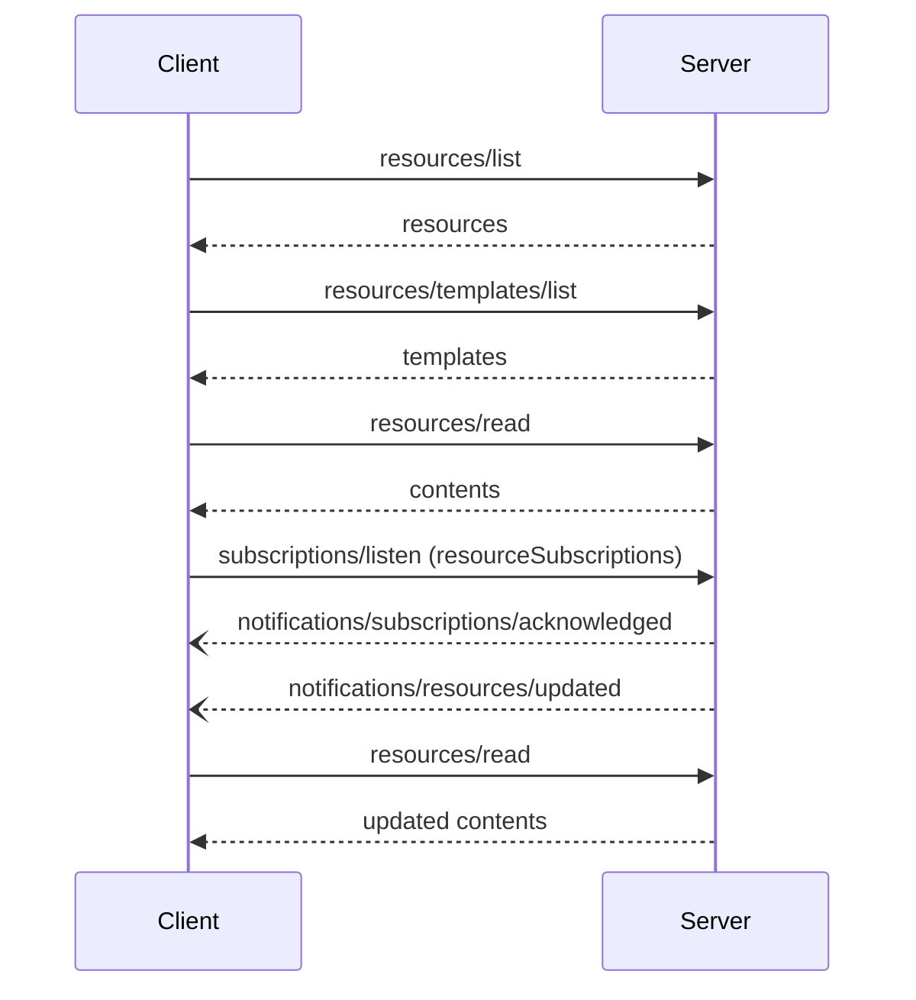

# Resources & Prompts

*Competency: **Protocol Primitives**.*

Tools let the model **act**. Resources and prompts supply **context** and **workflows**, and they are
controlled differently: resources by the **application**, prompts by the **user**. This chapter covers both
in full.

---

## Part 1: Resources

### 1. What a resource is

> Resources allow servers to share data that provides context to language models, such as files,
> database schemas, or application-specific information. Each resource is uniquely identified by a URI.

The essential property is the **URI**. A resource is an addressable piece of data: `file:///project/src/main.rs`,
`calendar://events/2024`, `postgres://db/schema/users`. Clients discover what exists, read what they need,
and optionally watch for changes.

### 2. Application-driven

Resources are **application-driven**: the **host** decides how context gets incorporated. The spec lists
examples:

- UI elements for explicit selection, such as a tree or list view,
- search and filter over available resources,
- **automatic** context inclusion based on heuristics or the model's selection.

This is the key contrast with tools. A model does not "call" a resource. The **application** reads resources
and decides what reaches the model: passing everything, selecting a portion, or searching with embeddings.

### 3. Capability

```json
{ "capabilities": { "resources": { "listChanged": true, "subscribe": true } } }
```

| Sub-capability | Meaning |
| --- | --- |
| `listChanged` | Server emits `notifications/resources/list_changed` when the **set** of resources changes |
| `subscribe` | Server supports per-resource **update** notifications requested via `subscriptions/listen` |

Either, both or neither may be declared. A server supporting neither can declare `"resources": {}`.

As with tools, `resources/list` returns what is available **to the requesting client**. It **MUST NOT** vary per
connection, and **MAY** vary by the authorization on the request.

### 4. Listing: `resources/list`

```json
{ "jsonrpc": "2.0", "id": 1, "method": "resources/list", "params": { "cursor": "optional-cursor-value" } }
```

```json
{
  "jsonrpc": "2.0",
  "id": 1,
  "result": {
    "resultType": "complete",
    "resources": [
      {
        "uri": "file:///project/src/main.rs",
        "name": "main.rs",
        "title": "Rust Software Application Main File",
        "description": "Primary application entry point",
        "mimeType": "text/x-rust"
      }
    ],
    "nextCursor": "next-page-cursor",
    "ttlMs": 300000,
    "cacheScope": "public"
  }
}
```

A resource has `uri` and `name`, and optionally `title`, `description`, `icons`, `mimeType` and `size` (in bytes).
The list is **paginated** and **cacheable**.

### 5. Reading: `resources/read`

```json
{ "jsonrpc": "2.0", "id": 2, "method": "resources/read", "params": { "uri": "file:///project/src/main.rs" } }
```

```json
{
  "jsonrpc": "2.0",
  "id": 2,
  "result": {
    "resultType": "complete",
    "contents": [
      { "uri": "file:///project/src/main.rs", "mimeType": "text/x-rust", "text": "fn main() {\n    println!(\"Hello world!\");\n}" }
    ],
    "ttlMs": 60000,
    "cacheScope": "private"
  }
}
```

Contents are **text**:

```json
{ "uri": "file:///example.txt", "mimeType": "text/plain", "text": "Resource content" }
```

or **binary**, base64-encoded in `blob`:

```json
{ "uri": "file:///example.png", "mimeType": "image/png", "blob": "iVBORw0KGgo..." }
```

Details worth knowing:

- A server **MAY return multiple contents** for one read. Reading a directory resource might return several files.
- `resources/read` **supports MRTR**: a server may return an `InputRequiredResult` (for example, asking the user to
  confirm access to a sensitive document) and the client retries with `inputResponses` and `requestState`.
- `resources/read` is **cacheable**. Note `cacheScope: "private"` in the example: file contents that depend on who is
  asking must not be shared across users.
- If the URI scheme is **`https://`**, the client **may fetch the resource directly** from the web rather than through
  the server.

### 6. Resource templates: `resources/templates/list`

Many data sources are too large or dynamic to enumerate. **Resource templates** expose parameterized URIs using
**RFC 6570 URI templates**:

```json
{
  "jsonrpc": "2.0",
  "id": 3,
  "result": {
    "resultType": "complete",
    "resourceTemplates": [
      {
        "uriTemplate": "file:///{path}",
        "name": "Project Files",
        "title": "📁 Project Files",
        "description": "Access files in the project directory",
        "mimeType": "application/octet-stream"
      }
    ],
    "ttlMs": 300000,
    "cacheScope": "public"
  }
}
```

The documentation's travel examples show the idea:

| Kind | Example | Meaning |
| --- | --- | --- |
| **Direct resource** | `calendar://events/2024` | A fixed URI |
| **Template** | `travel://activities/{city}/{category}` | A family of URIs |
| **Expanded template** | `travel://activities/barcelona/museums` | One concrete member, read with `resources/read` |

Template arguments can be **autocompleted**: as a user types "Par" for `{city}`, the host calls
`completion/complete` with `ref/resource` and the server suggests "Paris" or "Park City". See
[Utilities](utilities.md#part-3-completion).

Templates are paginated and cacheable.

### 7. Watching for changes

Two kinds of change, two notifications, both delivered on a **`subscriptions/listen`** stream:

| Change | Notification | Client opts in with | Server must declare |
| --- | --- | --- | --- |
| The **set** of resources changed | `notifications/resources/list_changed` | `resourcesListChanged: true` | `listChanged` |
| A **specific resource's content** changed | `notifications/resources/updated` (with `uri`) | `resourceSubscriptions: ["uri", …]` | `subscribe` |

```json
{
  "jsonrpc": "2.0",
  "method": "notifications/resources/updated",
  "params": { "_meta": { "io.modelcontextprotocol/subscriptionId": 4 }, "uri": "file:///project/src/main.rs" }
}
```

The notification carries only the **URI**, not the new content. The client decides whether to re-read.

!!! warning "Legacy vs. modern"
    `resources/subscribe` and `resources/unsubscribe` **no longer exist** in `2026-07-28`. Per-resource subscriptions
    are the `resourceSubscriptions` filter of `subscriptions/listen`.



### 8. Annotations

Resources, templates and content blocks accept **annotations**:

- **`audience`**: `["user"]`, `["assistant"]` or both, for whom the resource is intended;
- **`priority`**: `0.0`–`1.0`, where `1` means effectively required and `0` entirely optional;
- **`lastModified`**: ISO 8601 timestamp.

Hosts use them to filter by audience, **prioritize what to include in limited context**, and show or sort by recency.

### 9. URI schemes

| Scheme | Use | Guidance |
| --- | --- | --- |
| `https://` | A resource on the web | Servers **SHOULD** use it **only when the client can fetch it directly** without going through the server. Otherwise use another scheme, **even if the server itself downloads the content from the internet** |
| `file://` | Filesystem-like resources | Need not map to a real filesystem. **MAY** use XDG MIME types like `inode/directory` for non-regular files |
| `git://` | Git version control | |
| Custom (`calendar://`, `postgres://`…) | Anything else | **MUST** comply with **RFC 3986** |

The `https://` rule is subtle and worth understanding. An `https://` URI tells the client "you can fetch this
yourself". If the content actually requires the server's credentials or processing, a client fetching directly
would get the wrong thing or nothing, so use a scheme that routes through `resources/read`.

### 10. Errors

- Resource not found → JSON-RPC **`-32602`** (Invalid params). <span class="new-2026">2026</span>
- Internal errors → **`-32603`**.
- Clients **SHOULD also accept `-32002`** as not-found, from servers implementing earlier versions.
- A server **MUST NOT return an empty `contents` array for a non-existent resource.** An empty array is ambiguous: it
  could mean the resource exists but is empty.

```json
{ "jsonrpc": "2.0", "id": 5, "error": { "code": -32602, "message": "Resource not found", "data": { "uri": "file:///nonexistent.txt" } } }
```

### 11. Security

1. Servers **MUST validate all resource URIs**.
2. Access controls **SHOULD** be implemented for sensitive resources.
3. Binary data **MUST** be properly encoded.
4. Resource permissions **SHOULD** be checked before operations.
5. Servers **MUST sanitize file paths to prevent directory traversal** when serving `file://` resources.

Directory traversal concretely: a template `file:///{path}` rooted at `/srv/project`, read with
`path = "../../etc/passwd"`, resolves outside the project unless the server normalizes the path and verifies it is
still inside the allowed root.

---

## Part 2: Prompts

### 12. What a prompt is

> Prompts allow servers to provide structured messages and instructions for interacting with language models.
> Clients can discover available prompts, retrieve their contents, and provide arguments to customize them.

A prompt is a **server-authored template** for a conversation: "review this code", "summarize my meetings",
"plan a vacation". It packages domain expertise, telling the model how to use this server's tools and resources well.

### 13. User-controlled

Prompts are **user-controlled**: exposed so that **the user explicitly selects them**. Typically they appear as
**slash commands**, command-palette entries, buttons or context-menu suggestions.

The spec adds a precise clarification that is easy to miss:

> This refers to who decides **when** the prompt is used, not who authors its content. Prompt content is defined by
> the server.

So: **user** chooses when, **server** writes the content, **host** places it in the conversation.

### 14. Capability

```json
{ "capabilities": { "prompts": { "listChanged": true } } }
```

Declared in the `DiscoverResult`. `prompts/list` returns prompts available **to the requesting client**, not varying
per connection and possibly varying by authorization.

### 15. Listing: `prompts/list`

```json
{
  "jsonrpc": "2.0",
  "id": 1,
  "result": {
    "resultType": "complete",
    "prompts": [
      {
        "name": "code_review",
        "title": "Request Code Review",
        "description": "Asks the LLM to analyze code quality and suggest improvements",
        "arguments": [ { "name": "code", "description": "The code to review", "required": true } ]
      }
    ],
    "nextCursor": "next-page-cursor",
    "ttlMs": 600000,
    "cacheScope": "public"
  }
}
```

A prompt has `name`, optional `title`, `description`, `icons` and `arguments`. Each argument is `{ name, description?,
required? }`. This is **not** JSON Schema; prompt arguments are a simple list.

### 16. Getting: `prompts/get`

```json
{
  "jsonrpc": "2.0",
  "id": 2,
  "method": "prompts/get",
  "params": { "name": "code_review", "arguments": { "code": "def hello():\n    print('world')" } }
}
```

```json
{
  "jsonrpc": "2.0",
  "id": 2,
  "result": {
    "resultType": "complete",
    "description": "Code review prompt",
    "messages": [
      { "role": "user", "content": { "type": "text", "text": "Please review this Python code:\ndef hello():\n    print('world')" } }
    ]
  }
}
```

The server returns **messages**, not a single string. Each has a **`role`** (`"user"` or `"assistant"`) and a
**content block**: `text`, `image`, `audio`, `resource_link` or embedded `resource`, all accepting annotations.

Why a message list? Because a good prompt is often a **multi-turn scaffold**: a user message with context, an
assistant message demonstrating the expected format, then the real question. Prompts can also **embed resources**,
pulling server-managed documentation or code samples straight into the conversation:

```json
{ "role": "user", "content": { "type": "resource", "resource": { "uri": "resource://style-guide", "mimeType": "text/markdown", "text": "# Style guide…" } } }
```

Embedded resources in prompts **MUST** include a valid URI, the appropriate MIME type, and either text or
base64 blob.

`prompts/get` **supports MRTR**: a server can return `InputRequiredResult` to ask for something before resolving
the prompt. Arguments can be **autocompleted** with `completion/complete` and `ref/prompt`.

Note `prompts/get` results are **not** in the list of operations that must carry cache hints; `prompts/list` is.

### 17. List changes

A server declaring `listChanged` **SHOULD** send `notifications/prompts/list_changed` to clients subscribed with
`promptsListChanged: true`.

### 18. Errors and security

| Case | Code |
| --- | --- |
| Invalid prompt name | `-32602` (Invalid params) |
| Missing required arguments | `-32602` (Invalid params) |
| Internal error | `-32603` |

Servers **SHOULD** validate prompt arguments. Clients **SHOULD** handle pagination. Implementations **MUST** carefully
validate all prompt inputs and outputs **to prevent injection attacks** or unauthorized access to resources.

Prompt injection risk here runs in an interesting direction: the **server authors** the messages that enter the
conversation, with the user's apparent endorsement (they selected the prompt). A malicious server's prompt can
instruct the model to misuse other servers' tools. Hosts should show users what a prompt will insert.

---

## Part 3: Choosing the right primitive

| Question | Primitive |
| --- | --- |
| Should the **model** decide when to use it, and does it **do** something? | **Tool** |
| Is it **data** the **application** should be able to attach as context? | **Resource** |
| Is it a **workflow** the **user** starts on purpose? | **Prompt** |

Worked example: a **database** MCP server.

| Capability | Primitive | Why |
| --- | --- | --- |
| Run a SQL query | **Tool** `run_query` | The model decides when a query is needed; it executes something |
| The schema of every table | **Resource** `postgres://db/schema` | Context the app can attach so the model writes correct SQL |
| One table's schema | **Resource template** `postgres://db/schema/{table}` | A family of data, too many to list |
| "Analyze slow queries" | **Prompt** `analyze_slow_queries` | A workflow the user triggers, bundling instructions and few-shot examples |

A server author sometimes has a genuine choice. "Get the README" could be a **resource** (the app attaches it) or a
**tool** (the model fetches it when needed). Prefer the resource when the data is stable context the user or app
should see and choose. Prefer the tool when the model needs to decide dynamically, especially if the call has
parameters or side effects.

---

## Recap

**Resources**

- Data identified by a **URI**; **application-controlled**.
- Capability `resources` with optional **`listChanged`** (set changes) and **`subscribe`** (content updates).
- `resources/list` (paginated, cacheable), `resources/templates/list` (RFC 6570), `resources/read` (text or base64
  `blob`, possibly multiple contents, **MRTR-capable**, cacheable).
- Changes via **`subscriptions/listen`**: `resourcesListChanged` → `list_changed`; `resourceSubscriptions` → `updated`
  (URI only). No more `resources/subscribe`.
- Not found → **`-32602`** (accept legacy `-32002`); **never an empty `contents`** for a missing resource.
- `https://` only when the client can fetch directly. **Validate URIs; prevent directory traversal.**

**Prompts**

- Server-authored message templates; **user-controlled** (user decides **when**, server authors **content**).
- `prompts/list` (arguments are a **simple list**, not JSON Schema), `prompts/get` returns **`messages`** with roles and
  content blocks (can embed resources), **MRTR-capable**.
- Invalid name or missing arguments → **`-32602`**. Validate inputs and outputs against injection.
