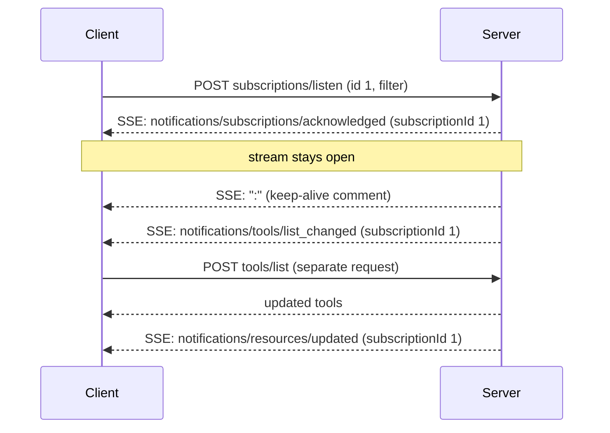
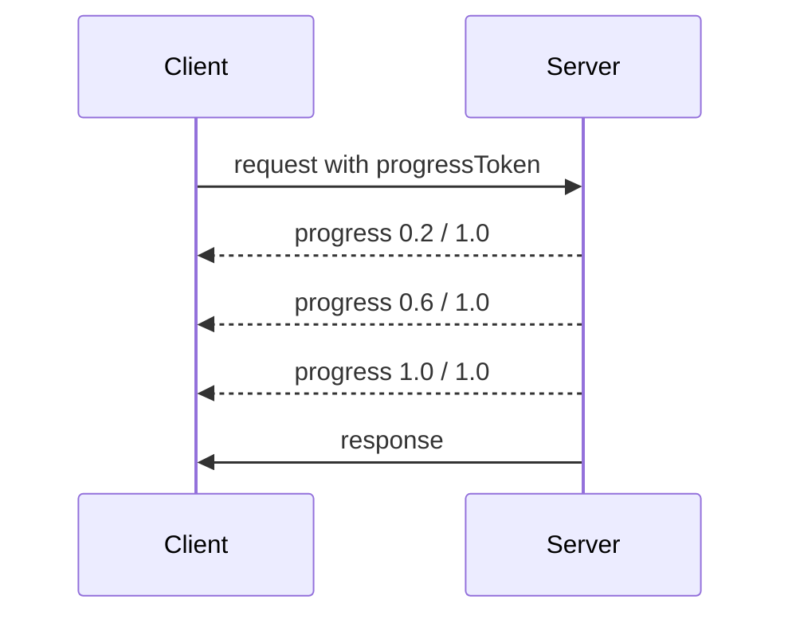
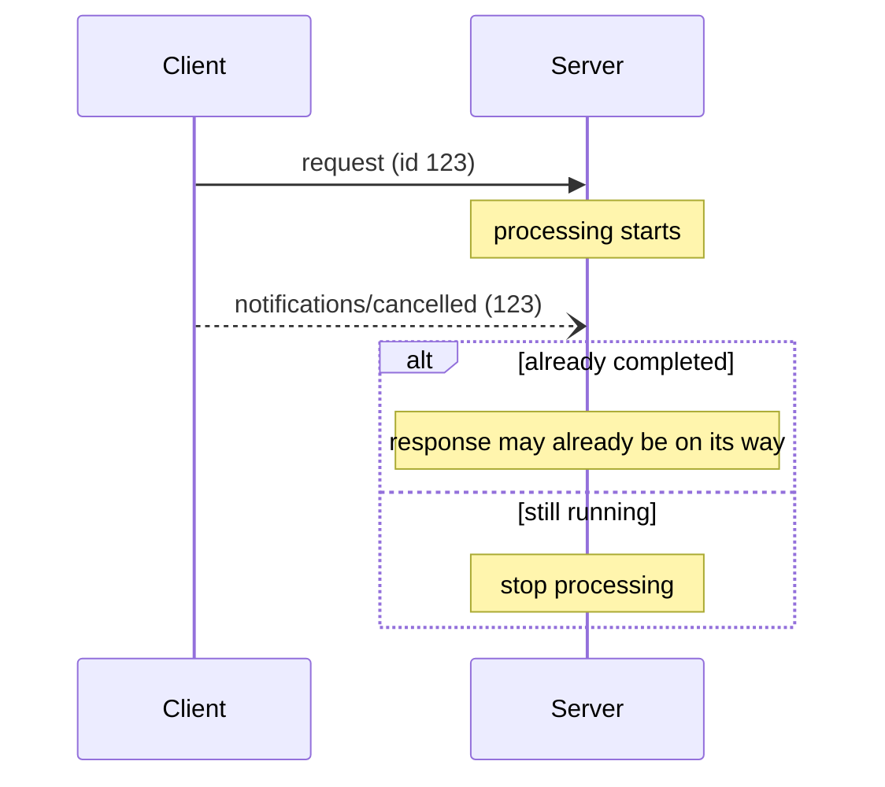

# Subscriptions, Progress & Cancellation

*Competency: **Interaction Patterns & Response Handling**.*

Three mechanisms for interactions that aren't a quick request and response: learning about **changes**
the client didn't ask about, watching **progress** on slow work, and **abandoning** work that is no
longer wanted. Each is short in the spec, and each has transport-specific details that show up in questions.

---

## Part 1: Subscriptions

### 1. The problem

A server's tool list changes when a plugin loads. A file the user is working with gets edited. The client
has no reason to ask right now, but wants to know. Something has to flow **from server to client without a
fresh request**.

In a stateless protocol where servers never initiate requests, the only option is: the **client** opens a
long-lived request, and the server uses its response stream to deliver notifications as they happen.

### 2. `subscriptions/listen`

> `subscriptions/listen` opens a long-lived notification stream from the server to the client. Unlike
> one-off requests, the stream stays open and delivers notifications until the client cancels it. It
> replaces the former `resources/subscribe` RPC and the HTTP GET endpoint.

The client names what it wants in a **`notifications` filter**:

```json
{
  "jsonrpc": "2.0",
  "id": 1,
  "method": "subscriptions/listen",
  "params": {
    "_meta": {
      "io.modelcontextprotocol/protocolVersion": "2026-07-28",
      "io.modelcontextprotocol/clientInfo": { "name": "ExampleClient", "version": "1.0.0" },
      "io.modelcontextprotocol/clientCapabilities": {}
    },
    "notifications": {
      "toolsListChanged": true,
      "resourceSubscriptions": ["file:///project/config.json"]
    }
  }
}
```

### 3. The filter

| Field | Type | Delivers |
| --- | --- | --- |
| `toolsListChanged` | boolean | `notifications/tools/list_changed` |
| `promptsListChanged` | boolean | `notifications/prompts/list_changed` |
| `resourcesListChanged` | boolean | `notifications/resources/list_changed` |
| `resourceSubscriptions` | string[] | `notifications/resources/updated` for these URIs |

All fields are optional; omitting one means not subscribing to it. The server **MUST NOT send notification
types the client didn't explicitly request**. Extensions can add their own types (the Tasks extension uses
this to push task status).

Requesting something requires the server to support it: `toolsListChanged` is meaningful only if the server's
`tools` capability has `listChanged: true`; `resourceSubscriptions` requires `resources.subscribe: true`.

### 4. Acknowledgment

The server **MUST** send **`notifications/subscriptions/acknowledged` first**, and **MUST NOT** send any
notification on the subscription before it:

```json
{
  "jsonrpc": "2.0",
  "method": "notifications/subscriptions/acknowledged",
  "params": {
    "_meta": { "io.modelcontextprotocol/subscriptionId": 1 },
    "notifications": { "toolsListChanged": true, "resourceSubscriptions": ["file:///project/config.json"] }
  }
}
```

The acknowledgment's `notifications` field is **the subset the server agreed to honor**. Unsupported types are
**omitted**. The client **SHOULD** compare it with what it asked for and handle the gaps gracefully.

On **stdio**, where every subscription shares one channel, the ordering rule applies **per subscription id**, not
per channel. Messages for *other* subscriptions may be interleaved before a new subscription's acknowledgment.

### 5. The subscription id

Every message on the stream carries **`io.modelcontextprotocol/subscriptionId`** in `_meta`, and its value is the
**JSON-RPC `id` of the `subscriptions/listen` request** that opened it. The request above used `"id": 1`, so the
acknowledgment and every later notification carry `subscriptionId: 1`:

```json
{
  "jsonrpc": "2.0",
  "method": "notifications/resources/updated",
  "params": { "_meta": { "io.modelcontextprotocol/subscriptionId": 1 }, "uri": "file:///project/config.json" }
}
```

A client **MAY** hold **several subscriptions at once** (one for tool changes, another for resource updates), and
uses `subscriptionId` to tell them apart. On **stdio**, where everything shares stdout, clients **MUST** use it to
correlate.

### 6. What is not delivered on a listen stream

**Request-scoped** notifications stay with their request:

| Notification | Travels on |
| --- | --- |
| `notifications/progress` | The response stream of the request it relates to |
| `notifications/message` (deprecated logging) | The response stream of the request that set `logLevel` |
| List-changed and resource-updated notifications | The `subscriptions/listen` stream |

### 7. How a subscription ends

| Who ends it | How |
| --- | --- |
| **Client** on Streamable HTTP | Closes the SSE stream |
| **Client** on stdio | Sends `notifications/cancelled` referencing the listen request's id |
| **Server** (e.g. shutdown) | Graceful: **SHOULD** send a successful **response** to the listen request, then close. Abrupt teardown without a response: **MUST** send `notifications/cancelled` referencing the listen id |
| **Transport** | HTTP timeout, TCP disconnect, stdio process exit |

**Graceful closure.** When the server ends a subscription itself, it **SHOULD** respond to the original
`subscriptions/listen` request with a completion result, still tagged with the subscription id:

```json
{ "jsonrpc": "2.0", "id": 1, "result": { "resultType": "complete", "_meta": { "io.modelcontextprotocol/subscriptionId": 1 } } }
```

This lets the client distinguish **"ended cleanly"** (a response arrived) from **"connection dropped"** (no response),
which the client **MAY** treat as a reason to reconnect.

!!! warning "SHOULD send a response vs. MUST send `notifications/cancelled` — two different signals"
    The spec makes two normative statements about a server ending a listen stream, on two pages:

    - **Subscriptions page:** on teardown the server **SHOULD** send a successful **response** to the
      listen request (graceful closure), then close the stream.
    - **Cancellation page:** a server **MUST** send `notifications/cancelled` referencing the listen
      request id when it tears down a subscription stream, and **MUST NOT** send
      `notifications/cancelled` for any other purpose.

    Read them together: the **completion response is the graceful path**; a server that tears the
    stream down **without** responding signals it with `notifications/cancelled` instead (a request
    that has been answered is no longer in progress, so it can't also be cancelled). For the exam:
    *graceful closure* → **SHOULD send a response**; *server-sent `notifications/cancelled`* →
    **only ever ends a listen stream**, never any other request.

On **stdio**, if the connection is terminated and re-established, the client **MUST re-send**
`subscriptions/listen`. The server holds **no subscription state** across reconnections.

!!! note "Notifications are best effort"
    Notifications can be missed, especially across reconnects. That is why list results carry `ttlMs`: clients combine
    **push** (notifications invalidate caches immediately) with **freshness** (TTL expiry triggers a re-fetch).

### 8. Keeping listen streams alive

On Streamable HTTP, a subscription stream may sit idle for long periods. Servers are encouraged to send periodic
**SSE comment lines** (starting with `:`) as keep-alives so intermediaries don't close the connection, and **SHOULD**
send `X-Accel-Buffering: no` so proxies don't buffer events. Clients must ignore comment lines.



---

## Part 2: Progress

### 9. Opting in

Progress is **optional**, and the client opts in per request by including a **`progressToken`** in `_meta`:

```json
{
  "jsonrpc": "2.0",
  "id": 1,
  "method": "tools/call",
  "params": { "name": "build_index", "arguments": {}, "_meta": { "progressToken": "abc123" } }
}
```

- The token **MUST** be a **string or integer**.
- The client chooses it by any means, but it **MUST be unique across all active requests**.

### 10. Notifications

The server **MAY** send:

```json
{
  "jsonrpc": "2.0",
  "method": "notifications/progress",
  "params": { "progressToken": "abc123", "progress": 50, "total": 100, "message": "Reticulating splines..." }
}
```

| Field | Rules |
| --- | --- |
| `progressToken` | The original token |
| `progress` | **MUST increase** with each notification, **even if `total` is unknown**; may be floating point |
| `total` | Optional; may be floating point; omit if unknown |
| `message` | Optional; **SHOULD** be human-readable progress information |

### 11. Behavior requirements

- Notifications **MUST only reference tokens** from an **active** request with an **in-progress** operation.
- A server receiving a token **MAY** send no notifications at all, **MAY** choose any frequency, and **MAY** omit `total`.
- Both sides **SHOULD** track active tokens and **SHOULD rate limit** to prevent flooding.
- Progress notifications **MUST stop after completion**.

Progress is **request-scoped**: on Streamable HTTP it travels on that request's **SSE response stream**, so a server
that wants to report progress answers with `text/event-stream` rather than a single JSON object.



!!! tip "Why `progress` must increase even without a total"
    An indeterminate operation (scanning an unknown number of files) can't report "40%". A monotonically increasing
    count (files scanned so far) still proves work is happening, which is what a client needs to decide whether to keep
    waiting (see timeouts below).

---

## Part 3: Cancellation

### 12. Cancelling a request

A client **SHOULD** signal when a request it issued should be terminated. How depends on the transport:

| Transport | Cancellation signal |
| --- | --- |
| **Streamable HTTP** | **Close the SSE response stream.** The server **MUST** treat the disconnect as cancellation. No `notifications/cancelled` is required or expected |
| **stdio** | **MUST send `notifications/cancelled`** referencing the request id (there's no per-request stream to close) |

The stdio notification:

```json
{
  "jsonrpc": "2.0",
  "method": "notifications/cancelled",
  "params": { "requestId": "123", "reason": "User requested cancellation" }
}
```

`reason` is optional and can be logged or displayed.

### 13. Behavior requirements

1. Cancellation notifications **MUST only reference** requests that the client **previously issued** and that are
   **believed to still be in progress**.
2. **Server-sent** `notifications/cancelled` **MUST reference a `subscriptions/listen`** request, to end that stream.
   Servers **MUST NOT** send it for any other purpose.
3. Servers receiving a cancellation **SHOULD**: **stop processing**, **free resources**, and **not send a response** for
   the cancelled request.
4. Servers **MAY ignore** a cancellation if the request is **unknown**, **already completed**, or **cannot be cancelled**.
5. The client **SHOULD ignore** any response to the cancelled request that arrives afterward.

Both transports' binding pages add: after cancellation, the server **MUST NOT** send any further messages for that
request.

### 14. The race condition

Networks have latency. The cancellation may arrive **after** the server finished, and even after it sent the response.



Both sides **MUST handle these races gracefully**. That is why:

- servers may ignore cancellations for completed or unknown requests,
- clients ignore late responses,
- **invalid cancellations SHOULD be ignored**: unknown ids, completed requests, malformed notifications. This preserves
  the "fire and forget" nature of notifications.

Implementations **SHOULD** log cancellation reasons, and application UIs **SHOULD** indicate that cancellation was
requested.

!!! warning "Cancellation doesn't undo side effects"
    If a tool had already charged a card or sent an email when the cancellation arrived, stopping processing doesn't
    reverse it. Cancellation is **cooperative and best effort**. Servers with irreversible steps should make that clear,
    and hosts should confirm before starting them, not rely on cancelling them.

### 15. Timeouts

Implementations **SHOULD** set **timeouts for all sent requests**, to prevent hung connections and resource exhaustion.
When a timeout expires, the sender **SHOULD cancel** the request and stop waiting, which on Streamable HTTP means
closing the stream and on stdio means sending `notifications/cancelled`.

- SDKs and middleware **SHOULD** allow timeouts to be configured **per request**.
- Implementations **MAY reset the timeout clock** when a **progress notification** arrives for the request, since it shows
  work is happening.
- They **SHOULD always enforce a maximum timeout** regardless of progress, to limit the damage from a misbehaving peer
  that sends progress forever.

Combining the two gives a sensible policy: *"Give up after 30 seconds of silence, or 10 minutes total, whichever comes
first."*

### 16. When a response stream breaks

Streams are **not resumable** in `2026-07-28` (no `Last-Event-ID`). If a Streamable HTTP response stream breaks, the
in-flight request is **lost**, and the client **MUST re-issue it as a new request with a new id**.

Re-issuing means **executing again**. That makes the retry safe only if the operation is safe to repeat. For tools
with side effects, **idempotency** matters: servers should design operations (or accept idempotency keys as arguments)
so a retried call doesn't double-charge or double-send. The `idempotentHint` annotation lets a trusted server signal
this.

For operations that must survive disconnects, the **Tasks extension** gives a **durable handle** the client can poll
after reconnecting.

---

## Recap

**Subscriptions**

- **`subscriptions/listen`** replaces `resources/subscribe` and the HTTP GET stream.
- Filter: `toolsListChanged`, `promptsListChanged`, `resourcesListChanged`, `resourceSubscriptions` (URIs). Server
  **MUST NOT** send unrequested types.
- **Acknowledgment first** (the honored subset); **every** message carries **`subscriptionId` = the listen request's
  JSON-RPC id**; stdio clients **MUST** correlate by it.
- `progress` and `message` notifications stay on **their own request's** stream.
- Ends by: client closing the stream (HTTP) or sending `notifications/cancelled` (stdio); server sending a completion
  **response** (graceful, SHOULD) or `notifications/cancelled` (teardown without a response, MUST); transport loss.
  stdio reconnect → **re-send listen**. Notifications are best effort.

**Progress**

- Client opts in with **`progressToken`** (string or int, unique among active requests) in `_meta`.
- `notifications/progress` with **increasing `progress`**, optional `total` and `message`; stops after completion;
  rate-limited.

**Cancellation**

- HTTP: **close the response stream**. stdio: **`notifications/cancelled`** with `requestId`.
- Servers **SHOULD** stop, free resources, not respond; **MAY** ignore unknown or completed requests. Clients ignore late
  responses. Server-sent `notifications/cancelled` **only** ends a listen stream.
- **Timeouts** on all requests; progress may reset the clock, but always enforce a **maximum**.
- Broken stream → request lost → **re-issue with a new id**. Mind idempotency.
