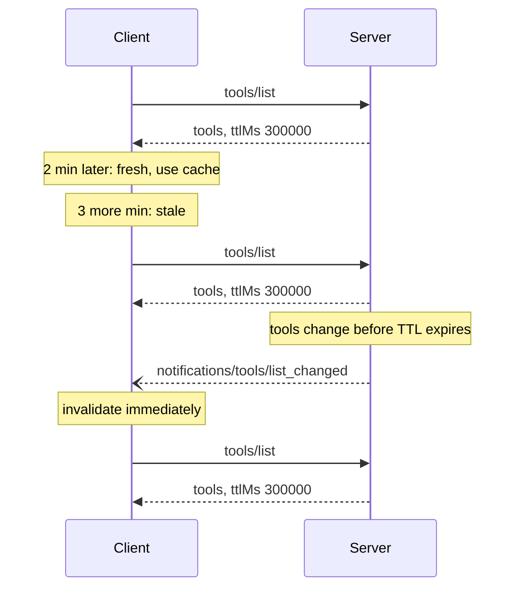
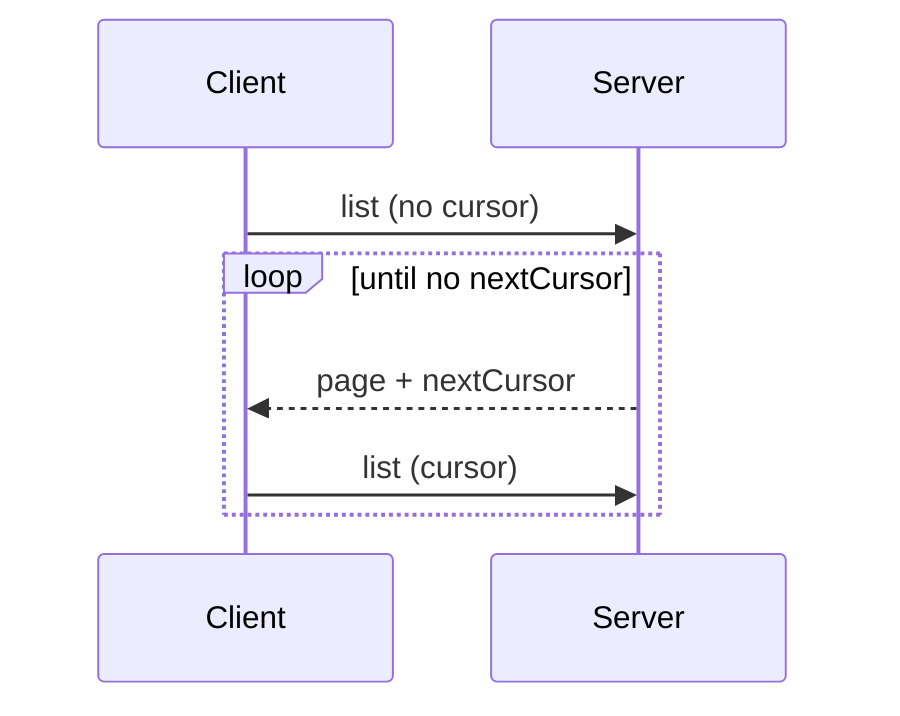

# Caching, Pagination & Completion

*Competency: **Protocol Primitives**.*

Three utilities that make MCP efficient at scale. **Caching** avoids re-fetching data that hasn't
changed. **Pagination** avoids fetching everything at once. **Completion** helps users fill in
arguments. Caching is new in `2026-07-28` and the most detailed of the three.

---

## Part 1: Caching <span class="new-2026">2026</span>

### 1. Why caching was added

A host connected to twenty servers wants each server's tool list. Tool lists rarely change. Without
guidance, clients either **poll** constantly (wasteful for everyone), or cache for an **arbitrary** time
(risking staleness), or rely purely on `list_changed` notifications (which require holding a stream open
and can be missed).

`2026-07-28` lets the **server**, which knows how volatile its data is, tell the client **how long a
result stays fresh** and **who may share it**.

### 2. Which results carry hints

Servers **MUST** include caching hints on results with `resultType: "complete"` from:

| Operation | Cacheable |
| --- | --- |
| `server/discover` | ✅ |
| `tools/list` | ✅ |
| `prompts/list` | ✅ |
| `resources/list` | ✅ |
| `resources/templates/list` | ✅ |
| `resources/read` | ✅ |
| `tools/call`, `prompts/get`, `completion/complete`… | ❌ not covered |

**Interim `input_required` results are not cacheable** and carry no hints.

### 3. The two fields

```json
{ "resultType": "complete", "tools": [ ], "ttlMs": 300000, "cacheScope": "public" }
```

#### `ttlMs`: freshness

An integer, in **milliseconds**: how long the client **MAY** consider the result **fresh**. The semantics
are analogous to HTTP **`Cache-Control: max-age`**.

| Value | Client behavior |
| --- | --- |
| **positive** | **SHOULD** consider fresh for that many ms after receipt |
| **`0`** | **SHOULD** consider **immediately stale**; MAY re-fetch every time |
| **absent** | **SHOULD** assume **`0`** and use its own heuristics or notifications (only expected from older servers) |
| **negative** | **SHOULD ignore** and treat as `0` |

Servers **MUST** provide `ttlMs >= 0`.

**Freshness calculation.** The client records `t_received` when the response arrives. The result is fresh while:

```text
now < t_received + ttlMs
```

Worked example: `tools/list` received at 10:00:00.000 with `ttlMs: 300000` (5 minutes).

| Time | Needs tools? | Fresh? | Action |
| --- | --- | --- | --- |
| 10:02:00 | yes | yes (120 s < 300 s) | Use cache |
| 10:04:59 | yes | yes | Use cache |
| 10:05:01 | yes | **no** | Re-fetch |
| 10:03:00 | `list_changed` arrives | — | **Invalidate immediately** |

!!! note "TTL is a hint, not a guarantee"
    *"TTL is a freshness hint, not a guarantee."* The server may change the data before the TTL expires. TTL tells the
    client how long it can reasonably avoid re-fetching, not how long the data will stay unchanged.

**TTL is not a polling interval.** Clients **SHOULD NOT** treat it as a timer for automatic background refetches. The
model is: check freshness **when you need the data**, and re-fetch only if stale. Implementations that do poll **MUST
apply jitter and backoff**, so thousands of clients don't hit the server in synchronized waves.

**Re-fetching early and serving stale:**

- Clients **MAY re-fetch before expiry** if they have reason to believe data changed, for example a tool call failing
  with "method not found" or invalid params.
- Clients **MAY serve stale results** if re-fetching fails (network error, server down).

#### `cacheScope`: who may reuse it

Analogous to HTTP **`Cache-Control: public` / `private`**:

| Value | Meaning |
| --- | --- |
| **`"public"`** | Contains **no user-specific data**. Any client, **shared gateway** or **caching proxy** **MAY** store and serve it **to any user** |
| **`"private"`** | Contains data **not to be shared between callers**. **MAY** be reused only for the **same authorization context**. Caches **MUST NOT** be shared across authorization contexts: a **different access token requires a different cache** |

**Choosing a scope:**

- `"public"`: tool, prompt and template lists **identical for all users**.
- `"private"`: `resources/read` results that **depend on the authenticated user**, and list results **filtered per user**
  (for example, a `tools/list` that varies by the caller's scopes).

### 4. Cache keys

A cached response is identified by the **method** plus the **request parameters that affect the result**: the `uri` for
`resources/read`, the `cursor` for a paginated list. Clients **MUST NOT** serve a cached response for a request whose method
or parameters differ.

Results from **MRTR retries** (requests carrying `inputResponses` or `requestState`) **MUST NOT be cached**. They depend on
inputs that aren't part of the key.

### 5. Caching and notifications work together

- A server **MAY** provide `ttlMs` **without** `listChanged: true`. The client relies purely on TTL.
- A server **MAY** provide **both**. The client avoids refetches between notifications, and a notification acts as an
  **immediate invalidation**.
- A relevant notification arriving while a cached result is still fresh **invalidates it**; treat it as immediately stale.



### 6. Caching and pagination

Each **page** is an **independently cacheable** response, like HTTP treats paginated resources:

- Each page has **its own `ttlMs`**, with its own clock starting when that page arrived. Servers **MAY** use different TTLs
  per page.
- When a cached page expires, re-fetch **that page** with its cursor.
- **No cross-page consistency guarantee.** If data changes between pages you may see duplicates or gaps. Clients needing a
  **consistent snapshot SHOULD re-fetch from the beginning** (no cursor).
- If a cursor becomes **invalid**, **discard all cached pages** and re-fetch from the start.
- Servers **MUST** apply the **same `cacheScope` to every page** of a given list.

### 7. Security

`cacheScope: "public"` means **shareable across users**, even when the result came from an **authenticated** endpoint.
An authenticated `tools/list` marked `public` may be cached by a gateway and served to requests with **different access
tokens**.

So servers:

- **should** make sure `cacheScope` truly reflects the data's visibility, and
- **MUST apply per-primitive access controls** and **MUST NOT rely on `cacheScope` alone** to prevent unauthorized access.

The failure mode to recognize: a server filters `tools/list` by the caller's scopes (an admin sees `delete_user`; a normal
user doesn't) but marks the result `public`. A shared cache serves the admin's list to a normal user. The user now *sees*
`delete_user`. If the server also enforces access control on `tools/call`, the call is still refused; if it trusted the
list as the security boundary, it is not. That is why both rules exist.

---

## Part 2: Pagination

### 8. The model

MCP uses **opaque cursor-based** pagination, not page numbers.

- The **cursor** is an **opaque string** representing a position in the result set.
- **Page size is determined by the server.** Clients **MUST NOT** assume a fixed page size.

### 9. The flow

The first request has no cursor. The response includes a page and, if more exists, `nextCursor`:

```json
{ "jsonrpc": "2.0", "id": "123", "result": { "resultType": "complete", "resources": [ ],
  "nextCursor": "cGFnZT0z", "ttlMs": 300000, "cacheScope": "public" } }
```

The client continues by passing that cursor:

```json
{ "jsonrpc": "2.0", "id": "124", "method": "resources/list", "params": { "cursor": "cGFnZT0z" } }
```



### 10. Which operations paginate

- `tools/list`
- `resources/list`
- `resources/templates/list`
- `prompts/list`

(Extensions add their own, such as the Skills extension's `skills/list`.)

### 11. Rules

**Servers SHOULD:**

- provide **stable** cursors,
- handle **invalid cursors gracefully**: an invalid cursor **SHOULD** produce **`-32602`** (Invalid params).

**Clients SHOULD:**

- treat a **missing `nextCursor`** as the **end** of results,
- support both paginated and non-paginated flows.

**Clients MUST treat cursors as opaque:**

- make no assumptions about format,
- **not parse or modify** them,
- make no determination from the value **other than whether a non-null value was provided**.

That last rule has a sharp consequence the spec spells out: **an empty string is a valid cursor**, and **MUST NOT** be
treated as the end of results. Only an **absent** `nextCursor` means "done".

!!! tip "Why opaque cursors"
    A cursor like `cGFnZT0z` decodes to `page=3`, and it is tempting to decode it and jump to page 7. Opaqueness
    lets the server change its implementation (switching from offsets to keyset pagination) without breaking clients, and stops
    clients from forging positions. It is the same principle as `requestState`.

---

## Part 3: Completion

### 12. What it's for

> The Model Context Protocol provides a standardized way for servers to offer autocompletion suggestions for the arguments of
> prompts and resource templates.

Completion is for **users** filling in arguments, IDE-style: a dropdown of suggestions as they type. It helps them discover
valid values without knowing the exact format.

### 13. Capability

```json
{ "capabilities": { "completions": {} } }
```

### 14. `completion/complete`

The request says **what** is being completed (a reference) and **the argument so far**:

```json
{
  "jsonrpc": "2.0",
  "id": 1,
  "method": "completion/complete",
  "params": {
    "ref": { "type": "ref/prompt", "name": "code_review" },
    "argument": { "name": "language", "value": "py" }
  }
}
```

```json
{
  "jsonrpc": "2.0",
  "id": 1,
  "result": { "resultType": "complete", "completion": { "values": ["python", "pytorch", "pyside"], "total": 10, "hasMore": true } }
}
```

### 15. Reference types

| Type | References | Example |
| --- | --- | --- |
| `ref/prompt` | A prompt, by **name** | `{"type": "ref/prompt", "name": "code_review"}` |
| `ref/resource` | A resource **URI or URI template** | `{"type": "ref/resource", "uri": "file:///{path}"}` |

Completion applies to **prompt arguments** and **resource template parameters**, **not** to tool arguments. Tool arguments are
filled by the model, not typed by a user.

### 16. Multi-argument context

When a prompt or template has several arguments, later suggestions often depend on earlier choices. Clients **should include
already-resolved arguments** in `context.arguments`:

```json
{
  "method": "completion/complete",
  "params": {
    "ref": { "type": "ref/prompt", "name": "code_review" },
    "argument": { "name": "framework", "value": "fla" },
    "context": { "arguments": { "language": "python" } }
  }
}
```

```json
{ "resultType": "complete", "completion": { "values": ["flask"], "total": 1, "hasMore": false } }
```

Knowing `language` is `python` lets the server suggest `flask` rather than some unrelated framework beginning with "fla".

### 17. Result rules

- `values` ranked by **relevance**, **maximum 100** items per response
- optional `total` (all available matches)
- `hasMore` indicates additional results

### 18. Errors, implementation, security

| Case | Code |
| --- | --- |
| Capability not supported | `-32601` |
| Invalid prompt name | `-32602` |
| Missing required arguments | `-32602` |
| Internal error | `-32603` |

Servers **SHOULD** sort by relevance, fuzzy-match where appropriate, **rate limit**, and validate inputs. Clients **SHOULD**
**debounce** rapid requests (don't send one per keystroke), cache results where appropriate, and handle partial results.

Implementations **MUST**: validate inputs, **rate limit**, **control access to sensitive suggestions**, and **prevent
completion-based information disclosure**.

That last one is a real risk. Completion is effectively a **search oracle**. A `ref/resource` for `customers://{name}` that
completes "Jo" to every matching customer name leaks the customer list to anyone who can call it, even without read access
to the resources.

---

## Recap

**Caching**

- **Required** on complete results of `server/discover`, `tools/list`, `prompts/list`, `resources/list`,
  `resources/templates/list`, `resources/read`. **Not** on `input_required` results or MRTR retry results.
- **`ttlMs`** (ms, like `max-age`): fresh while `now < t_received + ttlMs`; `0` or absent or negative = stale. Hint, not
  guarantee. **Not a polling interval**; if polling, **jitter and backoff**.
- **`cacheScope`**: `public` (shareable across users and gateways) or `private` (**same authorization context only; different
  token → different cache**).
- Notifications **invalidate** fresh caches. Each page caches independently; **same scope on all pages**; invalid cursor → drop
  all pages.
- Never rely on `cacheScope` for access control.

**Pagination**

- **Opaque cursors**; server decides page size; missing `nextCursor` = end; **empty string is a valid cursor**; invalid cursor →
  **`-32602`**.
- Paginated: `tools/list`, `resources/list`, `resources/templates/list`, `prompts/list`.

**Completion**

- `completions` capability; `completion/complete` with **`ref/prompt`** or **`ref/resource`**, `argument`, optional
  `context.arguments`.
- Up to **100** values, `total`, `hasMore`. For **prompt and template arguments**, not tools.
- Debounce, rate limit, and **prevent information disclosure**.
