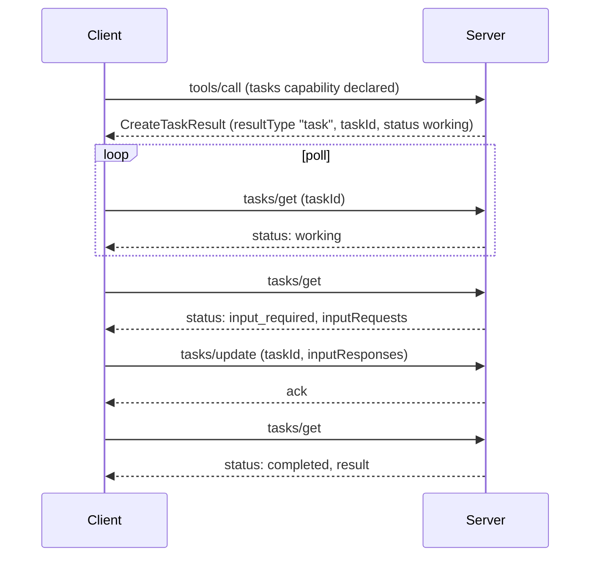

# Extensions

*Competency: **Ecosystem & Portability**.*

The core protocol is deliberately minimal. **Extensions** add capabilities that are modular, specialized or
experimental, without making every client and server implement them. In `2026-07-28`, several significant
capabilities live here: **Tasks** (moved out of the core), **MCP Apps**, **Skills**, and two **authorization**
extensions.

---

## Part 1: How extensions work

### 1. What an extension is

> MCP extensions are optional additions to the specification that define capabilities beyond the core protocol.
> Extensions enable functionality that may be **modular** (e.g., distinct features like authentication), **specialized**
> (e.g., industry-specific logic), or **experimental** (e.g., features being incubated for potential core inclusion).

The specification's overview adds that extensions are **always opt-in** and require **explicit support from both client
and server**, negotiated through capabilities. SDKs keep them **disabled by default**; developers must opt in explicitly.

### 2. Identifiers

Format: **`{vendor-prefix}/{extension-name}`**, following the `_meta` key naming rules with a **mandatory** prefix.

| Identifier | Extension |
| --- | --- |
| `io.modelcontextprotocol/tasks` | Tasks |
| `io.modelcontextprotocol/ui` | MCP Apps |
| `io.modelcontextprotocol/skills` | Skills over MCP |
| `io.modelcontextprotocol/oauth-client-credentials` | OAuth Client Credentials |
| `io.modelcontextprotocol/enterprise-managed-authorization` | Enterprise-Managed Authorization |

- **Official** extensions use **`io.modelcontextprotocol/`**.
- **Third-party** extensions use a **reversed domain the author owns**: a company owning `example.com` uses `com.example/my-extension`.

### 3. Negotiation

**Clients** declare extensions in `_meta["io.modelcontextprotocol/clientCapabilities"].extensions` **on each request**:

```json
"_meta": {
  "io.modelcontextprotocol/protocolVersion": "2026-07-28",
  "io.modelcontextprotocol/clientCapabilities": {
    "extensions": {
      "io.modelcontextprotocol/ui": { "mimeTypes": ["text/html;profile=mcp-app"] }
    }
  }
}
```

**Servers** declare them in the **`server/discover`** response:

```json
"capabilities": {
  "tools": {},
  "extensions": { "io.modelcontextprotocol/ui": {} }
}
```

Each extension defines the schema of its **settings object**; **an empty object means supported with no settings**.

### 4. Graceful degradation

If only one side supports an extension, the supporting side **MUST** either:

- **fall back to core protocol behavior**, or
- **reject the request with an appropriate error**, if the extension is mandatory for it.

Extensions **SHOULD document** their fallback. Examples from the docs: a server offering UI-enhanced tools should still return
meaningful **text content** to clients without the UI extension; a server requiring a specific authentication extension can reject
clients that don't support it.

### 5. Where extensions live and how they're created

- **Official** extensions live in repositories prefixed **`ext-`** in the MCP GitHub organization (`ext-auth`, `ext-apps`, `ext-skills`,
  `ext-tasks`).
- **Experimental** extensions live in **`experimental-ext-`** repositories, must belong to a **Working Group or Interest Group**, must
  clearly state their experimental status, and remain under Core Maintainer oversight.

**Lifecycle for official extensions** (SEP-2133):

1. **Propose**: a SEP of type **Extensions Track**.
2. **Implement**: at least one **reference implementation in an official SDK**, required **before** review.
3. **Review**: Core Maintainers have final authority.
4. **Publish**: PR into the extension repository.
5. **Adopt**: other clients, servers and SDKs implement it.

Requirements: RFC 2119 language, and an associated working or interest group. An experimental extension **graduates** by going through
the same Extensions Track SEP process.

### 6. Evolution and breaking changes

Extensions **evolve independently** of the core, managed by their repository maintainers without core review for routine updates.

Backward compatibility still matters: prefer **capability flags or versioning inside the settings object**. If a breaking change is
unavoidable, use a **new identifier**, such as `io.modelcontextprotocol/my-extension-v2`.

A **breaking change** includes: removing or renaming fields, changing field types, altering existing semantics, or **adding new required fields**.

### 7. SDK support

SDKs **may** implement extensions; it's **not required for protocol conformance**, and SDK tier requirements exclude experimental features
and extensions such as Tasks and MCP Apps. SDKs that support extensions should document which.

---

## Part 2: Tasks

### 8. Why Tasks exist

Some operations take seconds, minutes or longer: CI pipelines, batch processing, human approvals. Blocking a request until they finish
fails for several reasons:

| Problem with blocking | What Tasks provide |
| --- | --- |
| Long-lived connections; clients and intermediaries time out | **No long-lived connection**: return a handle immediately |
| Disconnect loses the request (streams aren't resumable) | **Crash resilience**: a durable `taskId` survives disconnects and restarts |
| No visibility into what's happening | **Status metadata**: `working`, `input_required`, `completed`, `failed`, `cancelled` |
| Mid-operation input needs extra channels | **Mid-flight interaction** via `tasks/update` |
| Per-tool setup | **Server-directed**: the server decides per request whether to create a task |

Tasks were **experimental in the core** in `2025-11-25` and **moved into this extension** in `2026-07-28` (SEP-2663), redesigned in the
process.

### 9. How Tasks work

1. **Negotiate.** The client includes `io.modelcontextprotocol/tasks` in its per-request capabilities; the server advertises it in
   `server/discover`.
2. **Create.** For a supported request (e.g. `tools/call`) the server returns a **`CreateTaskResult`** with **`resultType: "task"`**,
   containing a `taskId`, initial status, **`ttlMs`** and a suggested **`pollIntervalMs`**. The task is **durably created before** the response
   is sent.
3. **Poll.** The client calls **`tasks/get`** with the `taskId`, respecting `pollIntervalMs`.
4. **Mid-flight input.** If status becomes `input_required`, the `tasks/get` response includes an **`inputRequests`** map; the client answers
   with **`tasks/update`** carrying `inputResponses`.
5. **Complete.** On `completed`, `result` holds **what the original request would have returned synchronously**. On `failed`, `error` holds the
   JSON-RPC error.
6. **Cancel.** **`tasks/cancel`** at any time. Cancellation is **cooperative**: acknowledged, but the task may still reach a non-cancelled
   terminal state.



### 10. Lifecycle states

| Status | Meaning | Terminal? |
| --- | --- | --- |
| `working` | In progress | No |
| `input_required` | Needs client input (see `inputRequests`) | No |
| `completed` | Done; `result` has the output | **Yes** |
| `failed` | JSON-RPC error; `error` has details | **Yes** |
| `cancelled` | Cancelled (not always honored) | **Yes** |

Terminal states never change.

### 11. Notifications instead of polling

Servers can push **`notifications/tasks`** carrying the **full task state**, which clients opt into through **`subscriptions/listen`**. Polling is
the default; clients may rely on notifications when the server supports them.

### 12. Obligations

**Clients:** declare support; handle **polymorphic results** (a normal result **or** `resultType: "task"`); poll until terminal; handle
`input_required` via `tasks/update`; **persist task IDs durably** so polling resumes after a crash.

**Servers:** advertise support; **check the client declared the extension on that request** and **never return a task otherwise**; create tasks
durably before responding; serve `tasks/get` (with `result` or `error` on terminal states); accept `tasks/update` and **ignore** responses for unknown
or already-satisfied keys; acknowledge `tasks/cancel`.

### 13. Differences from the legacy core tasks

| `2025-11-25` experimental core | `2026-07-28` extension |
| --- | --- |
| Blocking `tasks/result` | **Polling** with `tasks/get` |
| No client-to-server input method | **`tasks/update`** for mid-flight input |
| `tasks/list` | **Removed** |
| Per-request opt-in required | Servers may return task handles **unsolicited** once the client has the capability |

**Good fits:** long-running jobs, human approval gates, wrapping external job systems that already have job IDs, unreliable (e.g. mobile) connections,
batch processing where partial progress matters.

---

## Part 3: MCP Apps

### 14. What they are

**MCP Apps** (`io.modelcontextprotocol/ui`) let servers return **interactive HTML interfaces** (charts, forms, dashboards, viewers) that render
**inside the conversation**.

**Why not a separate web app?**

- **Context preservation**: the UI lives beside the conversation that produced it.
- **Bidirectional data flow**: the app can call the server's tools, and the host can push fresh results, with no separate API or auth.
- **Host capability integration**: the app can ask the host to do things through the user's already-connected capabilities, with consent.
- **Security guarantees**: a **sandboxed iframe** controlled by the host.

### 15. How they work

1. **UI preloading.** A tool's description includes **`_meta.ui.resourceUri`** pointing to a **`ui://` resource**. The host can preload it before the
   tool is called.
2. **Resource fetch.** The host reads the resource: an HTML page, usually bundling its JS and CSS. External origins must be declared in **`_meta.ui.csp`**.
3. **Sandboxed rendering.** The HTML runs in a **sandboxed iframe**. `_meta.ui` can request **`permissions`** (camera, microphone) and set **`csp`**.
4. **Communication.** App and host talk over **`postMessage`** using a JSON-RPC **dialect of MCP**: some messages shared with core (`tools/call`), some
   similar (`ui/initialize`), most new with a **`ui/`** prefix. The app can request tool calls, send messages, update the model's context and receive data.

The sandbox prevents the app from touching the parent DOM, reading host cookies or storage, navigating the parent page, or running scripts in the parent
context. The **host decides** which capabilities the app gets, such as restricting which tools it can call or disabling link opening.

Client MIME type for app content: **`text/html;profile=mcp-app`**.

**Good fits:** exploring complex data, many-option configuration, rich media viewing, real-time monitoring, multi-step review workflows.

**Fallback:** servers should still return meaningful **text** for hosts without the extension.

Support includes Claude, Claude Desktop, VS Code GitHub Copilot, Microsoft 365 Copilot, Goose, Postman, MCPJam, ChatGPT and Cursor, per the extension support
matrix. The `@modelcontextprotocol/ext-apps` package provides an optional `App` class; hosts can use `@mcp-ui/client` or the SDK's **App Bridge**.

---

## Part 4: Skills over MCP

### 16. What they are

**Skills over MCP** (`io.modelcontextprotocol/skills`) lets servers expose **Agent Skills**: directories containing a **`SKILL.md`** (YAML frontmatter with
`name` and `description`, then instructions) and optional supporting files, following the Agent Skills specification. Skills package **reusable workflows**
that combine tools with instructions and references (code review checklists, document processing procedures) and keep them **with the service** they describe.

### 17. Protocol

**Capabilities:** servers **MUST** declare both **`resources`** and the extension. Optional setting **`directoryRead`** (default `false`).

| Method | Purpose |
| --- | --- |
| **`skills/list`** | Catalog: each entry has `uri` (of `SKILL.md`), full `frontmatter`, and a **`resources` manifest** (each file's URI, **SHA-256 digest**, size), or `"dynamic"` |
| **`skills/get`** | One entry by URI; servers **MUST** answer for every skill they serve, listed or not |
| **`resources/read`** | Read `SKILL.md` and supporting files |
| **`resources/directory/read`** | List direct children of a directory, only if `directoryRead: true` |

Servers **SHOULD** use the `skill://` scheme; hosts **MUST NOT** identify skills by scheme alone. Skill identity = **originating server + URI** (names aren't
unique). Servers **SHOULD NOT** exceed **512 files or 16 MiB per skill**.

**Reading `SKILL.md` does not activate a skill.** Loading goes through the host's skill-loading path, which verifies content and applies approval.

### 18. Integrity and security

Hosts **MUST**:

- restrict file reads to URIs in the **retained manifest**;
- **verify each file's size and SHA-256 digest** before use, and compare `SKILL.md` frontmatter field by field;
- **not use** content failing verification (refresh the entry with `skills/get`);
- **bind persisted approval to the full set of URIs and digests**, so any changed, added or removed file **revokes approval**;
- **not retrieve files ahead of need**;
- prevent same-name skills from **silently replacing** each other;
- **tag content with its originating server**; cross-server reads need explicit per-call approval naming both servers;
- treat skill content as **untrusted**: host-side code execution and permission grants (such as `allowed-tools`) require **explicit per-skill approval**;
- obtain **fresh consent** before activating a nested skill.

Digests establish **consistency with the manifest**, not trust in the content. For `"dynamic"` skills, hosts **MAY decline**, and approval never covers arbitrary
future content.

---

## Part 5: Authorization extensions

Covered fully in [Authorization](../domain-4/authorization.md#12-authorization-extensions). In brief:

| Extension | For | Mechanism |
| --- | --- | --- |
| **OAuth Client Credentials** | Machine-to-machine: services, CI/CD, daemons | `client_credentials` grant; **JWT bearer assertions** (RFC 7523) recommended over client secrets |
| **Enterprise-Managed Authorization** | Employees under corporate policy | Enterprise IdP issues an **ID-JAG** after evaluating policy; exchanged for an MCP access token; central revocation and audit |

Both are **opt-in** and require explicit client support.

---

## Part 6: Support matrix

Extension support varies by host and is tracked in the community-maintained
[extension support matrix](https://modelcontextprotocol.io/extensions/client-matrix). At the time of writing, **MCP Apps** has the broadest support; the
authorization extensions and Skills have narrower, sometimes partial, support. **Always design for fallback.**

---

## Recap

- Extensions are **optional, opt-in, disabled by default**, and need **both sides**. Identifiers: **`vendor-prefix/name`**; official =
  **`io.modelcontextprotocol/`**; third-party = **reverse domain**.
- Negotiated via **`extensions`** in client capabilities (per request) and server capabilities (`server/discover`); **empty object = supported, no settings**.
- Unsupported by the peer → **fall back to core or reject**; document the fallback.
- Official repos **`ext-*`**, experimental **`experimental-ext-*`**; created via **Extensions Track SEP** with an **SDK reference implementation**; breaking
  change → **new identifier**. Not required for SDK conformance.
- **Tasks** (moved from core): `resultType: "task"`, `taskId`, `ttlMs`, `pollIntervalMs`; **`tasks/get`** polling; **`tasks/update`** for input;
  **`tasks/cancel`** (cooperative); states `working`, `input_required`, `completed`, `failed`, `cancelled`; optional `notifications/tasks` via listen; never
  return a task to a client without the capability.
- **MCP Apps** (`io.modelcontextprotocol/ui`): `ui://` resource via `_meta.ui.resourceUri`; **sandboxed iframe**; **postMessage** JSON-RPC dialect (`ui/…`);
  `csp`, `permissions`; text fallback.
- **Skills** (`io.modelcontextprotocol/skills`): `skills/list`, `skills/get`, `resources/read`; manifests with **SHA-256 digests**; approvals bound to digests;
  content untrusted; reading ≠ activating.
- **Auth extensions:** Client Credentials (M2M) and Enterprise-Managed (IdP, ID-JAG).
