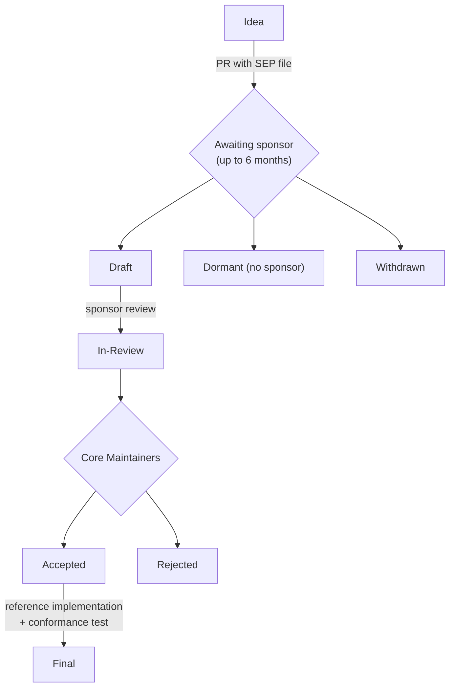

# Roles, Responsibilities & Adoption

*Competency: **Roles, Responsibilities & Adoption**.*

MCP distributes responsibilities across many parties, most of whom never coordinate. This chapter maps who owns
what, explains how the protocol itself is governed, and covers how organizations adopt MCP sensibly.

---

## Part 1: Roles and responsibilities

### 1. The roles

| Role | Who they are | Builds or operates |
| --- | --- | --- |
| **Server author** | Developer exposing a system via MCP | An MCP server (local package or remote service) |
| **Host / client developer** | Team building an AI application | The host: UI, agent loop, clients, consent |
| **Server operator** | Team running a remote server in production | Hosting, scaling, authorization, monitoring |
| **Authorization server operator** | Identity team or IdP vendor | Token issuance, client registration, policy |
| **Security / governance team** | AppSec, IT, compliance | Policies: which servers, which tools, which data, audit |
| **End user** | The person using the AI application | Consent decisions, server configuration |
| **Enterprise IdP administrator** | Corporate IT | Enterprise-Managed Authorization policy |
| **Registry publisher / aggregator** | Server maintainers; marketplaces | Publishing `server.json`; curating catalogs |
| **SDK maintainer** | Language SDK teams | Protocol implementations, conformance |
| **Spec contributor / maintainer** | MCP community | SEPs, working groups, the specification |

### 2. Who owns which responsibility

The specification assigns obligations to specific parties. Knowing the owner is how you answer "who must…" questions.

**Server authors and operators**

- **Implement `server/discover`** (MUST) and advertise every implemented capability.
- **Never initiate requests**; use `InputRequiredResult` for client input.
- **Validate all tool inputs, implement access controls, rate limit, sanitize outputs** (MUST).
- **Validate resource URIs** and **prevent directory traversal** (MUST).
- Write **clear, accurate tool descriptions** and schemas; provide `outputSchema` where useful; keep `tools/list` **deterministic**.
- Set correct **`ttlMs` and `cacheScope`**; never rely on cache scope for access control.
- **Protect `requestState`** (HMAC/AEAD, principal, TTL, request binding).
- **Bind state handles** to the authenticated user.
- For remote servers: implement **Protected Resource Metadata**, **validate token audience**, **never pass tokens through**, validate **`Origin`**, and
  reject header/body mismatches.
- For local servers: prefer **stdio**, log to **stderr**, bind HTTP to **127.0.0.1**.
- Never use **form elicitation for secrets**; verify the user in **URL-mode** flows.

**Host and client developers**

- **Enforce consent**: explicit consent before **invoking tools** and before **exposing user data** to servers.
- Keep a **human in the loop**, **show tool inputs** before calling, **confirm sensitive operations**.
- **Treat server metadata as untrusted** (annotations, descriptions) unless the server is trusted.
- **Validate tool results** before they reach the model; set **timeouts**; **log tool usage**.
- Put **required `_meta`** on every request; handle `resultType` correctly (absent → complete; unknown → invalid).
- Perform **MRTR retries** correctly (new id, exact `requestState`).
- **Disambiguate** tool names across servers.
- Implement OAuth correctly: **PKCE S256**, **`resource`** parameter, **`iss` validation**, issuer-keyed credentials, **SSRF protections**, safe URL opening.
- For one-click local installs, show the **exact command** and **sandbox**.
- Handle elicitation safely: identify the requesting server, **never pre-fetch or auto-open URLs**.

**Security and governance teams**

- Decide **which servers** may be used (allowlists, registry namespaces, internal registries).
- Define **approval policy** by risk tier.
- Enforce **least privilege** scopes and **central identity** (Enterprise-Managed Authorization).
- Require **audit logging** and trace propagation; review usage.
- Track **deprecations** (sampling, roots, logging, DCR, HTTP+SSE) and **protocol migrations**.

**End users**

- Grant or deny consent **knowingly**; review tool arguments; install servers only from trusted sources.

!!! tip "The division in one sentence"
    **Servers protect themselves and their data; hosts protect the user; authorization servers protect identity; governance teams decide what is
    allowed at all.**

---

## Part 2: How MCP itself is governed

### 3. From Anthropic to a neutral foundation

- **November 2024**: Anthropic open-sources MCP.
- **9 December 2025**: the Linux Foundation announces the **Agentic AI Foundation (AAIF)**, a **directed fund under the Linux Foundation**,
  with three founding project contributions:
    - **Model Context Protocol** (Anthropic)
    - **goose** (Block), an open-source, local-first AI agent framework built on MCP integration
    - **AGENTS.md** (OpenAI), a standard file giving AI coding agents project-specific guidance
- AAIF platinum members at formation include **Amazon Web Services, Anthropic, Block, Bloomberg, Cloudflare, Google, Microsoft and OpenAI**.

Why it matters: a protocol intended to be **vendor-neutral infrastructure** is more credible, and more widely adopted, when no single vendor controls
it. Competitors can build on it without depending on a rival's goodwill.

MCP is legally established as **Model Context Protocol a Series of LF Projects, LLC**, and follows LF Projects policies (including trademark usage).

### 4. Licensing

| Material | License |
| --- | --- |
| **Code and specifications** | **Apache License 2.0** |
| **Documentation** (excluding specifications) | **Creative Commons Attribution 4.0** |

Contributors **retain copyright** in their contributions; no copyright assignment is required. Core Maintainers may approve alternative open licenses by
exception.

### 5. Technical governance structure

A hierarchy like Python's or PyTorch's:

| Role | Scope |
| --- | --- |
| **Lead Maintainers** (BDFL) | **Final decision authority**; can veto any decision; appoint and remove Core Maintainers |
| **Core Maintainers** | **Overall project direction** and the specification; can veto Maintainer decisions by majority vote; appoint and remove Maintainers |
| **Maintainers** | Specific areas: **SDKs, documentation, Working Groups** |
| **Contributors** | Issues, pull requests, discussions |

Maintainers, Core Maintainers and Lead Maintainers together form the **MCP Steering Group**.

Principles worth knowing:

- **Membership is for individuals, not companies.** No seats are reserved for any employer.
- Maintainers at every level use **the same pull-request process** as outside contributors.
- Core Maintainers meet **every two weeks** to discuss and vote on proposals; decisions and discussions are recorded transparently.
- The current Lead Maintainers are **David Soria Parra** and **Den Delimarsky**; Justin Spahr-Summers, MCP's co-inventor, is Lead Maintainer Emeritus.

### 6. Interest Groups and Working Groups

| | **Interest Group (IG)** | **Working Group (WG)** |
| --- | --- | --- |
| Purpose | **Identify and discuss problems** | **Build concrete solutions** |
| Output | Problem statements, use cases, recommendations | **SEPs**, implementations, code |
| Duration | Ongoing while relevant | Until deliverables complete |
| Leadership | Facilitators | Leads |
| Decisions | Rough consensus, **non-binding** | **Binding** (lazy consensus → vote → escalation) |
| Example | "Security in MCP" | "Server Identity" |

Typical flow: **discuss a problem in an IG → validate it's worth solving → form or join a WG → submit a SEP → implement.**

### 7. Specification Enhancement Proposals (SEPs)

**What a SEP is:** a design document proposing a feature or process change, with rationale. SEPs are the primary mechanism for major features and the
historical record of design decisions. They live as Markdown files in the `seps/` directory of the specification repository, **numbered by their pull
request** (PR #1850 becomes SEP-1850).

**When a SEP is needed:** new features or protocol changes, **breaking changes**, governance or process changes, complex or controversial topics. **Not**
for bug fixes, typos, documentation clarifications, added examples or minor schema fixes.

**SEP types:**

| Type | For |
| --- | --- |
| **Standards Track** | A new protocol feature or interoperability standard |
| **Informational** | Design guidance without proposing a feature |
| **Process** | Changes to MCP processes |
| **Extensions Track** | A protocol **extension**; same review as Standards Track |

**Workflow and statuses:**

| Status | Meaning |
| --- | --- |
| `draft` | Has a **sponsor**; informal review |
| `in-review` | Formal Core Maintainer review |
| `accepted` | Approved; awaiting implementation and conformance |
| `rejected` | Declined |
| `withdrawn` | Author withdrew |
| `final` | Complete with implementation and conformance |
| `superseded` | Replaced by a newer SEP |
| `dormant` | **No sponsor within 6 months**; can be revived. **Not the same as rejected** |

Key rules:

- A **sponsor** (a Core Maintainer or Maintainer) champions the SEP and **updates its status**. Authors don't change status themselves.
- **Acceptance requires** a **prototype implementation** (pseudocode or a design doc is not enough), clear ecosystem benefit, and community consensus.
- **Final requires** a reference implementation and, for Standards Track SEPs with observable protocol behavior, a **conformance test** merged in the
  conformance repository. **SDK implementations are not required** for Final.
- Final SEPs are historical records; **the current specification is authoritative** if they differ.

The `2026-07-28` redesign came through this process: **SEP-2575** (stateless MCP), **SEP-2322** (MRTR), **SEP-2567** (sessionless handles), **SEP-2577**
(deprecations), **SEP-2596** (feature lifecycle), **SEP-2663** (Tasks as an extension).

### 8. The feature lifecycle

Adopted in `2026-07-28` (SEP-2596): features are **Active**, **Deprecated** (at least **12 months** before removal eligibility, or **90 days** expedited)
or **Removed**, tracked in a public **deprecated features registry**. It gives adopters a predictable migration window.

---

## Part 3: Adoption

### 9. Why organizations adopt MCP

- **Reuse:** one server per system of record, usable by every AI application.
- **Vendor neutrality:** an open, foundation-governed protocol supported by most major AI platforms.
- **Central control point:** authorization, logging and rate limiting for AI access to a system, in one place.
- **Ecosystem leverage:** existing public servers for common tools (GitHub, Sentry, Slack, databases).
- **Faster delivery:** SDKs make simple servers a few dozen lines.

### 10. A phased adoption path

| Phase | Scope | Controls to establish |
| --- | --- | --- |
| **1. Explore** | Individual developers, local stdio servers, read-only tools | Approved server list; sandboxing; no production credentials |
| **2. Pilot** | A team; a few internal remote servers | OAuth via the corporate IdP; audit logging; tool confirmation policy |
| **3. Scale** | Many teams and servers | Internal registry or subregistry; Enterprise-Managed Authorization; OpenTelemetry tracing; scope minimization |
| **4. Operate** | Business-critical workflows | Conformance testing; version pinning; deprecation tracking; incident response for AI actions |

### 11. Decisions every adopter faces

**Build or reuse a server?** Reuse vetted public servers for standard tools; build internal servers for proprietary systems.

**Local or remote?**

| Choose **local (stdio)** when | Choose **remote (Streamable HTTP)** when |
| --- | --- |
| Data lives on the user's machine (files, local git) | Data lives in a shared service |
| Single user | Many users |
| Credentials can come from the environment | Per-user authorization and audit are needed |
| Low latency, no network | Central updates without redistributing binaries |

**Which authorization model?**

| Scenario | Model |
| --- | --- |
| Local stdio server | **Environment credentials** |
| Interactive users of a remote server | **Core OAuth 2.1** |
| Background jobs, CI/CD | **OAuth Client Credentials** extension |
| Employees under corporate policy | **Enterprise-Managed Authorization** extension |

**Which primitives?** Tools for actions the model decides on; resources for context the application attaches; prompts for workflows users start.

**Which protocol version?** New implementations target **`2026-07-28`**. Organizations with legacy clients or servers plan **dual-era** support during
migration.

### 12. Migrating to `2026-07-28`

A checklist for teams with existing MCP implementations:

**Servers**

- [ ] Implement **`server/discover`**
- [ ] Read version and capabilities from **per-request `_meta`**; reject missing fields with `-32602`
- [ ] Add **`resultType`** to every result
- [ ] Replace server-initiated `elicitation/create` (and sampling, roots) with **`InputRequiredResult`**; protect `requestState`
- [ ] Remove reliance on **sessions**; move cross-call state to **explicit handles** bound to users
- [ ] Replace `resources/subscribe` and the GET stream with **`subscriptions/listen`**
- [ ] Add **`ttlMs` / `cacheScope`** to cacheable results
- [ ] Return tools in **deterministic** order
- [ ] Switch resource not-found to **`-32602`**
- [ ] Validate **`MCP-Protocol-Version` / `Mcp-Method` / `Mcp-Name`** headers; answer legacy GET/DELETE with 405
- [ ] Plan migration off **sampling, roots, logging** (provider APIs, arguments/config, stderr/OpenTelemetry)
- [ ] Move experimental **tasks** to the **Tasks extension**

**Clients**

- [ ] Send required **`_meta`** on every request, plus HTTP headers
- [ ] Handle **`input_required`** and retry correctly
- [ ] Handle `UnsupportedProtocolVersionError` and `MissingRequiredClientCapabilityError`
- [ ] Use **`subscriptions/listen`**; correlate by `subscriptionId`
- [ ] Honor **cache hints**
- [ ] Implement **era detection** if legacy servers must still work
- [ ] Prefer **CIMD** over DCR; validate **`iss`**; set `application_type` if still using DCR

---

## Recap

- **Servers** protect themselves (validation, access control, audience checks, `requestState` integrity); **hosts** protect users (consent, human in the loop,
  untrusted metadata, safe URLs); **ASes** protect identity; **governance teams** decide what is allowed.
- MCP joined the **Agentic AI Foundation**, a directed fund under the **Linux Foundation**, on **9 December 2025**, alongside **goose** and **AGENTS.md**.
- Licenses: **Apache 2.0** for code and specs; **CC-BY 4.0** for docs; no copyright assignment.
- Governance: **Lead Maintainers (BDFL) → Core Maintainers → Maintainers → Contributors**; **individuals, not companies**.
- **Interest Groups** discuss problems (non-binding); **Working Groups** build solutions (binding).
- **SEPs**: Standards Track, Informational, Process, Extensions Track; numbered by PR; need a **sponsor** and a **prototype**; **Final** needs reference implementation
  and **conformance tests**; **dormant ≠ rejected**.
- Feature lifecycle: **Active → Deprecated (≥ 12 months) → Removed**.
- Adopt in phases; choose local vs. remote, authorization model and primitives deliberately; migrate to `2026-07-28` with a checklist.
