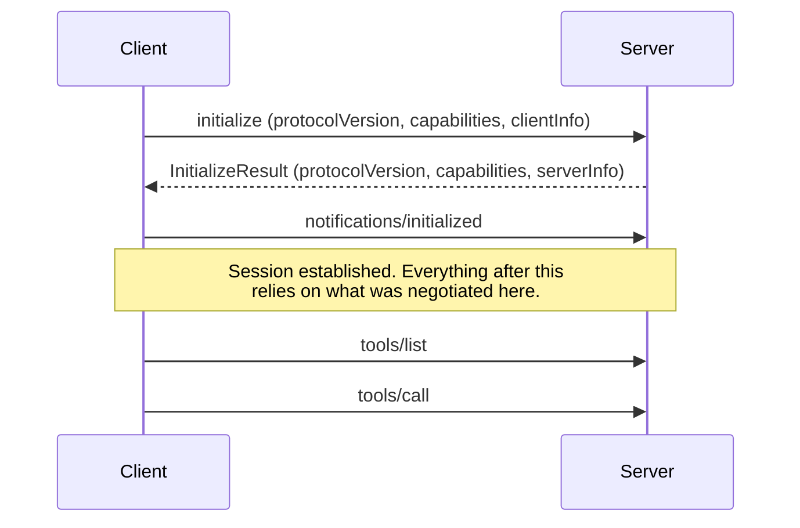
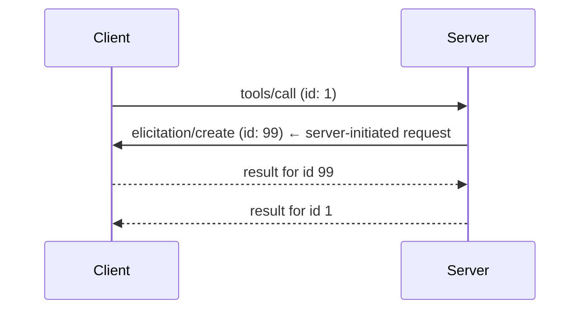
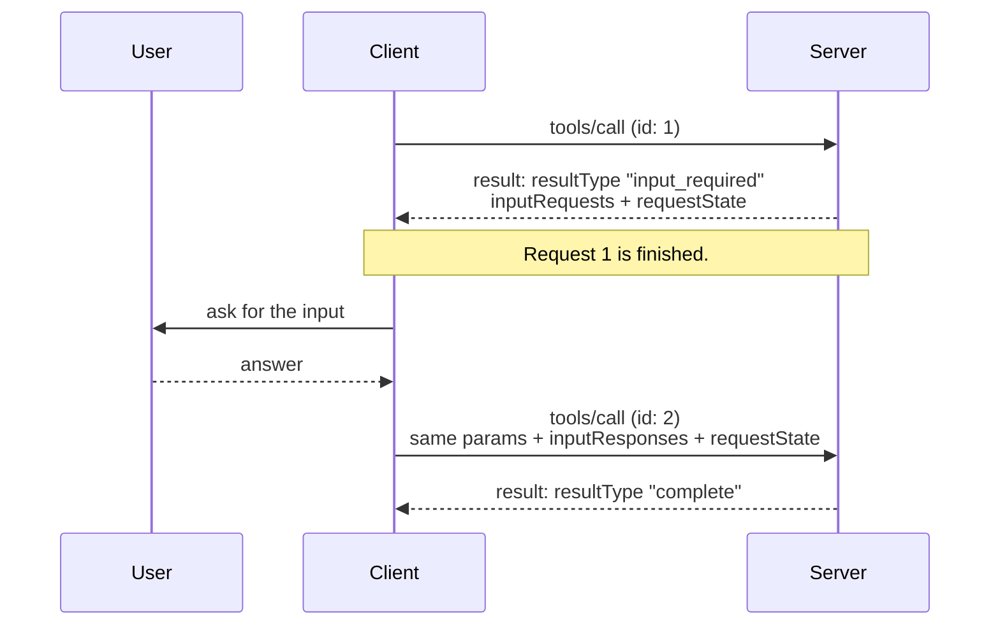

# What Changed in 2026-07-28

The exam references specification revision **`2026-07-28`**. It is the most
significant redesign MCP has had since its launch in November 2024. This page explains
what changed, **why**, and how to tell legacy from modern behavior in a question.

Read it even if you already build with MCP. The changes are not cosmetic. Several of
them reverse things that were true for the protocol's first eighteen months, and much
of the material you will find online still describes the old design.

---

## 1. The big idea: MCP became stateless

### What MCP used to look like

Until `2025-11-25`, every MCP connection started with a **handshake**:



The negotiated version and capabilities were **remembered by the connection**. Over
HTTP, the server could also mint a session ID (`Mcp-Session-Id` header), and every later
request carried it so the server could find the session state again.

That design works fine for a local server launched as a subprocess: one client, one
process, one long-lived connection. It works badly for a remote server behind a load
balancer. Consider what happens when:

- Request 1 (`initialize`) lands on server instance A.
- Request 2 (`tools/call`) lands on instance B.

Instance B has never heard of this session. You need **sticky sessions** (always route
this client to A) or a **shared session store** (Redis, a database) that every instance
consults. Both are operational pain. Sticky sessions break autoscaling and failover. A
shared store is a new dependency on every request's path.

SEP-2575 ("Make MCP Stateless"), which drove the redesign, names three problems: **scalability**
(a plain round-robin load balancer can't be used, forcing sticky sessions), **resilience** (if the
instance holding a session fails, the session is lost and the handshake must be redone), and
**implementation complexity** (servers must create, manage and garbage-collect per-client session
state, a common source of bugs and memory leaks).

### What MCP looks like now

In `2026-07-28` there is **no handshake**. Every request is self-contained:

```json
{
  "jsonrpc": "2.0",
  "id": 3,
  "method": "tools/call",
  "params": {
    "name": "get_weather",
    "arguments": { "location": "Seattle, WA" },
    "_meta": {
      "io.modelcontextprotocol/protocolVersion": "2026-07-28",
      "io.modelcontextprotocol/clientCapabilities": { "elicitation": {} },
      "io.modelcontextprotocol/clientInfo": { "name": "ExampleClient", "version": "1.0.0" }
    }
  }
}
```

The three fields that the handshake used to establish **once** now travel **on every
request**:

| Field | Required? | Replaces |
| --- | --- | --- |
| `io.modelcontextprotocol/protocolVersion` | **Yes** | `protocolVersion` in `initialize` |
| `io.modelcontextprotocol/clientCapabilities` | **Yes** | `capabilities` in `initialize` |
| `io.modelcontextprotocol/clientInfo` | SHOULD | `clientInfo` in `initialize` |

The server's identity travels the other way, in each result's `_meta` as
`io.modelcontextprotocol/serverInfo`.

Now any instance can serve any request, because everything it needs is in the request.
Load balancing is plain round-robin. Instances can come and go freely.

!!! important "The rule the spec states explicitly"
    Servers **MUST NOT** rely on prior requests over the same connection to establish
    context. An open connection (including a stdio process) **is not a conversation or
    a session**. A client may interleave unrelated requests on it.

    A request missing a required `_meta` field is **malformed**. The server **MUST**
    reject it with `-32602` (Invalid params), and on HTTP with `400 Bad Request`.

### How servers still keep state

Some things genuinely need state: a shopping cart, an open browser session, a database
transaction. Statelessness does not forbid state. It forbids **implicit, connection-bound**
state.

The pattern is an **explicit handle**. A creation tool returns an ID, and later calls
pass it back as an ordinary argument:

```jsonc
// → tools/call  create_basket  {}
// ← result      { "structuredContent": { "basket_id": "bsk_a1b2c3" } }

// → tools/call  add_item  { "basket_id": "bsk_a1b2c3", "sku": "..." }
```

The model carries `basket_id` forward. The server stores the cart under that key. This
creates a new security concern, **state handle hijacking**, covered in
[Attacks & Mitigations](../domain-4/attacks-mitigations.md#state-handle-hijacking).

---

## 2. `server/discover` replaces the handshake's discovery role

Without `initialize`, how does a client learn what a server supports?

**`server/discover`** is a new RPC that **every server MUST implement**. It returns the
server's supported versions, capabilities, identity and optional instructions:

```json
{
  "jsonrpc": "2.0",
  "id": "discover-1",
  "result": {
    "resultType": "complete",
    "supportedVersions": ["2026-07-28"],
    "capabilities": { "tools": {}, "resources": {} },
    "_meta": {
      "io.modelcontextprotocol/serverInfo": { "name": "ExampleServer", "version": "1.0.0" }
    },
    "instructions": "This server provides weather and resource utilities.",
    "ttlMs": 3600000,
    "cacheScope": "public"
  }
}
```

The crucial difference from `initialize`: **calling `server/discover` is optional.**
Servers must implement it, but clients may skip it. A client can send `tools/call`
directly and handle an error if the version is wrong.

**Version negotiation** is now per request. If the server does not support the version a
request declares, it returns an **`UnsupportedProtocolVersionError`** (`-32022`) listing
the versions it does support, and the client retries with one of them.

!!! tip "Exam distinction"
    - `initialize` (legacy): **mandatory** first message, establishes a session.
    - `server/discover` (modern): **mandatory for servers to implement**, **optional for
      clients to call**, establishes nothing. Its result is cacheable.

---

## 3. Servers no longer send requests: Multi Round-Trip Requests

This is the change most likely to trip up experienced MCP users.

### The old way

Previously a server could send its own JSON-RPC **request** to the client, in the middle
of handling the client's request:



For the server to do this, it had to **suspend** the tool call while waiting, remember it,
and then **resume** it when the answer arrived. That is state held on a specific server
instance for an unknown amount of time, exactly what breaks horizontal scaling. It also
needed a channel for server-to-client requests. On HTTP that meant either a long-lived
SSE stream or a separate `GET` endpoint.

### The new way

Now the server **returns** instead of asking. It answers the tool call with an
**`InputRequiredResult`** describing what it needs, and the **client retries** the whole
request with the answers attached:



Request 1 is **over** when the server returns. Nothing is suspended. Anything the server
needs to remember goes into `requestState`, an opaque string the client must echo back
unchanged. The retry can land on a completely different server instance, and that
instance can finish the job from what is in the retry alone.

!!! important "The rules to memorize"
    - Servers **MUST NOT** initiate JSON-RPC requests. Clients do not send JSON-RPC responses.
    - Only **`tools/call`**, **`resources/read`** and **`prompts/get`** may return
      `InputRequiredResult`.
    - The retry **MUST** use a **new JSON-RPC `id`**.
    - The client **MUST** echo `requestState` **exactly**, and MUST NOT inspect or modify it.
    - The server **MUST** treat `requestState` as **attacker-controlled**, and protect its
      integrity (HMAC or AEAD) whenever it influences authorization or business logic.

This is the subject of a full chapter:
[Multi Round-Trip Requests & Elicitation](../domain-3/mrtr-elicitation.md).

---

## 4. Every result now has a `resultType`

Because a request can now end in two different ways (finished, or needs input), results
are **polymorphic**. Every result **MUST** carry `resultType`:

| `resultType` | Meaning |
| --- | --- |
| `"complete"` | The request finished; the result holds the final content |
| `"input_required"` | The request needs more input; the result is an `InputRequiredResult` |
| *(extension values)* | Extensions may add types, e.g. the Tasks extension's `"task"` |

Two compatibility rules:

- A client that receives a `resultType` it does not recognize **MUST** treat the result
  as **invalid**.
- A result with **no** `resultType` (from a legacy server) **MUST** be treated as
  **`"complete"`**.

---

## 5. Subscriptions replaced the GET stream and `resources/subscribe`

Change notifications ("the tool list changed", "this resource was updated") need a way to
reach the client without the client asking.

**Before:** the client opened a standalone SSE stream with **HTTP GET**, and subscribed to
individual resources with **`resources/subscribe`** / **`resources/unsubscribe`**.

**Now:** one mechanism, **`subscriptions/listen`**. It is an ordinary request whose response
is a long-lived stream. The client names exactly what it wants:

```json
{
  "method": "subscriptions/listen",
  "params": {
    "notifications": {
      "toolsListChanged": true,
      "resourceSubscriptions": ["file:///project/config.json"]
    }
  }
}
```

The server first sends `notifications/subscriptions/acknowledged` (saying which of those it
will honor), then the matching notifications. Every one of them carries
`io.modelcontextprotocol/subscriptionId`, whose value is the **JSON-RPC id of the listen
request**.

!!! note "Request-scoped notifications do not move"
    `notifications/progress` and `notifications/message` still travel on the response
    stream of the **request they relate to**, never on the `subscriptions/listen` stream.

---

## 6. Things that were removed outright

| Removed | What replaces it |
| --- | --- |
| `initialize` / `notifications/initialized` | Per-request `_meta` + optional `server/discover` |
| Protocol-level sessions, `Mcp-Session-Id` header | Stateless requests; explicit handles as tool arguments |
| HTTP `GET` stream endpoint | `subscriptions/listen` |
| `resources/subscribe`, `resources/unsubscribe` | `subscriptions/listen` with `resourceSubscriptions` |
| Server-initiated JSON-RPC requests | `InputRequiredResult` + client retry (MRTR) |
| `ping` | Nothing. Stateless requests have no connection to keep alive |
| `logging/setLevel` | Per-request `io.modelcontextprotocol/logLevel` in `_meta` |
| `notifications/roots/list_changed` | Nothing. Servers request roots when they need them |
| SSE resumability (`Last-Event-ID`, event IDs) | A broken stream loses the request; the client re-issues it with a **new id** |
| `notifications/elicitation/complete`, `elicitationId` | The client learns the outcome by retrying; servers correlate via `requestState` |
| Tasks in the core protocol | The **`io.modelcontextprotocol/tasks` extension** |

A server that speaks only `2026-07-28` and receives legacy HTTP traffic **SHOULD** answer
`GET` or `DELETE` on the endpoint with **`405 Method Not Allowed`**, and **ignore** any
`Mcp-Session-Id` or `Last-Event-ID` header.

---

## 7. Things that were deprecated

**Deprecated** means the feature still works and remains in the spec, but new
implementations **SHOULD NOT** adopt it. Under the new
[feature lifecycle policy](https://modelcontextprotocol.io/community/feature-lifecycle),
a deprecated feature stays for **at least twelve months** before it becomes *eligible* for
removal (ninety days under an expedited exception).

| Deprecated feature | Migration path | Earliest removal |
| --- | --- | --- |
| **Sampling** | Integrate directly with LLM provider APIs | First revision on or after 2027-07-28 |
| **Roots** | Pass directories/files via tool parameters, resource URIs or server configuration | First revision on or after 2027-07-28 |
| **Logging** | Log to `stderr` (stdio) or use OpenTelemetry | First revision on or after 2027-07-28 |
| **Dynamic Client Registration** (RFC 7591) | **Client ID Metadata Documents** | First revision on or after 2027-07-28 |
| `includeContext: "thisServer"` / `"allServers"` | Omit it, or use `"none"` | No later than Sampling itself |
| **HTTP+SSE transport** (from `2024-11-05`) | Streamable HTTP | Three months after SEP-2596 is Final |

The HTTP+SSE row is not an exception to the twelve-month floor: the window counts from the revision
that first marked the feature deprecated (`2025-03-26` for HTTP+SSE), which elapsed before the
lifecycle policy existed. SEP-2596's transition provisions reclassify it as Deprecated and give it
three months after the SEP reaches Final before it is eligible for removal.

Why deprecate sampling, roots and logging? SEP-2577 gives the criteria: the specification *"aims to remain minimal and
focused"*, and these features showed **low adoption**, **overlap with existing alternatives**, or **disproportionate
implementation burden**. Specifically:

- **Sampling** is complex to implement correctly (human review, model selection, tool loops), few clients support it, and
  servers can call LLM provider APIs directly.
- **Roots** have vague, advisory semantics that servers need not respect, low adoption, and more explicit alternatives (tool
  parameters, resource URIs, configuration).
- **Logging** duplicates mature infrastructure (`stderr`, OpenTelemetry) at a cost in implementation surface.

The details are in [Deprecated Features](../domain-3/deprecated-features.md).

---

## 8. New and changed details worth knowing

**Error codes were partitioned.** The JSON-RPC server-error range is now split:

- `-32000` to `-32019`: legacy, implementation-defined. New codes must not be allocated here.
- `-32020` to `-32099`: reserved for the MCP specification.

The spec-defined codes are **`-32020` HeaderMismatch**, **`-32021`
MissingRequiredClientCapability** and **`-32022` UnsupportedProtocolVersion**.

**Resource-not-found changed** from `-32002` to **`-32602`** (Invalid params). Clients
**SHOULD** still accept `-32002` from older servers.

**Caching hints are mandatory** on `server/discover`, `tools/list`, `prompts/list`,
`resources/list`, `resources/templates/list` and `resources/read`: every complete result
carries **`ttlMs`** and **`cacheScope`** (`"public"` or `"private"`).

**Streamable HTTP now mirrors metadata into headers.** Every POST carries
`MCP-Protocol-Version` and `Mcp-Method`. `tools/call`, `resources/read` and `prompts/get`
also carry `Mcp-Name`. Tool parameters can be mirrored as `Mcp-Param-{Name}` via the
`x-mcp-header` schema annotation. Servers must reject mismatches between headers and body
with `-32020`.

**Tool lists should be deterministic.** Servers **SHOULD** return `tools/list` in a stable
order, which enables caching and improves LLM prompt-cache hit rates.

**List results must not vary per connection.** They **MAY** vary by the authorization on the
request, because credentials are per-request input, not connection state.

**Schemas were loosened.** `inputSchema` and `outputSchema` may use any JSON Schema 2020-12
keywords, and `structuredContent` may be **any JSON value**, not just an object.

**OpenTelemetry trace context** (`traceparent`, `tracestate`, `baggage`) has reserved keys
in `_meta`.

**Extensions have a formal home.** Both client and server capabilities have an `extensions`
map, for example `"io.modelcontextprotocol/tasks": {}`.

**Authorization hardening.** Clients **MUST** validate the `iss` parameter in authorization
responses (RFC 9207) to stop mix-up attacks; must set `application_type` in dynamic
registration; and must key stored client credentials by authorization-server issuer.

---

## 9. Legacy vs. modern at a glance

Use this table to classify a question stem. If the stem mentions anything in the left
column **as current behavior**, it is describing the old protocol.

| Legacy (`2025-11-25` and earlier) | Modern (`2026-07-28`) |
| --- | --- |
| `initialize` handshake, then `notifications/initialized` | No handshake; per-request `_meta` |
| Session per connection; `Mcp-Session-Id` | Stateless; explicit handles if state is needed |
| Server sends `sampling/createMessage` etc. as requests | Server returns `InputRequiredResult`; client retries |
| Results have no `resultType` | Every result has `resultType` |
| `GET` SSE stream, `resources/subscribe` | `subscriptions/listen` |
| `ping` keep-alive | Removed |
| `logging/setLevel` | `io.modelcontextprotocol/logLevel` per request |
| Resumable SSE via `Last-Event-ID` | Not resumable; re-issue with a new id |
| Tasks in core (`tasks/result`, `tasks/list`) | Tasks extension (`tasks/get` polling, `tasks/update`) |
| Resource not found = `-32002` | Resource not found = `-32602` |
| Dynamic Client Registration as a normal option | DCR deprecated; Client ID Metadata Documents preferred |

### Backward compatibility, briefly

Implementations that support both eras are called **dual-era**.

- On **stdio**, a dual-era client **probes with `server/discover`** first. A
  `DiscoverResult` or a recognized modern error means a modern server. Any other error, or
  a timeout, means legacy: fall back to `initialize`.
- On **Streamable HTTP**, a dual-era client sends a modern request and, on `400 Bad
  Request`, **inspects the body**. A recognized modern JSON-RPC error means modern. An empty
  or unrecognized body means legacy.

A **legacy client cannot talk to a modern-only server**. Legacy clients have no
fall-forward mechanism. A modern-only server therefore SHOULD name its supported versions in
whatever error it returns to an `initialize` request, since that message may be the only
diagnostic the user ever sees.

Full detail: [Versioning & Discovery](../domain-2/versioning-discovery.md).

---

## Recap

- **Stateless:** no `initialize`, no sessions. Version and capabilities ride in every
  request's `_meta`.
- **`server/discover`:** servers must implement it, clients may call it, and its result is
  cacheable.
- **MRTR:** servers never send requests. They return `resultType: "input_required"` with
  `inputRequests` and `requestState`, and the client retries with a new id.
- **`subscriptions/listen`** replaces the GET stream and `resources/subscribe`.
- **Removed:** `ping`, `logging/setLevel`, roots `list_changed`, SSE resumability, core Tasks.
- **Deprecated:** Sampling, Roots, Logging, Dynamic Client Registration, HTTP+SSE.
- **New error codes:** `-32020` HeaderMismatch, `-32021` MissingRequiredClientCapability,
  `-32022` UnsupportedProtocolVersion; resource-not-found is now `-32602`.
