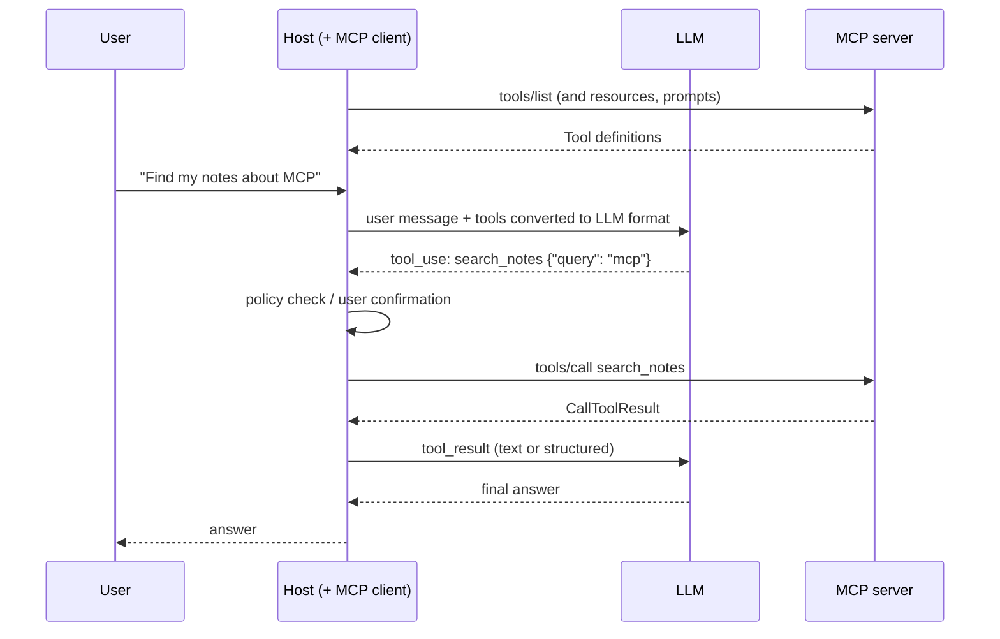

# Lab 3: Build a Client

**Time:** 45 minutes · **Goal:** write the client side of a host. Launch a server, find out what it
offers, show its tools to a model in function-calling format, and send the model's choices back as MCP
calls.

## 1. What a host actually does

When a user types a question into an AI application, the host runs this loop:



Notice that **the model never talks to the server**. The host sits in the middle and decides:

- which tools the model gets to see,
- whether a call needs the user's confirmation,
- what goes back into the model's context.

This is the trust boundary from [Hosts, Clients & Servers](../domain-2/hosts-clients-servers.md) turned
into code.

## 2. The client

This client launches `notes_server.py` from Lab 2 as a subprocess. Create `notes_client.py` next to it:

```python title="notes_client.py"
"""Lab 3: a minimal host-side client for the notes server."""
import json
import sys

import anyio
from mcp import Client
from mcp.client.stdio import StdioServerParameters
from mcp.types import Implementation, TextContent

SERVER = StdioServerParameters(command=sys.executable, args=["notes_server.py"])


def to_llm_tool(tool) -> dict:
    """Map an MCP Tool to the function-calling format most LLM APIs accept."""
    return {
        "name": tool.name,
        "description": tool.description or "",
        "input_schema": tool.input_schema,   # snake_case attribute; "inputSchema" on the wire
    }


def result_for_model(result) -> str:
    """Flatten a CallToolResult into the text a model would see."""
    if result.structured_content is not None:
        body = json.dumps(result.structured_content)
    else:
        body = "\n".join(c.text for c in result.content if isinstance(c, TextContent))
    return ("ERROR: " if result.is_error else "") + body


async def main() -> None:
    async with Client(SERVER, client_info=Implementation(name="lab-host", version="0.1.0")) as client:
        print("protocol    :", client.protocol_version)
        print("server      :", client.server_info.name, client.server_info.version)
        print("instructions:", client.instructions)
        caps = client.server_capabilities
        print("capabilities:", [k for k in ("tools", "resources", "prompts") if getattr(caps, k)])

        tools = await client.list_tools()
        llm_tools = [to_llm_tool(t) for t in tools.tools]
        print("\nTools offered to the model:")
        print(json.dumps(llm_tools[0], indent=2))
        print("...and", len(llm_tools) - 1, "more")

        # Pretend the model decided to call search_notes.
        call = {"name": "search_notes", "arguments": {"query": "mcp"}}
        result = await client.call_tool(call["name"], call["arguments"])
        print("\nsearch_notes ->", result_for_model(result))

        bad = await client.call_tool("create_note", {"title": "x", "body": "y" * 2500})
        print("create_note (too long) ->", result_for_model(bad))

        resources = await client.list_resources()
        templates = await client.list_resource_templates()
        print("\nresources :", [r.uri for r in resources.resources])
        print("templates :", [t.uri_template for t in templates.resource_templates])
        index = await client.read_resource("notes://index")
        print("notes://index ->", index.contents[0].text[:80])

        prompts = await client.list_prompts()
        print("\nprompts   :", [p.name for p in prompts.prompts])
        p = await client.get_prompt("summarize_note", {"note_id": "n1"})
        print("prompt msg:", p.messages[0].role, "|", p.messages[0].content.text[:80])


anyio.run(main)
```

```bash
python notes_client.py 2>/dev/null
```

!!! question "Predict"
    `Client(...)` uses `mode="auto"` by default. What will its first message to the server be?

    ??? success "Answer"
        `server/discover`. In auto mode, a dual-era client probes with discovery and only falls back to
        `initialize` if the server turns out to be legacy. This is the stdio backward-compatibility
        procedure from the spec, done for you.

## 3. The output

```text
protocol    : 2026-07-28
server      : notes 1.0.0
instructions: Search notes before creating a new one to avoid duplicates.
capabilities: ['tools', 'resources', 'prompts']

Tools offered to the model:
{
  "name": "search_notes",
  "description": "Search notes by a word in the title or body.\n\n    Args:\n        query: A word to look for, case-insensitive.\n    ",
  "input_schema": {
    "type": "object",
    "properties": {
      "query": {
        "title": "Query",
        "type": "string"
      }
    },
    "required": [
      "query"
    ],
    "title": "search_notesArguments"
  }
}
...and 3 more

search_notes -> {"result": [{"id": "n1", "title": "MCP transports", "body": "stdio for local, Streamable HTTP for remote."}]}
create_note (too long) -> ERROR: Error executing tool create_note: Body is 2500 characters; the maximum is 2000. Shorten it and retry.

resources : ['notes://index']
templates : ['notes://{note_id}']
notes://index -> - n1: MCP transports
- n2: MRTR

prompts   : ['summarize_note']
prompt msg: user | Summarize this note for a engineer in three bullet points:
```

## 4. What the client had to decide

### Capabilities first

The client checked `server_capabilities` before listing anything. On a server without `resources`,
calling `resources/list` would fail. Discovery tells the client what it may ask for.

### Mapping tools is almost free

An MCP `Tool` already has a name, a description and a JSON Schema for its input, which is exactly what
LLM function-calling APIs want. That is no accident: it is why a server written once works with any
model vendor. Portability is the heart of Domain 1's
[interoperability](../domain-1/interoperability.md) story.

### Errors go back to the model

`result_for_model` sends a tool execution error back as text, marked as an error, rather than raising
an exception. The model reads "maximum is 2000. Shorten it and retry." and can try again. If the client
threw instead, the conversation would simply stop.

### Resources and prompts are *not* given to the model as tools

The host lists them and decides what to do with them itself. Typically it offers resources in an
"attach context" picker and prompts in a slash-command menu. That matches their control model:
resources are application-controlled and prompts are user-controlled.

## 5. Extending the host

These exercises have no single answer. Each one practises a decision that comes up on the exam.

!!! tip "Try it: several servers"
    Connect to both `weather_server.py` (Lab 1) and `notes_server.py` at once. What if two servers both
    had a tool called `search`? A common host approach is to namespace names before showing them to the
    model, e.g. `notes__search`, and keep a map back to (server, original name).

!!! tip "Try it: human in the loop"
    Before `call_tool`, print the tool name and arguments and ask `Run this? [y/N]`. Skip the prompt for
    tools annotated `readOnlyHint: true`. Then think about why that shortcut is only safe for servers you
    trust. (The spec says annotations from untrusted servers are untrusted.)

!!! tip "Try it: caching"
    Call `client.list_tools()` and `client.list_resources()` three times each, and count the requests
    that actually reach the server (for example by wrapping `client.session.list_tools`). When we ran it:

    ```text
    wire requests after 3 calls each: {'tools/list': 1, 'resources/list': 3}
    ```

    `tools/list` carries Lab 2's 5-minute hint, so the SDK's default `CacheConfig` answers the repeat
    calls from its cache. `resources/list` carries `ttlMs: 0`, so every call goes to the server.

## What this showed you

| You saw | Study chapter |
| --- | --- |
| Host-mediated model ↔ server interaction | [Interaction Flow](../domain-2/interaction-flow.md) |
| Discovery before use; capabilities | [Versioning & Discovery](../domain-2/versioning-discovery.md) |
| Tools → LLM function calling, vendor-neutral | [Interoperability](../domain-1/interoperability.md) |
| Host roles and control points | [Hosts, Clients & Servers](../domain-2/hosts-clients-servers.md) |
| Confirmation and trust decisions | [Permissions & Consent](../domain-4/permissions-consent.md) |
