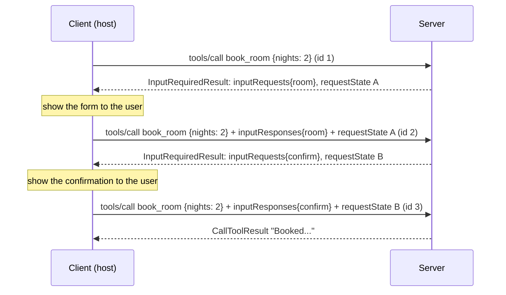

# Lab 5: Elicitation & MRTR

**Time:** 60 minutes · **Goal:** build a tool that stops halfway to ask the user something, and watch
every round of the Multi Round-Trip Request (MRTR) pattern on the wire. You will also see why the older
"server calls the client back" style cannot work in a stateless protocol, and what stops a client from
tampering with the server's state.

Read [MRTR & Elicitation](../domain-3/mrtr-elicitation.md) first. This lab puts that chapter into
practice.

## 1. The scenario

A `book_room` tool needs two things only the user can provide:

1. **Which room size** they want. The tool can't guess, and the model shouldn't choose for them.
2. **Confirmation of the total price** before committing.

Before `2026-07-28`, the server would have sent an `elicitation/create` *request* to the client in the
middle of the tool call, over a session, and waited for the reply. With no sessions and no back-channel,
the server instead **finishes the request early** with "I need input", and the client **asks again**
with the answers attached:



Each round is a **complete, independent request with its own id**. Any server instance behind a load
balancer can handle any round, because everything it needs is in the request: the original arguments,
the answers, and the state blob.

## 2. The server

Create `booking_server.py`:

```python title="booking_server.py"
"""Lab 5: multi-round-trip requests (MRTR) and elicitation."""
import json
import logging
import sys

from pydantic import BaseModel, Field

from mcp.server import MCPServer
from mcp.server.mcpserver import Context
from mcp.server.mcpserver.exceptions import ToolError
from mcp.shared.exceptions import MCPError
from mcp.types import (
    MISSING_REQUIRED_CLIENT_CAPABILITY,
    CallToolResult,
    ElicitRequest,
    ElicitRequestFormParams,
    ElicitResult,
    InputRequiredResult,
    TextContent,
)

logging.basicConfig(stream=sys.stderr, level=logging.WARNING)
mcp = MCPServer("booking", version="1.0.0")

ROOMS = {"small": 40, "large": 90}          # price per night, EUR


# ---------- Style 1: spec-native MRTR, written by hand ----------

@mcp.tool()
def book_room(nights: int, ctx: Context) -> CallToolResult | InputRequiredResult:
    """Book a hotel room. Asks the user which room size they want and confirms the price."""
    if nights < 1 or nights > 30:
        raise ToolError("nights must be between 1 and 30")
    caps = ctx.client_capabilities
    if caps is None or caps.elicitation is None:
        # Never send an input request the client did not declare support for.
        raise MCPError(
            code=MISSING_REQUIRED_CLIENT_CAPABILITY,
            message="book_room needs a client that supports elicitation",
            data={"requiredCapabilities": {"elicitation": {}}},
        )

    answers = ctx.input_responses or {}
    state = json.loads(ctx.request_state) if ctx.request_state else {"step": "choose"}

    if state["step"] == "choose":
        reply = answers.get("room")
        if reply is None:
            # Round 1: nothing answered yet, so ask.
            return InputRequiredResult(
                input_requests={
                    "room": ElicitRequest(params=ElicitRequestFormParams(
                        message=f"Which room for {nights} night(s)?",
                        requested_schema={
                            "type": "object",
                            "properties": {"size": {"type": "string", "enum": list(ROOMS)}},
                            "required": ["size"],
                        },
                    ))
                },
                request_state=json.dumps({"step": "choose"}),
            )
        if not isinstance(reply, ElicitResult) or reply.action != "accept":
            return CallToolResult(content=[TextContent(type="text", text="Booking cancelled by the user.")])
        size = reply.content["size"]
        total = ROOMS[size] * nights
        # Round 2: carry what we learned in request_state and ask for confirmation.
        return InputRequiredResult(
            input_requests={
                "confirm": ElicitRequest(params=ElicitRequestFormParams(
                    message=f"{size} room, {nights} night(s): {total} EUR. Confirm?",
                    requested_schema={
                        "type": "object",
                        "properties": {"ok": {"type": "boolean"}},
                        "required": ["ok"],
                    },
                ))
            },
            request_state=json.dumps({"step": "confirm", "size": size, "total": total}),
        )

    # Round 3: state says we are confirming.
    reply = answers.get("confirm")
    if isinstance(reply, ElicitResult) and reply.action == "accept" and reply.content.get("ok"):
        text = f"Booked a {state['size']} room for {nights} night(s), {state['total']} EUR."
    else:
        text = "Booking not confirmed."
    return CallToolResult(content=[TextContent(type="text", text=text)])


# ---------- Style 2: the SDK convenience, ctx.elicit ----------

class Contact(BaseModel):
    email: str = Field(description="Where to send the receipt")
    newsletter: bool = False


@mcp.tool()
async def send_receipt(booking_ref: str, ctx: Context) -> str:
    """Email a receipt for a booking. Asks the user for the address."""
    answer = await ctx.elicit("Where should we send the receipt?", Contact)
    if answer.action != "accept":
        return f"No receipt sent ({answer.action})."
    return f"Receipt for {booking_ref} sent to {answer.data.email} (newsletter={answer.data.newsletter})."


if __name__ == "__main__":
    mcp.run(transport="stdio")
```

### How to read `book_room`

The handler is a small **state machine** that runs from the top on every round:

| Round | `request_state` | `input_responses` | Handler returns |
| --- | --- | --- | --- |
| 1 | none | none | `InputRequiredResult` asking for `room`, state `{"step":"choose"}` |
| 2 | `choose` | `room` answered | `InputRequiredResult` asking for `confirm`, state includes size and total |
| 3 | `confirm` | `confirm` answered | Final `CallToolResult` |

Three design points, each backed by a spec rule:

- **The capability check comes first.** Servers **MUST NOT** send input requests the client hasn't
  declared support for. When a required capability is missing, the server returns
  `-32021 MissingRequiredClientCapability`, with the missing capabilities in
  `data.requiredCapabilities`.
- **Decline and cancel are normal outcomes.** Servers **MUST NOT** assume the client will fulfil the
  request or retry. A user who closes the form is making a legitimate choice, not causing an error.
- **The total is computed on the server and carried in `request_state`.** The client never gets to
  send back a price.

!!! warning "The SDK did not check capabilities for us"
    Without the `client_capabilities` check, `mcp 2.2.0` happily returned an `InputRequiredResult` with an
    `elicitation/create` request to a client that had declared no elicitation support. The rule is on
    your server code, not the framework.

## 3. The client

The client needs an **elicitation callback**: the function a host uses to show the form and collect
the answer. Create `booking_client.py`:

```python title="booking_client.py"
"""Lab 5: a client that answers elicitations, plus a manual view of the MRTR loop."""
import json
import sys

import anyio
from mcp import Client
from mcp.client.stdio import StdioServerParameters
from mcp.types import ElicitResult

SERVER = StdioServerParameters(command=sys.executable, args=["booking_server.py"])

# A scripted "user". A real host would render a form here.
SCRIPT = {"Which room": {"size": "large"}, "Confirm?": {"ok": True}, "receipt": {"email": "ada@example.com"}}


async def on_elicit(context, params):
    print(f"   [user sees] {params.message}")
    print(f"   [schema]    {json.dumps(params.requested_schema)}")
    for fragment, content in SCRIPT.items():
        if fragment in params.message:
            print(f"   [user types] {content}")
            return ElicitResult(action="accept", content=content)
    return ElicitResult(action="decline")


def wire(model) -> str:
    return json.dumps(model.model_dump(by_alias=True, exclude_none=True, mode="json"))


async def main() -> None:
    async with Client(SERVER, elicitation_callback=on_elicit) as client:
        print("== automatic: Client.call_tool drives the rounds for you")
        result = await client.call_tool("book_room", {"nights": 3})
        print("final ->", result.content[0].text)

        print("\n== ctx.elicit style on 2026-07-28")
        try:
            result = await client.call_tool("send_receipt", {"booking_ref": "BK-42"})
            print("final ->", result.content[0].text)
        except Exception as exc:  # noqa: BLE001
            print("failed:", type(exc).__name__, exc)

        print("\n== manual: drive the loop yourself and look at each round")
        session = client.session
        first = await session.call_tool("book_room", {"nights": 2}, allow_input_required=True)
        print("round 1 <-", wire(first))
        second = await session.call_tool(
            "book_room", {"nights": 2},
            input_responses={"room": ElicitResult(action="accept", content={"size": "small"})},
            request_state=first.request_state,
            allow_input_required=True,
        )
        print("round 2 <-", wire(second))

        print("\n== tampering: edit request_state before echoing it")
        forged = second.request_state[:-4] + "AAAA"
        try:
            third = await session.call_tool(
                "book_room", {"nights": 2},
                input_responses={"confirm": ElicitResult(action="accept", content={"ok": True})},
                request_state=forged,
                allow_input_required=True,
            )
            print("round 3 <-", wire(third))
        except Exception as exc:  # noqa: BLE001
            print("rejected:", type(exc).__name__, getattr(exc, "code", None), exc)

    print("\n== ctx.elicit style on a legacy (2025-11-25) connection")
    async with Client(SERVER, elicitation_callback=on_elicit, mode="legacy") as legacy:
        print("protocol:", legacy.protocol_version)
        result = await legacy.call_tool("send_receipt", {"booking_ref": "BK-42"})
        print("final ->", result.content[0].text)


anyio.run(main)
```

!!! question "Predict"
    1. In the automatic run, how many `tools/call` requests reach the server for one `call_tool`?
    2. The server puts plain JSON like `{"step": "choose"}` into `request_state`. What will the client
       *actually* receive in `requestState`?
    3. Will `send_receipt` (which uses `ctx.elicit`) work on a `2026-07-28` connection?

```bash
python booking_client.py 2>/dev/null
```

## 4. Reading the output

### The automatic loop

```text
== automatic: Client.call_tool drives the rounds for you
   [user sees] Which room for 3 night(s)?
   [schema]    {"properties": {"size": {"type": "string", "enum": ["small", "large"]}}, "required": ["size"], "type": "object"}
   [user types] {'size': 'large'}
   [user sees] large room, 3 night(s): 270 EUR. Confirm?
   [schema]    {"properties": {"ok": {"type": "boolean"}}, "required": ["ok"], "type": "object"}
   [user types] {'ok': True}
final -> Booked a large room for 3 night(s), 270 EUR.
```

One `call_tool` in the application, **three** `tools/call` requests on the wire. The SDK saw
`resultType: "input_required"`, called the callback for each input request, and retried with a new id,
the answers and the echoed state. It gives up after `input_required_max_rounds`, so a server can't keep
a client looping forever.

### The rounds on the wire

```json
round 1 <- {"resultType": "input_required",
  "inputRequests": {"room": {"method": "elicitation/create",
    "params": {"mode": "form", "message": "Which room for 2 night(s)?",
      "requestedSchema": {"properties": {"size": {"type": "string", "enum": ["small", "large"]}},
                          "required": ["size"], "type": "object"}}}},
  "requestState": "v1.7vyKPXTLcL0M8nkZQXQWC5Z9dhkMpg3KaiBHzAemNjuFXgluAXYu..."}

round 2 <- {"resultType": "input_required",
  "inputRequests": {"confirm": {"method": "elicitation/create",
    "params": {"mode": "form", "message": "small room, 2 night(s): 80 EUR. Confirm?", ...}}},
  "requestState": "v1.7vyKPQYJSvgwiGtA5vUrWm3-ioLIp8PgLZKGuCsQuP1W5q5-f9TN..."}
```

Things to notice:

- **`inputRequests` is a map with server-chosen keys** (`room`, `confirm`). The client answers with
  `inputResponses` using the same keys. One round can ask several questions at once.
- **Each entry looks like a complete `elicitation/create` request**, but it is embedded in a result
  rather than sent as a separate JSON-RPC request.
- **`requestState` is not the JSON the handler wrote.** The SDK **sealed** it: encrypted and
  authenticated with AES-GCM, and bound to this request. The client sees an opaque `v1.` token. This
  is Predict question 2.

### Why the state had to be sealed

The spec says servers **MUST** treat `requestState` as **attacker-controlled input**. If the state
affects authorisation, resource access or business logic, the server **MUST** protect its integrity,
for example with an HMAC or AEAD, and **MUST** reject state that fails verification.

Imagine this lab with unsealed state. A malicious client rewrites `{"step":"confirm","size":"large",
"total":270}` to `"total": 1` and confirms. Sealing makes that impossible:

```text
== tampering: edit request_state before echoing it
rejected: MCPError -32602 Invalid or expired requestState
```

### Replaying state on a different request

Sealing also covers a subtler attack: taking valid state from one request and using it on another. The
spec says servers **SHOULD** bind the state to the principal, give it a short expiry, and bind it to the
originating request. Try reusing round 1's state from a 2-night booking on a 9-night booking:

```python
first = await s.call_tool("book_room", {"nights": 2}, allow_input_required=True)
await s.call_tool("book_room", {"nights": 9},
                  input_responses={"room": ElicitResult(action="accept", content={"size": "small"})},
                  request_state=first.request_state, allow_input_required=True)
```

```text
WARNING:mcp.server.request_state:requestState rejected on tools/call: request binding
MCPError -32602 Invalid or expired requestState
```

The server log gives the real reason (`request binding`). The client only sees a generic message, so
an attacker learns nothing about *why* the state was refused.

!!! info "Multiple server instances"
    By default the SDK seals state with a key that exists only inside the current process. State minted
    by one replica would be rejected by another, and by the same server after a restart. In production,
    configure `MCPServer(request_state_security=...)` with a key shared by all instances.

!!! warning "Binding is not single-use"
    Principal, expiry and request binding **limit** replay but do not prevent it. If an action must happen
    at most once, such as redeeming a voucher, the server **MUST** enforce that itself, e.g. by recording
    a nonce.

### The `ctx.elicit` style

```text
== ctx.elicit style on 2026-07-28
failed: MCPError Cannot send 'elicitation/create': this transport context has no back-channel for server-initiated requests.

== ctx.elicit style on a legacy (2025-11-25) connection
protocol: 2025-11-25
   [user sees] Where should we send the receipt?
   [schema]    {"properties": {"email": {"description": "Where to send the receipt", "title": "Email", "type": "string"}, "newsletter": {"default": false, "title": "Newsletter", "type": "boolean"}}, "required": ["email"], "title": "Contact", "type": "object"}
   [user types] {'email': 'ada@example.com'}
final -> Receipt for BK-42 sent to ada@example.com (newsletter=False).
```

This answers Predict question 3, and it is the most important result in the lab. `ctx.elicit` is
written as "pause here, send a request to the client, wait for the answer". That needs the server to
be able to **start** a request towards the client in the middle of handling one. On a `2025-11-25`
session that was possible. On `2026-07-28` there is no such channel, so the call fails.

This is exactly the change SEP-2322 made: **server-to-client requests became data inside a result**.
Under the new protocol, a tool that needs input must be written in the MRTR style.

## 5. What a real host must add

The scripted callback skips everything that makes elicitation safe. The spec requires these:

| Rule | Who | Why |
| --- | --- | --- |
| Make it clear **which server** is asking | Client **MUST** | The user must be able to tell a trusted server from a random one |
| Offer clear **decline** and **cancel** options | Client **MUST** | The user controls what is shared |
| In form mode, let the user **review and change** answers before sending | Client **MUST** | No silent submission |
| In URL mode, show the **target domain** and get consent before opening it | Client **MUST** | Phishing defence |
| **Never** ask for passwords, API keys, access tokens or payment credentials in form mode; use **URL mode** | Server **MUST NOT** / **MUST** | Form answers pass through the client and possibly the model. In URL mode the user types secrets straight into the server's own page |

An email address, as in `send_receipt`, is not a secret in this sense. The spec leaves such contact
details to the server's judgement, as long as the user can review and decline.

## What this showed you

| You saw | Study chapter |
| --- | --- |
| `InputRequiredResult`, `inputRequests`, `inputResponses`, retry with new id | [MRTR & Elicitation](../domain-3/mrtr-elicitation.md) |
| Form-mode schemas; accept, decline, cancel | [MRTR & Elicitation](../domain-3/mrtr-elicitation.md) |
| `-32021` when a capability is missing | [Error Handling](../domain-3/error-handling.md) |
| `requestState` as attacker-controlled input | [Attacks & Mitigations](../domain-4/attacks-mitigations.md) |
| No server-initiated requests in `2026-07-28` | [What's New in 2026-07-28](../exam/whats-new.md) |
| User consent for elicitation | [Permissions & Consent](../domain-4/permissions-consent.md) |
